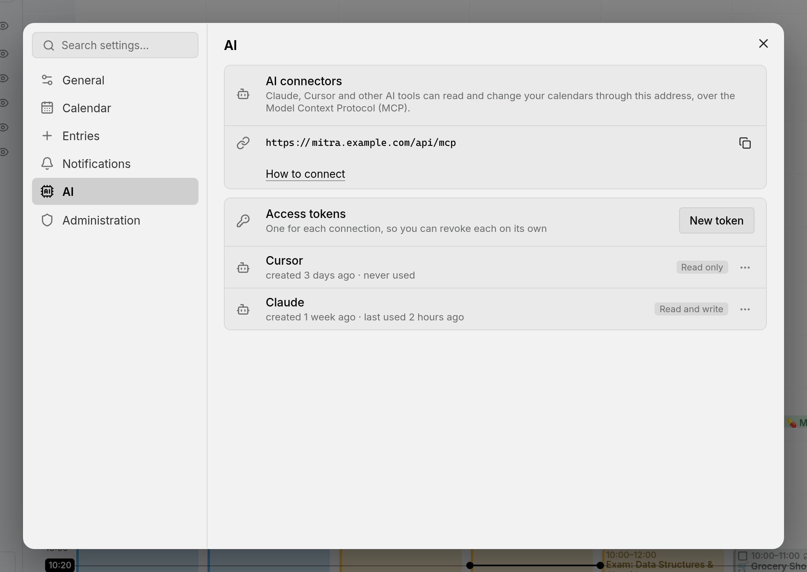

Mitra は Model Context Protocol (MCP) を話すため、AI ツールがカレンダーを操作できます: 週の様子を見る、項目を探す、タスクの計画を立てる、会議を動かす、など。どのツールも同じアドレス `https://<your Mitra>/api/mcp` に接続します。このアドレスは **設定 → AI** の **AIコネクタ** に表示されます。Claude はこうした接続を「コネクター」と呼び、Cursor などは「MCP サーバー」と呼びます。

接続したツールは、接続済みのすべてのカレンダーを対象に、Mitra の中であなたが見て変更できるものとまったく同じものを見て変更でき、その変更はあなた自身の変更と同じようにプロバイダーへ届きます。

<picture>
  <source media="(prefers-color-scheme: dark)" srcset="../assets/screenshots/ai-connectors-detail-dark.webp">
  
</picture>

## ツールを接続する

人が[サインイン](sso.md)するのと同じように、ツールにはアクセストークンが必要です:

1. **設定 → AI** を開き、**アクセストークン** の下にある **新しいトークン** を選びます。
2. ノートパソコンや Claude のように用途に合わせて名前を付け、**読み取り専用** または **読み書き** を選びます。
3. トークンをコピーします。Mitra が保存するのはそのフィンガープリントだけなので、表示されるのはこの一度きりです。

トークンは、同じリストで取り消すまであなたの代理として機能します。リストには各トークンが最後に使われた日時も表示されます。読み取り専用のトークンは、ツールに読み取り系の機能だけを提供します。

サインインを使っていない場合、Mitra は一人用なのでトークンは求められません: アドレスだけで足ります。その場合、そのアドレスに届く人なら誰でも使えてしまうため、こうしたサーバーは非公開にしておいてください。

多くのツールは自分でセットアップすることもできます: Claude Code や Cursor に、そのアドレスとトークンで接続するように指示すれば、ツール自身が設定ファイルを書きます。以下の例は同じことを手動で行うもので、トークンが不要な場合は `Authorization` ヘッダーを省略しています。

### Claude Code

```sh
claude mcp add --transport http mitra https://mitra.example.com/api/mcp --header "Authorization: Bearer mitra_…"
```

### Cursor

プロジェクトの `.cursor/mcp.json`、またはすべてのプロジェクトに適用する `~/.cursor/mcp.json` に Mitra を追加します:

```json
{
  "mcpServers": {
    "mitra": {
      "url": "https://mitra.example.com/api/mcp",
      "headers": { "Authorization": "Bearer mitra_…" }
    }
  }
}
```

### Claude Desktop

Claude Desktop は `mcp-remote` 経由でトークン付きのアドレスに届きます。これには Node.js が必要です。`claude_desktop_config.json` に次を追加します:

```json
{
  "mcpServers": {
    "mitra": {
      "command": "npx",
      "args": ["mcp-remote", "https://mitra.example.com/api/mcp", "--header", "Authorization:${MITRA_TOKEN}"],
      "env": { "MITRA_TOKEN": "Bearer mitra_…" }
    }
  }
}
```

## 接続したツールにできること

接続したツールは、あなたが Mitra で行うのと同じようにカレンダーを操作できます。たとえば:

- 1日や1週間を見る。期限切れのものやまだ日付未定のものも確認できる
- 項目を探して全文を読む
- [ルーティン](routines.md)の調子を見る: 直近の回のうち何回を達成・キャンセル・未達成にしたか、どの曜日に崩れやすいか。「ジムは順調?」と聞ける
- 項目の作成・変更・完了・削除。繰り返し項目の1回だけ、または全部を対象にできる
- [参加者](participants.md)を持つカレンダーでは人を招待できる。相手に通知されるかどうかはプロバイダー次第
- 項目どうしを[依存関係](dependencies.md)や[サブタスク](subtasks.md)として関連付ける
- プロバイダーが許すところではカレンダーの作成・削除もできる

サイドバーで隠したカレンダーも含め、すべてのカレンダーを読み取ります。また、あなたのタイムゾーンと、**設定 → 一般** で選んだ言語と地域を知っているため、あなたが書くのと同じ形で日付を扱えます。

> [!CAUTION]
> 項目は、共有カレンダーや招待のように、他の人が書き込めるカレンダーから届きます。そのテキストはツールが読む他のすべてと同じようにツールへ渡ります。見知らぬ人のメモを目の前に置かれても信頼できるツールにだけ、書き込み可能なトークンを渡してください。

## ブラウザーで

ブラウザー自身のアシスタントがページの提供する機能を使える環境(Chrome の初期機能である WebMCP)では、開いている Mitra が設定なしで同じ機能を提供します。

## 無効にする

[`MITRA_MCP`](configuration.md) を `off` にすると、どのツールも接続できなくなります。[デモ](https://demo.mitracal.com)は常に接続を受け付けません。
