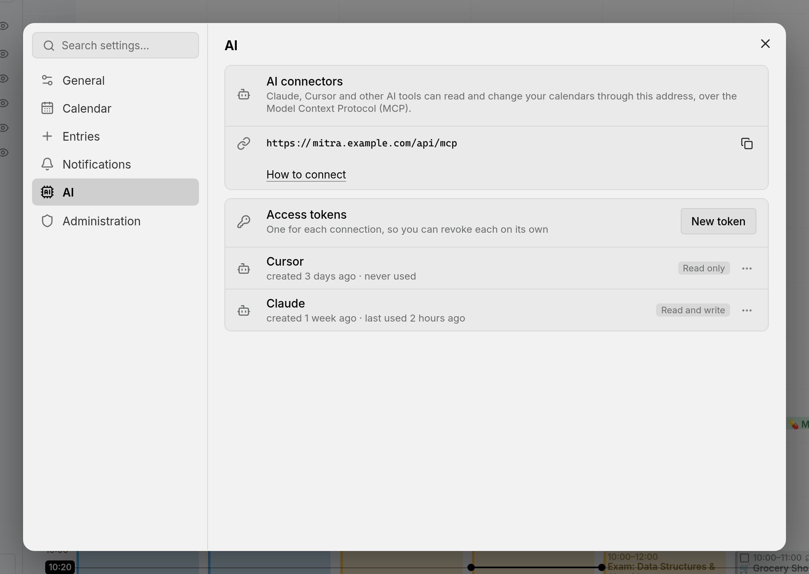

Mitra는 Model Context Protocol(MCP)을 지원하므로 AI 도구가 캘린더를 다룰 수 있습니다. 한 주를 살펴보고, 항목을 찾고, 작업을 계획하고, 회의를 옮기는 일을 합니다. 모든 도구는 같은 주소 `https://<your Mitra>/api/mcp`에 연결하며, 이 주소는 **설정 → AI**의 **AI 커넥터** 아래에 나옵니다. Claude는 이런 연결을 커넥터라고 부르고, Cursor 등은 MCP 서버라고 부릅니다.

연결된 도구는 연결된 모든 캘린더에서 Mitra로 내가 하는 것과 똑같은 것을 보고 바꿀 수 있으며, 도구가 만든 변경은 내가 한 변경처럼 제공업체에 전달됩니다.

<picture>
  <source media="(prefers-color-scheme: dark)" srcset="../assets/screenshots/ai-connectors-detail-dark.webp">
  
</picture>

## 도구 연결하기

사용자가 [로그인](sso.md)하는 환경에서는 도구에 액세스 토큰이 필요합니다.

1. **설정 → AI**를 열고 **액세스 토큰** 아래의 **새 토큰**을 고르세요.
2. 노트북이나 Claude처럼 용도에 맞게 이름을 붙이고 **읽기 전용** 또는 **읽기 및 쓰기**를 고르세요.
3. 토큰을 복사하세요. Mitra는 토큰의 지문만 보관하므로 토큰은 이번 한 번만 표시됩니다.

토큰은 같은 목록에서 취소할 때까지 나를 대신합니다. 이 목록에는 각 토큰을 마지막으로 쓴 시점도 나옵니다. 읽기 전용 토큰은 도구에 읽는 기능만 제공합니다.

로그인이 없으면 Mitra는 한 사람용이며 토큰을 요구하지 않습니다. 주소만 있으면 됩니다. 그러면 그 주소에 닿을 수 있는 누구나 쓸 수 있으므로, 이런 서버는 외부에 공개하지 마세요.

많은 도구는 직접 설정할 수도 있습니다. Claude Code나 Cursor에 토큰과 함께 주소에 연결하라고 하면 스스로 설정을 작성합니다. 아래 예시는 같은 일을 손으로 하며, 토큰이 필요 없는 경우에는 `Authorization` 헤더를 빼면 됩니다.

### Claude Code

```sh
claude mcp add --transport http mitra https://mitra.example.com/api/mcp --header "Authorization: Bearer mitra_…"
```

### Cursor

프로젝트의 `.cursor/mcp.json`에, 또는 모든 프로젝트에 쓰려면 `~/.cursor/mcp.json`에 Mitra를 추가하세요.

```json
{
  "mcpServers": {
    "mitra": {
      "url": "https://mitra.example.com/api/mcp",
      "headers": { "Authorization": "Bearer mitra_…" }
    }
  }
}
```

### Claude Desktop

Claude Desktop은 토큰이 필요한 주소에 `mcp-remote`를 거쳐 연결하며, 여기에는 Node.js가 필요합니다. `claude_desktop_config.json`에 추가하세요.

```json
{
  "mcpServers": {
    "mitra": {
      "command": "npx",
      "args": ["mcp-remote", "https://mitra.example.com/api/mcp", "--header", "Authorization:${MITRA_TOKEN}"],
      "env": { "MITRA_TOKEN": "Bearer mitra_…" }
    }
  }
}
```

## 연결된 도구가 할 수 있는 일

연결된 도구는 Mitra에서 내가 하듯이 캘린더를 다룹니다. 할 수 있는 일은 다음과 같습니다.

- 하루나 한 주를 살펴보고, 기한 지난 것과 아직 날짜 미정인 것을 확인합니다
- 항목을 찾아 전체 내용을 읽습니다
- [루틴](routines.md)이 어떻게 되어 가는지 봅니다. 최근 회차 중 몇 번을 지켰고 취소했고 놓쳤는지, 어느 요일에 자주 빠지는지 알 수 있으므로 "운동은 잘 되고 있어?"처럼 물어볼 수 있습니다
- 항목을 만들고, 바꾸고, 완료하고, 삭제합니다. 반복 항목은 회차 하나만 또는 전체를 다룹니다
- 캘린더가 [참석자](participants.md)를 담는 경우 사람을 초대합니다. 상대에게 알림이 가는지는 제공업체에 따라 다릅니다
- 항목을 [종속 관계](dependencies.md)와 [하위 작업](subtasks.md)으로 연결합니다
- 제공업체가 허용하는 경우 캘린더를 만들고 삭제합니다

도구는 사이드바에서 숨긴 캘린더를 포함해 모든 캘린더를 읽으며, 시간대와 **설정 → 일반**에서 고른 언어와 지역을 알고 있으므로 내가 쓰는 방식대로 날짜를 말할 수 있습니다.

> [!CAUTION]
> 항목은 공유 캘린더나 초대처럼 다른 사람이 쓸 수 있는 캘린더에서도 옵니다. 그 텍스트는 도구가 읽는 다른 내용과 똑같이 도구에 전달되므로, 쓰기 권한이 있는 토큰은 낯선 사람의 메모를 앞에 두고도 믿을 수 있는 도구에만 주세요.

## 브라우저에서

브라우저의 자체 어시스턴트가 페이지에서 제공하는 기능을 쓸 수 있는 경우(Chrome의 초기 기능인 WebMCP), 열려 있는 Mitra도 따로 설정할 것 없이 같은 기능을 제공합니다.

## 끄기

[`MITRA_MCP`](configuration.md)를 `off`로 설정하면 어떤 도구도 연결할 수 없습니다. [데모](https://demo.mitracal.com)는 연결을 받지 않습니다.
