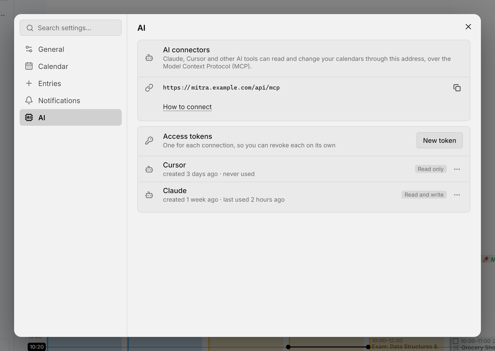

Mitra поддерживает Model Context Protocol (MCP), поэтому ИИ-инструменты могут работать с вашими календарями: посмотреть вашу неделю, найти запись, запланировать задачу, перенести встречу. Все инструменты подключаются к одному адресу, `https://<your Mitra>/api/mcp`, который указан в разделе **Настройки → ИИ** под заголовком **ИИ-коннекторы**. В Claude такое подключение называется коннектором, в Cursor и других инструментах сервером MCP.

Подключённый инструмент видит и изменяет ровно то же, что и вы в Mitra, во всех ваших подключённых календарях, а внесённые им изменения попадают к провайдеру так же, как ваши собственные.

<picture>
  <source media="(prefers-color-scheme: dark)" srcset="../assets/screenshots/ai-connectors-detail-dark.webp">
  
</picture>

## Подключение инструмента

Если пользователи [входят в систему](sso.md), инструменту нужен токен доступа:

1. Откройте **Настройки → ИИ** и в разделе **Токены доступа** выберите **Новый токен**.
2. Назовите его по назначению, например «Ноутбук» или «Claude», и выберите **Только чтение** или **Чтение и запись**.
3. Скопируйте токен. Mitra хранит только его отпечаток, поэтому токен показывается один-единственный раз.

Токен действует от вашего имени, пока вы не отзовёте его в том же списке, где также видно, когда каждый токен использовался в последний раз. Токен только для чтения позволяет инструменту только читать данные.

Без входа в систему Mitra рассчитан на одного человека и не запрашивает токен: достаточно адреса. В этом случае им может воспользоваться любой, у кого есть доступ к этому адресу, поэтому не открывайте такой сервер посторонним.

Многие инструменты умеют настраиваться сами: попросите Claude Code или Cursor подключиться к адресу с этим токеном, и инструмент сам запишет свою конфигурацию. Примеры ниже делают то же самое вручную; если токен не нужен, уберите заголовок `Authorization`.

### Claude Code

```sh
claude mcp add --transport http mitra https://mitra.example.com/api/mcp --header "Authorization: Bearer mitra_…"
```

### Cursor

Добавьте Mitra в файл `.cursor/mcp.json` проекта или в `~/.cursor/mcp.json`, чтобы он был доступен во всех проектах:

```json
{
  "mcpServers": {
    "mitra": {
      "url": "https://mitra.example.com/api/mcp",
      "headers": { "Authorization": "Bearer mitra_…" }
    }
  }
}
```

### Claude Desktop

Claude Desktop подключается к адресу с токеном через `mcp-remote`, для которого нужен Node.js. Добавьте его в `claude_desktop_config.json`:

```json
{
  "mcpServers": {
    "mitra": {
      "command": "npx",
      "args": ["mcp-remote", "https://mitra.example.com/api/mcp", "--header", "Authorization:${MITRA_TOKEN}"],
      "env": { "MITRA_TOKEN": "Bearer mitra_…" }
    }
  }
}
```

## Что умеет подключённый инструмент

Подключённый инструмент работает с вашими календарями так же, как вы в Mitra. Он может:

- посмотреть день или неделю, включая просроченное и ещё не запланированное
- найти записи и прочитать их целиком
- создавать, изменять, завершать и удалять записи, как одно повторение повторяющейся записи, так и все сразу
- приглашать людей, если календарь хранит [участников](participants.md); получат ли они уведомление, зависит от провайдера
- связывать записи [зависимостями](dependencies.md) и делать их [подзадачами](subtasks.md)
- создавать и удалять календари, если провайдер это позволяет

Он читает все ваши календари, в том числе скрытые на боковой панели, и знает ваш часовой пояс, а также язык и регион, выбранные в разделе **Настройки → Общие**, поэтому называет даты так же, как пишете их вы.

> [!CAUTION]
> Записи приходят и из календарей, в которые могут писать другие люди, например из общего календаря или приглашения. Их текст попадает к инструменту наравне со всем остальным, что он читает. Поэтому давайте токен с правом записи только тому инструменту, которому вы доверились бы, даже если перед ним окажется записка от незнакомца.

## В браузере

Если встроенный помощник браузера умеет пользоваться тем, что предлагает страница (WebMCP, ранняя функция Chrome), открытый Mitra предлагает ему то же самое, без всякой настройки.

## Отключение

Задайте [`MITRA_MCP`](configuration.md) значение `off`, и ни один инструмент не сможет подключиться. [Демо](https://demo.mitracal.com) подключений никогда не принимает.
