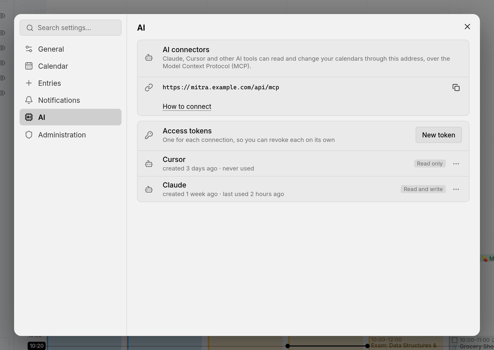

Mitra nói được giao thức Model Context Protocol (MCP), nên các công cụ AI có thể làm việc với lịch của bạn: xem tuần của bạn, tìm một mục, lên kế hoạch cho một công việc, dời một cuộc họp. Mỗi công cụ kết nối đến cùng một địa chỉ, `https://<your Mitra>/api/mcp`, được **Cài đặt → AI** hiển thị dưới **Trình kết nối AI**. Claude gọi kết nối như vậy là connector, còn Cursor và các công cụ khác gọi là MCP server.

Công cụ đã kết nối thấy và thay đổi đúng những gì bạn làm trong Mitra, trên mọi lịch đã kết nối của bạn, và thay đổi nó thực hiện đến được nhà cung cấp như thay đổi của bạn.

<picture>
  <source media="(prefers-color-scheme: dark)" srcset="../assets/screenshots/ai-connectors-detail-dark.webp">
  
</picture>

## Kết nối một công cụ

Khi mọi người [đăng nhập](sso.md), một công cụ cần có mã truy cập:

1. Mở **Cài đặt → AI** và chọn **Mã mới** dưới **Mã truy cập**.
2. Đặt tên theo mục đích sử dụng, chẳng hạn laptop hoặc Claude, và chọn **Chỉ đọc** hoặc **Đọc và ghi**.
3. Sao chép mã. Mitra chỉ giữ dấu vân tay của mã, nên mã chỉ hiện một lần này.

Một mã đại diện cho bạn cho đến khi bạn thu hồi nó trong cùng danh sách, nơi cũng cho biết lần dùng gần nhất của từng mã. Mã chỉ đọc chỉ cho công cụ những gì thuộc về đọc.

Khi không đăng nhập, Mitra dành cho một người và không đòi mã: chỉ cần địa chỉ. Khi đó bất kỳ ai truy cập được địa chỉ đó đều dùng được, nên hãy giữ máy chủ như vậy ở chế độ riêng tư.

Nhiều công cụ cũng tự thiết lập được: hãy bảo Claude Code hoặc Cursor kết nối đến địa chỉ với mã, và nó tự viết cấu hình của mình. Các ví dụ dưới đây làm điều tương tự bằng tay, và bỏ tiêu đề `Authorization` ở nơi không cần mã.

### Claude Code

```sh
claude mcp add --transport http mitra https://mitra.example.com/api/mcp --header "Authorization: Bearer mitra_…"
```

### Cursor

Thêm Mitra vào `.cursor/mcp.json` trong một dự án, hoặc `~/.cursor/mcp.json` cho tất cả dự án:

```json
{
  "mcpServers": {
    "mitra": {
      "url": "https://mitra.example.com/api/mcp",
      "headers": { "Authorization": "Bearer mitra_…" }
    }
  }
}
```

### Claude Desktop

Claude Desktop kết nối đến một địa chỉ có mã thông qua `mcp-remote`, cần có Node.js. Thêm nó vào `claude_desktop_config.json`:

```json
{
  "mcpServers": {
    "mitra": {
      "command": "npx",
      "args": ["mcp-remote", "https://mitra.example.com/api/mcp", "--header", "Authorization:${MITRA_TOKEN}"],
      "env": { "MITRA_TOKEN": "Bearer mitra_…" }
    }
  }
}
```

## Công cụ đã kết nối làm được gì

Công cụ đã kết nối làm việc với lịch của bạn như bạn làm trong Mitra. Nó có thể:

- xem một ngày hoặc một tuần, kèm những gì quá hạn và những gì vẫn chưa lên lịch
- tìm các mục và đọc chúng đầy đủ
- xem [thói quen](routines.md) của bạn tiến triển ra sao: bạn đã giữ, hủy hay bỏ lỡ bao nhiêu trong các lần lặp gần nhất, và thứ trong tuần bạn hay trượt, để bạn hỏi được “Việc tập gym dạo này thế nào?”
- tạo, thay đổi, hoàn thành và xóa các mục, một lần lặp của mục lặp lại hoặc tất cả
- mời người ở những lịch có chứa [người tham gia](participants.md); họ có được báo hay không tùy vào nhà cung cấp
- liên kết các mục thành [phụ thuộc](dependencies.md) và [công việc con](subtasks.md)
- tạo và xóa lịch ở nơi nhà cung cấp cho phép

Nó đọc mọi lịch của bạn, kể cả những lịch bạn đã ẩn trong thanh bên, và biết múi giờ cũng như ngôn ngữ và khu vực bạn chọn trong **Cài đặt → Chung**, nên nó nói ngày tháng theo cách bạn viết.

> [!CAUTION]
> Các mục đến từ những lịch mà người khác có thể ghi vào, như lịch được chia sẻ hoặc lời mời. Văn bản của chúng đến công cụ như mọi thứ khác nó đọc, nên chỉ cấp mã có quyền ghi cho công cụ mà bạn tin tưởng khi có ghi chú của người lạ ngay trước mặt nó.

## Trong trình duyệt

Khi trợ lý riêng của trình duyệt dùng được những gì một trang cung cấp (WebMCP, một tính năng Chrome còn mới), Mitra đang mở cung cấp điều tương tự, không cần thiết lập gì.

## Tắt

Đặt [`MITRA_MCP`](configuration.md) thành `off` và không công cụ nào kết nối được. [Bản demo](https://demo.mitracal.com) không bao giờ nhận kết nối.
