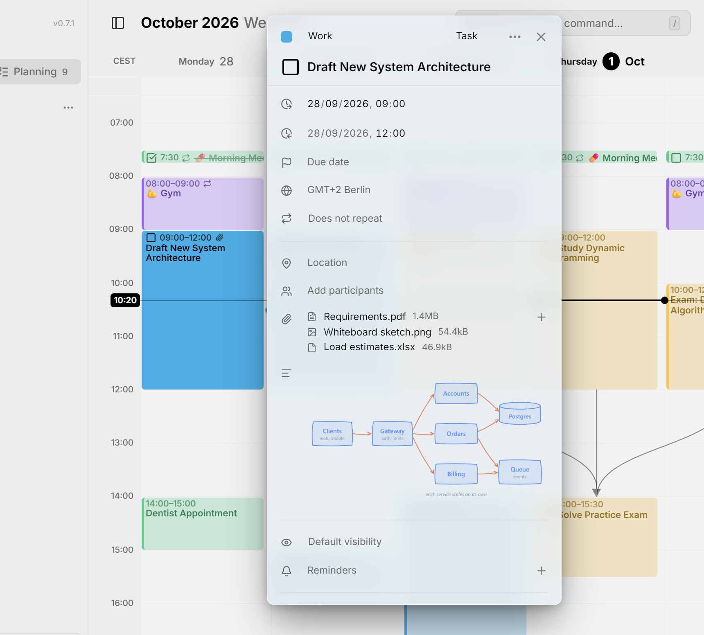

Ein Eintrag kann **Anhänge** haben: Dateien wie ein Ticket, ein Foto vom Whiteboard oder ein Rezept. Mitra bewahrt die Datei auf deinem Server auf und speichert sie im Standard-Kalenderformat beim Eintrag, sodass andere Apps, die denselben Kalender nutzen, etwa Nextcloud oder Apple Calendar, dieselbe Datei beim selben Termin zeigen.

## Eine Datei hinzufügen

Öffne den Eintrag und drück in der Zeile mit der Büroklammer auf **＋**, oder auf das Wort **Anhänge**, solange die Zeile noch leer ist, und wähle eine oder mehrere Dateien. Jeder Anhang zeigt ein Symbol für seine Art, seinen Namen und seine Größe. Klick auf einen, um ihn in einem neuen Tab zu öffnen, und drück auf sein **✕**, um ihn aus dem Eintrag zu entfernen.

Eine Büroklammer am Eintrag im Kalender zeigt, welche Einträge Dateien haben.

<picture>
  <source media="(prefers-color-scheme: dark)" srcset="../assets/screenshots/attachments-detail-dark.webp">
  
</picture>

Links sind keine Anhänge. Um einem Eintrag einen Link hinzuzufügen, schreib ihn in die Beschreibung, und die Zeile [Links](links.md) zeigt ihn.

## Wo die Dateien liegen

Hinzugefügte Dateien liegen im Ordner `files` von Mitras Datenordner, neben seiner Datenbank, sodass ein [Backup](backups.md) dieses Ordners sie enthält. Jede Datei wird unter einem zufälligen Namen statt ihres eigenen gespeichert, und dieselbe Datei, zweimal hinzugefügt, wird einmal aufbewahrt.

> [!IMPORTANT]
> Wer die Adresse einer Datei hat, kann sie öffnen, ohne sich bei Mitra anzumelden. Das erlaubt anderen Kalender-Apps, die Datei zu öffnen: Mitra schreibt die Adresse in deinen Kalender, und diese Apps können sich nicht bei Mitra anmelden. Die Adresse enthält einen zufälligen Teil, der sich nicht erraten lässt, aber behandle sie wie jeden Freigabelink. Für eine neue Adresse entferne den Anhang und füge die Datei erneut hinzu.

Bilder, Videos, Audio, PDFs und reiner Text öffnen sich im Browser. Jede andere Art von Datei wird heruntergeladen, sodass eine Datei nie Code in Mitra ausführen kann.

## Grenzen

Eine einzelne Datei kann bis zu 25 MB groß sein, und wie viel eine Person speichern kann, ist nicht begrenzt. Wer den Server betreibt, kann beides ändern oder das Hinzufügen von Dateien ausschalten; siehe [Konfiguration](configuration.md#attachments). In der [Demo](https://demo.mitracal.com) ist das Hinzufügen von Dateien immer ausgeschaltet.

Eine Datei, die kein Eintrag mehr nutzt, wird etwa einen Tag nach dem Hinzufügen gelöscht. Bis dahin kannst du sie noch einem Eintrag hinzufügen, den du noch nicht gespeichert hast, oder sie wieder hinzufügen, nachdem du sie versehentlich entfernt hast.

## Welche Kalender das unterstützen

Kalender von einem [CalDAV-Server](integrations/caldav.md) und von [Apple Calendar](integrations/apple.md) können Anhänge enthalten, ebenso [Mitra-Kalender](integrations/mitra.md). In einem [abonnierten Kalender](integrations/subscriptions.md) siehst du die Anhänge, die der Feed mitbringt, kannst sie aber nicht ändern.

Eine Datei kann auch in der Beschreibung erscheinen: Die Bild- oder Link-Schaltfläche in ihrer Zeile fügt sie am Ende des Textes ein, als Bild bei Bildern und als Link bei allem anderen. Wird der Anhang entfernt, verschwindet auch das.

In einem [Google-Kalender](integrations/google.md) sind die Anhänge die Google-Drive-Dateien, die in Google Kalender angehängt wurden: Mitra zeigt sie an, kann aber keine hinzufügen oder entfernen. Kalender von [Notion](integrations/notion.md), [Todoist](integrations/todoist.md) und [Tempo](integrations/tempo.md) haben keine Zeile für Anhänge. Wenn du einen Eintrag mit Anhängen in einen davon verschiebst, gehen seine Dateien verloren, und Mitra sagt es dir, bevor etwas verschoben wird.

> [!NOTE]
> Anhänge, die andere Apps hinzugefügt haben, erscheinen auch in Mitra, auch Dateien, die dein Kalenderserver selbst speichert und die sich mit der eigenen Adresse dieses Servers öffnen. Mitra lässt Anhänge, die es nicht erkennt, genau so, wie sie sind, sodass das Bearbeiten eines Eintrags in Mitra nie die Anhänge einer anderen App verändert.
