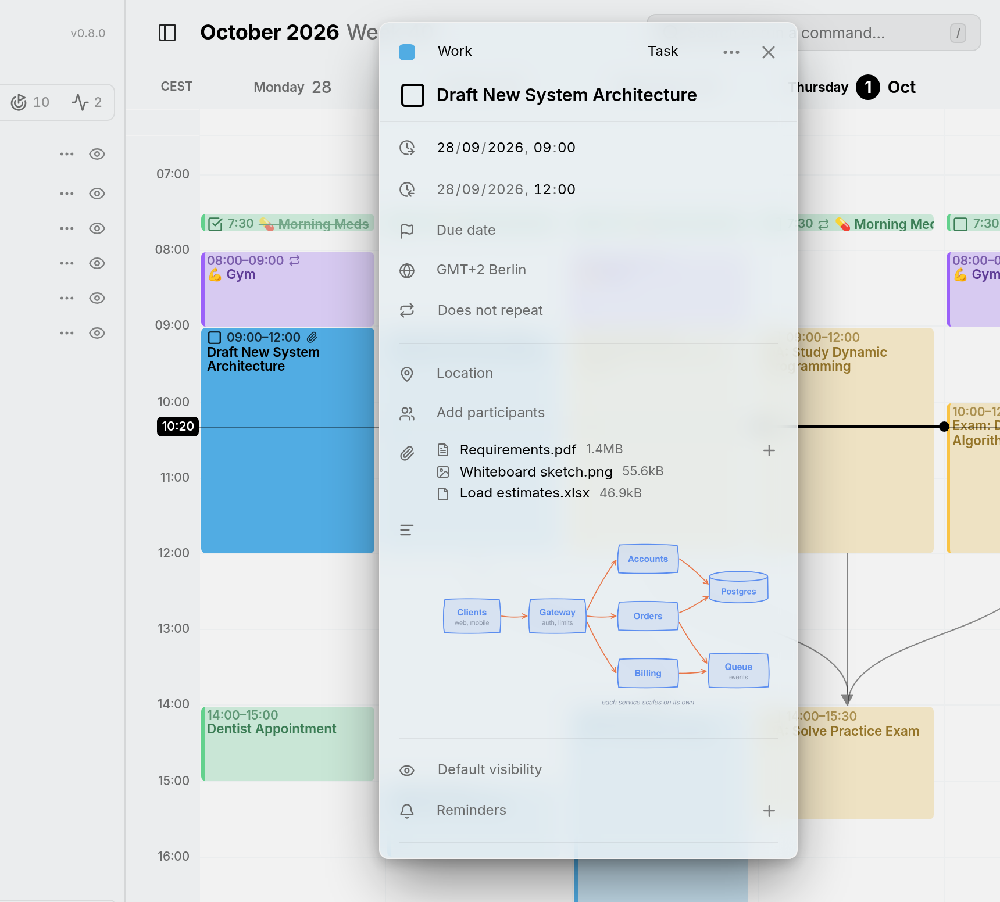

項目には **添付ファイル** を付けられます: チケット、ホワイトボードの写真、レシピなどのファイルです。Mitra はファイルをサーバーに保管し、標準的なカレンダー形式で項目と一緒に保存します。だから Nextcloud や Apple カレンダーのように同じカレンダーを使う他のアプリでも、同じ予定に同じファイルが表示されます。

## ファイルを追加する

項目を開き、ペーパークリップのアイコンがある行の **＋** を押すか、行が空のうちは **添付ファイル** という文字を押して、1つ以上のファイルを選びます。各添付ファイルには、種類に応じたアイコン、名前、サイズが表示されます。クリックすると新しいタブで開き、**✕** を押すと項目から外れます。

カレンダー上の項目に付いたペーパークリップのアイコンが、ファイルを持つ項目を示します。

<picture>
  <source media="(prefers-color-scheme: dark)" srcset="../assets/screenshots/attachments-detail-dark.webp">
  
</picture>

リンクは添付ファイルではありません。項目にリンクを付けるには説明文に書いてください。[リンク](links.md)の行に表示されます。

## ファイルの保管場所

追加したファイルは、Mitra のデータフォルダーにある `files` フォルダーに、データベースと並んで保管されます。そのフォルダーの[バックアップ](backups.md)に一緒に含まれます。各ファイルは元の名前ではなくランダムな名前で保存され、同じファイルを2回追加しても1つしか保管されません。

> [!IMPORTANT]
> ファイルのアドレスを知っていれば、Mitra にサインインしなくても誰でもそのファイルを開けます。他のカレンダーアプリがファイルを開けるのはそのおかげです: Mitra はアドレスをカレンダーに書き込みますが、他のアプリは Mitra にサインインできないからです。アドレスには推測できないランダムな部分が含まれますが、共有リンクと同じように扱ってください。新しいアドレスが必要になったら、添付ファイルを外してファイルを付け直してください。

画像、動画、音声、PDF、プレーンテキストはブラウザーで開きます。それ以外の種類のファイルはすべてダウンロードされるため、ファイルが Mitra の中でコードを実行することはありません。

## 制限

1ファイルは最大 25 MB です。一人が保存できる総量に制限はありません。サーバーの運営者はこの両方を変更したり、ファイルの追加そのものを無効にできます。[設定](configuration.md#attachments)を参照してください。[デモ](https://demo.mitracal.com)ではファイルの追加は常に無効です。

どの項目からも使われなくなったファイルは、追加から約1日後に削除されます。それまでは、まだ保存していない項目に追加したり、誤って外したあとで付け直したりできます。

## 対応しているカレンダー

[CalDAV サーバー](integrations/caldav.md)や [Apple カレンダー](integrations/apple.md)のカレンダーは添付ファイルを保持でき、[Mitra カレンダー](integrations/mitra.md)も同様です。[カレンダー購読](integrations/subscriptions.md)では、フィードが持つ添付ファイルは見えますが変更はできません。

ファイルは説明文にも現れます: その行にある画像ボタンやリンクボタンで、テキストの末尾に追加されます。画像は画像として、それ以外はリンクとして挿入されます。添付ファイルを外すと、それも消えます。

[Google カレンダー](integrations/google.md)では、添付ファイルは Google カレンダー側で添付された Google ドライブのファイルです。Mitra はそれを表示しますが、追加も削除もできません。[Notion](integrations/notion.md)、[Todoist](integrations/todoist.md)、[Tempo](integrations/tempo.md) のカレンダーには添付ファイルの行がありません。添付ファイル付きの項目をこれらへ移すとファイルは失われますが、移動の前に Mitra が知らせます。

> [!NOTE]
> 他のアプリが追加した添付ファイルも Mitra に表示されます。カレンダーサーバー自身が保管しているファイルも含まれ、その場合はそのサーバー自身のアドレスで開きます。Mitra は認識できない添付ファイルをそのままにしておくので、Mitra で項目を編集しても他のアプリの添付ファイルが変わることはありません。
