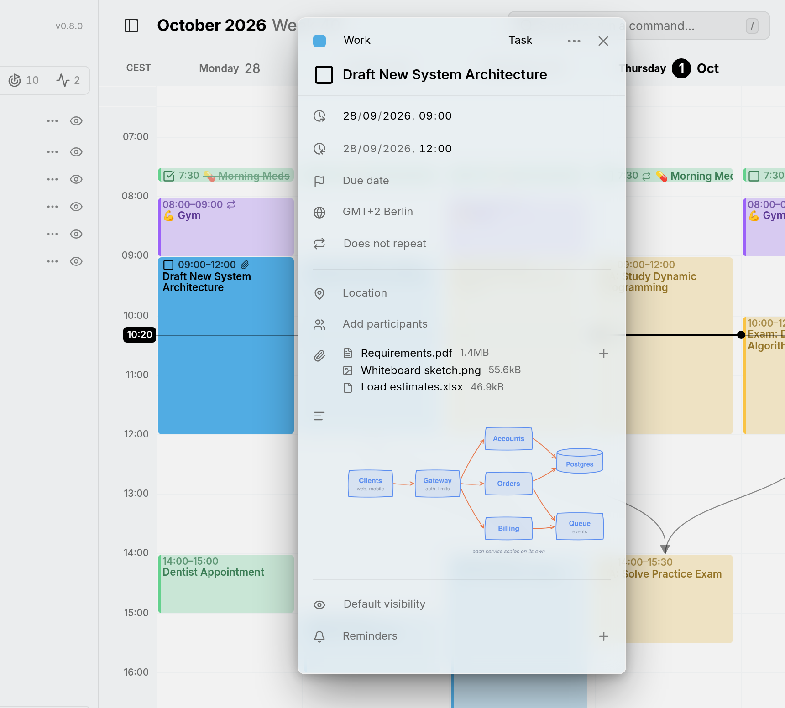

항목에는 티켓, 화이트보드 사진, 요리법 같은 파일을 **첨부 파일**로 넣을 수 있습니다. Mitra는 파일을 서버에 보관하고 표준 캘린더 형식으로 항목과 함께 저장하므로, Nextcloud나 Apple 캘린더처럼 같은 캘린더를 쓰는 다른 앱에서도 같은 일정에 같은 파일이 표시됩니다.

## 파일 추가하기

항목을 열고 클립이 있는 행의 **＋** 버튼을 누르거나, 행이 아직 비어 있다면 **첨부 파일**이라는 글자를 누른 다음 파일을 하나 이상 고르세요. 각 첨부 파일에는 종류를 나타내는 아이콘, 이름, 크기가 표시됩니다. 파일을 클릭하면 새 탭에서 열리고, **✕** 버튼을 누르면 항목에서 제거됩니다.

캘린더에서 항목에 클립이 있으면 파일이 첨부된 항목입니다.

<picture>
  <source media="(prefers-color-scheme: dark)" srcset="../assets/screenshots/attachments-detail-dark.webp">
  
</picture>

링크는 첨부 파일이 아닙니다. 항목에 링크를 넣으려면 설명에 적으세요. 그러면 [링크](links.md) 행에 표시됩니다.

## 파일이 보관되는 곳

추가한 파일은 Mitra 데이터 폴더의 `files` 폴더, 즉 데이터베이스 옆에 보관되므로, 그 폴더를 [백업](backups.md)하면 파일도 함께 백업됩니다. 각 파일은 원래 이름이 아닌 임의의 이름으로 저장되며, 같은 파일을 두 번 추가해도 한 번만 보관됩니다.

> [!IMPORTANT]
> 파일 주소를 아는 사람은 누구나 Mitra에 로그인하지 않고도 파일을 열 수 있습니다. 그래야 다른 캘린더 앱이 파일을 열 수 있기 때문입니다. Mitra는 주소를 캘린더에 기록하는데, 그런 앱은 Mitra에 로그인할 수 없습니다. 주소에는 추측할 수 없는 임의의 부분이 들어 있지만, 공유 링크처럼 다루세요. 새 주소를 받으려면 첨부 파일을 제거하고 파일을 다시 추가하세요.

이미지, 동영상, 오디오, PDF, 일반 텍스트는 브라우저에서 열립니다. 그 밖의 파일은 모두 다운로드되므로, 파일이 Mitra 안에서 코드를 실행하는 일은 없습니다.

## 제한

파일 하나는 최대 25MB까지 가능하며, 한 사람이 보관할 수 있는 총량에는 제한이 없습니다. 서버를 운영하는 사람은 두 값을 모두 바꾸거나 파일 추가를 끌 수 있습니다. [구성](configuration.md#attachments)을 참고하세요. [데모](https://demo.mitracal.com)에서는 파일 추가가 항상 꺼져 있습니다.

더 이상 어떤 항목도 쓰지 않는 파일은 추가한 지 약 하루 뒤에 삭제됩니다. 그 전까지는 아직 저장하지 않은 항목에 추가하거나, 실수로 제거한 파일을 다시 추가할 수 있습니다.

## 지원하는 캘린더

[CalDAV 서버](integrations/caldav.md)와 [Apple 캘린더](integrations/apple.md)의 캘린더는 첨부 파일을 담을 수 있고, [Mitra 캘린더](integrations/mitra.md)도 마찬가지입니다. [캘린더 구독](integrations/subscriptions.md)에서는 피드에 담긴 첨부 파일을 볼 수 있지만 바꿀 수는 없습니다.

파일은 설명에도 넣을 수 있습니다. 파일 행에 있는 그림 또는 링크 버튼을 누르면 텍스트 끝에 추가되는데, 이미지는 그림으로, 나머지는 링크로 들어갑니다. 첨부 파일을 제거하면 이것도 함께 제거됩니다.

[Google 캘린더](integrations/google.md)에서 첨부 파일은 Google Calendar에서 첨부한 Google Drive 파일입니다. Mitra는 이를 보여 주지만 추가하거나 제거할 수는 없습니다. [Notion](integrations/notion.md), [Todoist](integrations/todoist.md), [Tempo](integrations/tempo.md) 캘린더에는 첨부 파일 행이 없습니다. 첨부 파일이 있는 항목을 이런 캘린더로 옮기면 파일이 빠지며, Mitra는 옮기기 전에 이를 알려 줍니다.

> [!NOTE]
> 다른 앱이 추가한 첨부 파일도 Mitra에 표시됩니다. 캘린더 서버가 직접 보관하는 파일도 포함되며, 이런 파일은 그 서버의 주소로 열립니다. Mitra는 알아보지 못하는 첨부 파일을 있는 그대로 두므로, Mitra에서 항목을 편집해도 다른 앱의 첨부 파일은 바뀌지 않습니다.
