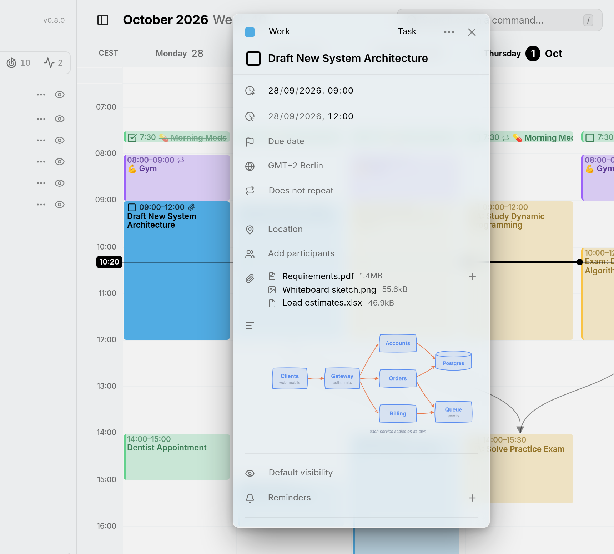

Một mục có thể mang **tệp đính kèm**: các tệp như vé, ảnh chụp bảng trắng hay một công thức nấu ăn. Mitra lưu tệp trên máy chủ của bạn và lưu cùng mục theo định dạng lịch chuẩn, nên các ứng dụng khác dùng cùng một lịch, như Nextcloud hay Lịch Apple, hiển thị đúng tệp đó trên đúng sự kiện đó.

## Thêm tệp

Mở mục rồi nhấn **＋** ở hàng có biểu tượng kẹp giấy, hoặc nhấn chữ **Tệp đính kèm** khi hàng còn trống, rồi chọn một hoặc nhiều tệp. Mỗi tệp đính kèm hiện biểu tượng theo loại tệp, tên và dung lượng. Nhấp vào một tệp để mở trong thẻ mới, và nhấn **✕** của nó để gỡ khỏi mục.

Biểu tượng kẹp giấy trên mục trong lịch cho biết mục nào có tệp.

<picture>
  <source media="(prefers-color-scheme: dark)" srcset="../assets/screenshots/attachments-detail-dark.webp">
  
</picture>

Liên kết không phải là tệp đính kèm. Để thêm liên kết vào mục, hãy viết nó trong phần mô tả, và hàng [Liên kết](links.md) sẽ hiển thị nó.

## Tệp được lưu ở đâu

Các tệp bạn thêm được lưu trong thư mục `files` của thư mục dữ liệu của Mitra, cạnh cơ sở dữ liệu, nên [bản sao lưu](backups.md) của thư mục đó bao gồm cả chúng. Mỗi tệp được lưu dưới một tên ngẫu nhiên thay vì tên gốc, và cùng một tệp thêm hai lần chỉ được lưu một lần.

> [!IMPORTANT]
> Bất kỳ ai có địa chỉ của một tệp đều mở được nó mà không cần đăng nhập vào Mitra. Nhờ vậy các ứng dụng lịch khác mới mở được tệp: Mitra ghi địa chỉ vào lịch của bạn, và các ứng dụng đó không thể đăng nhập vào Mitra. Địa chỉ chứa một phần ngẫu nhiên không thể đoán được, nhưng hãy xem nó như một liên kết chia sẻ. Để có địa chỉ mới, hãy gỡ tệp đính kèm rồi thêm lại tệp.

Hình ảnh, video, âm thanh, PDF và văn bản thuần túy mở ngay trong trình duyệt. Mọi loại tệp khác sẽ được tải xuống, nên một tệp không bao giờ có thể chạy mã bên trong Mitra.

## Giới hạn

Một tệp có thể nặng tối đa 25 MB, và không giới hạn tổng dung lượng mỗi người có thể lưu. Người vận hành máy chủ có thể thay đổi cả hai, hoặc tắt việc thêm tệp; xem [Cấu hình](configuration.md#attachments). Việc thêm tệp luôn bị tắt trong [bản demo](https://demo.mitracal.com).

Một tệp không còn mục nào dùng sẽ bị xóa khoảng một ngày sau khi được thêm. Trước đó, bạn vẫn có thể thêm nó vào một mục chưa lưu, hoặc thêm lại nếu lỡ gỡ nhầm.

## Lịch nào hỗ trợ tính năng này

Các lịch từ [máy chủ CalDAV](integrations/caldav.md) và [Lịch Apple](integrations/apple.md) chứa được tệp đính kèm, các [lịch Mitra](integrations/mitra.md) cũng vậy. Trong [lịch đăng ký](integrations/subscriptions.md), bạn thấy các tệp đính kèm mà nguồn cấp mang theo nhưng không thể thay đổi chúng.

Một tệp cũng có thể xuất hiện trong phần mô tả: nút ảnh hoặc liên kết trên hàng của nó thêm tệp vào cuối văn bản, dưới dạng hình ảnh với ảnh và liên kết với các loại còn lại. Gỡ tệp đính kèm cũng gỡ luôn phần đó.

Trong [lịch Google](integrations/google.md), tệp đính kèm là các tệp Google Drive được đính kèm trong Google Lịch: Mitra hiển thị chúng nhưng không thể thêm hay gỡ tệp nào. Các lịch [Notion](integrations/notion.md), [Todoist](integrations/todoist.md) và [Tempo](integrations/tempo.md) không có hàng tệp đính kèm. Chuyển một mục có tệp đính kèm vào bất kỳ lịch nào trong số này sẽ làm mất các tệp của nó, và Mitra sẽ báo cho bạn trước khi di chuyển.

> [!NOTE]
> Tệp đính kèm do các ứng dụng khác thêm cũng hiện trong Mitra, kể cả các tệp mà chính máy chủ lịch của bạn lưu, những tệp này mở bằng địa chỉ riêng của máy chủ đó. Mitra giữ nguyên các tệp đính kèm mà nó không nhận ra, nên sửa một mục trong Mitra không bao giờ làm thay đổi tệp đính kèm của ứng dụng khác.
