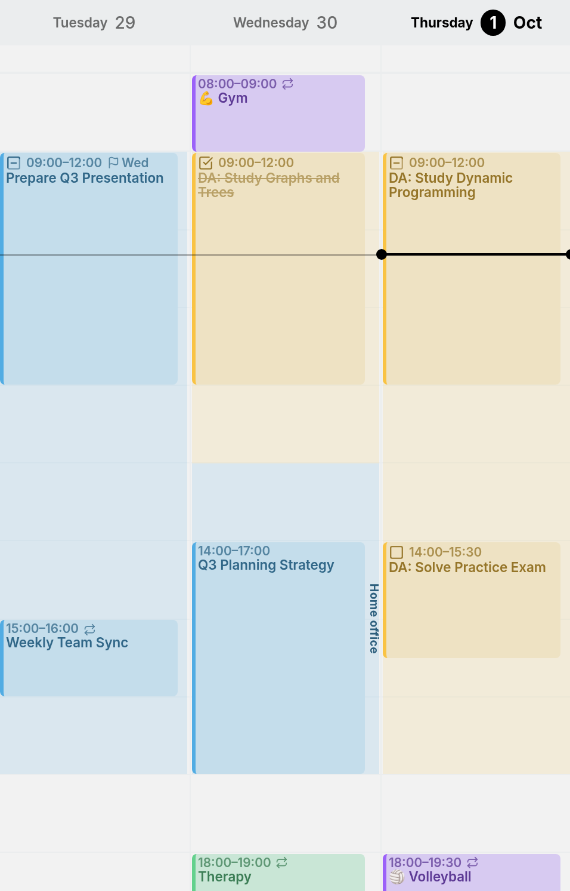
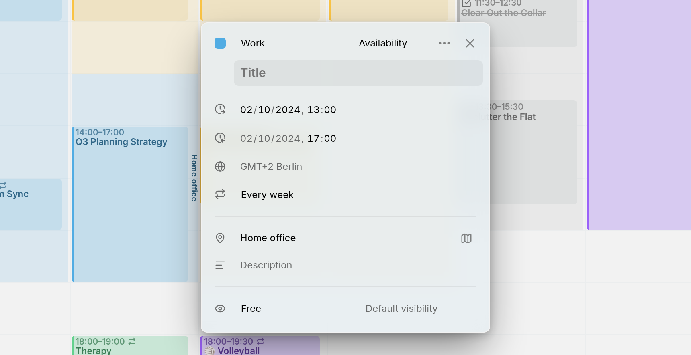

**対応可能時間** とは、定期的に確保しておく時間のことです。月曜から水曜は仕事、木曜と金曜は勉強、土曜は家事、というような時間です。Mitra は **週**ビューで、そのカレンダーの色で時間に陰影を付けます。

対応可能時間はカレンダーに属し、そのカレンダーの予定やタスクと並びます。勤務時間は仕事のカレンダーに、勉強時間は大学のカレンダーに入れます。約束事ではないため、アカウントには追加されず Mitra 自身が保持します。[予定ありの対応可能時間](#busy-or-free)だけが例外です。

それはいつもの1週間の形であって、柵ではありません。勤務時間の真ん中に歯医者の予約が入っても構いません。

<picture>
  <source media="(prefers-color-scheme: dark)" srcset="../assets/screenshots/availability-detail-dark.webp">
  
</picture>

## 名前の有無

名前を付けなければ、枠はただの陰です。たいていの対応可能時間はそれで十分です。カレンダーの色がすでにその時間の用途を物語っているからです。名前や場所を付けると、その文字が日の端に沿って表示されます。勤務時間の中の「集中時間」や、日によって「オフィス」と「在宅勤務」を分けるような使い方です。

枠が重なると、陰は濃く混ざり合い、ラベルは離れます: 先のものは開始側へ、後のものは終了側へ。

## 対応可能時間を追加する

<kbd>/</kbd> または <kbd>Ctrl</kbd> + <kbd>K</kbd> でコマンドパレットを開き、**対応可能時間を追加** を実行します。追加先はデフォルトのカレンダーです:

- そのカレンダーに対応可能時間がまだなければ、月曜から金曜の 9:00〜17:00 の勤務時間ができます。
- すでにある場合は、今日と同じ曜日の枠が1つできます。

エディターが開くので、時刻、曜日、名前、場所、カレンダーを変更できます。繰り返さない項目は、**種類** を変えて対応可能時間にすることもできます。

<picture>
  <source media="(prefers-color-scheme: dark)" srcset="../assets/screenshots/availability-editor-detail-dark.webp">
  
</picture>

## 編集と移動

- 枠の内側をクリックすると開きます。その上をドラッグしても、グリッドの空いている部分と同じように普通の項目が作られます。
- 対応可能時間は他の項目と同じように繰り返します。タイムゾーンと繰り返しルールを持ち、ある1日を変更・削除しようとすると、その日だけか全部かを Mitra が尋ねます。
- エディターの **カレンダー** フィールドで別のカレンダーへ移せます。**項目の移動先…** でカレンダーの項目を移動すると、対応可能時間も一緒に付いてきます。
- 対応可能時間は週ビューにだけ表示されます。月ビュー、年ビュー、タイムラインビュー、テーブルビュー、検索結果、関連付けには現れません。

## 表示と非表示

サイドバーでカレンダーの目のアイコンを使うと、予定やタスクと一緒に対応可能時間も隠れます。対応可能時間だけをすべて隠すには、**設定 → カレンダー** の **対応可能時間を隠す** をオンにするか、コマンドパレットで探します。

## 対応可能時間を置ける場所

項目を追加できるカレンダーなら、[Mitra](integrations/mitra.md) カレンダーを含め、対応可能時間を置けます。次は例外です:

- [Notion](integrations/notion.md)、[Todoist](integrations/todoist.md)、[Tempo](integrations/tempo.md) のカレンダー。項目を繰り返せないため。
- [カレンダー購読](integrations/subscriptions.md)のような読み取り専用カレンダー。

対応可能時間はカレンダーと運命を共にします。カレンダーを削除したり、所属するアカウントとの接続を切ったりすると、その対応可能時間も削除されます。

## 予定ありと空き

対応可能時間には、予定と同じ **予定ありまたは空きとして表示** の選択肢があります。初期値は **空き** で、勤務時間にはそれが合っています。その時間に予約が入っても構わないからです。集中時間のように他の人に取られたくない時間には **予定あり** を選びます。

Mitra の中では、どちらも見た目は同じです。違いは他の人にどう見えるかです。空きの対応可能時間がアカウントに書き込まれることはありません。予定ありの対応可能時間は、[CalDAV、Google、Apple のカレンダー](integrations/caldav.md#busy-availability)では、名前と場所を持つ予定ありの予定としてそのカレンダーに追加されます。スマートフォンにも表示され、あなたを招待する人にはその時間が埋まっているように見えます。
