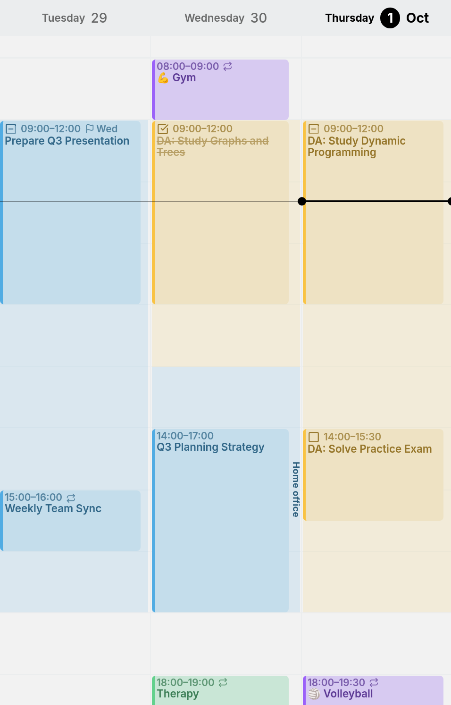
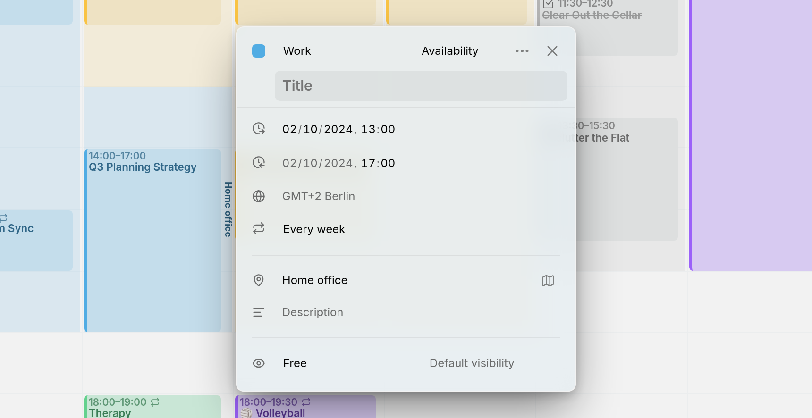

**가용 시간**은 월요일부터 수요일까지 업무, 목요일과 금요일은 공부, 토요일은 집안일처럼 정기적으로 따로 떼어 두는 시간입니다. Mitra는 **주** 보기에서 이 시간을 캘린더 색깔로 음영 처리합니다.

가용 시간은 캘린더에 속하며, 그 캘린더의 일정 및 작업과 나란히 있습니다. 근무 시간은 업무 캘린더에, 공부 시간은 학교 캘린더에 넣으면 됩니다. 약속이 아니므로 Mitra는 이를 계정에 추가하지 않고 직접 보관합니다. 단, [바쁨으로 표시한 가용 시간](#busy-or-free)은 예외입니다.

가용 시간은 한 주의 평소 모습일 뿐, 울타리가 아닙니다. 근무 시간 한가운데에 치과 예약이 있어도 괜찮습니다.

<picture>
  <source media="(prefers-color-scheme: dark)" srcset="../assets/screenshots/availability-detail-dark.webp">
  
</picture>

## 이름이 있거나 없거나

이름이 없으면 시간대는 음영으로만 보입니다. 캘린더 색깔만으로도 무엇을 위한 시간인지 알 수 있으므로 대부분의 가용 시간에는 이것으로 충분합니다. 이름이나 장소를 붙이면 그 글자가 하루의 가장자리를 따라 표시됩니다. 근무 시간 안의 집중 시간이나, 요일마다 다른 사무실과 재택근무가 그 예입니다.

시간대가 겹치는 곳에서는 음영이 섞여 더 진해지고, 이름표는 서로 떨어집니다. 첫 번째는 시작 쪽으로, 마지막은 끝 쪽으로 갑니다.

## 가용 시간 추가하기

<kbd>/</kbd>나 <kbd>Ctrl</kbd> + <kbd>K</kbd>로 명령 팔레트를 열고 **가용 시간 추가**를 실행하세요. 기본 캘린더에 추가됩니다.

- 그 캘린더에 아직 가용 시간이 없으면 월요일부터 금요일까지 9:00에서 17:00까지의 근무 시간이 만들어집니다.
- 그렇지 않으면 오늘 요일에 시간대 하나가 만들어집니다.

편집기가 열리므로 시간, 요일, 이름, 장소, 캘린더를 바꿀 수 있습니다. 반복하지 않는 항목도 **유형**에서 가용 시간으로 바꿀 수 있습니다.

<picture>
  <source media="(prefers-color-scheme: dark)" srcset="../assets/screenshots/availability-editor-detail-dark.webp">
  
</picture>

## 편집하고 옮기기

- 시간대 안쪽을 클릭하면 열립니다. 그 위로 드래그하면 그리드의 빈 곳에서와 마찬가지로 일반 항목이 만들어집니다.
- 가용 시간은 다른 항목처럼 반복합니다. 시간대와 반복 규칙이 있으며, 하루를 바꾸거나 삭제하면 Mitra가 그날만인지 전체인지 묻습니다.
- 편집기의 **캘린더** 필드로 다른 캘린더로 옮길 수 있습니다. **다른 캘린더로 항목 옮기기…** 메뉴로 캘린더의 항목을 옮기면 가용 시간도 함께 옮겨집니다.
- 가용 시간은 주 보기에만 나옵니다. 월, 연, 타임라인, 표 보기, 검색 결과, 관계에는 나오지 않습니다.

## 보이기와 숨기기

사이드바에서 캘린더의 눈 아이콘을 누르면 일정, 작업과 함께 가용 시간도 숨겨집니다. 다른 것은 그대로 두고 가용 시간만 모두 숨기려면 **설정 → 캘린더**에서 **가용 시간 숨기기**를 켜거나, 명령 팔레트에서 찾으세요.

## 가용 시간을 둘 수 있는 곳

[Mitra](integrations/mitra.md) 캘린더를 포함해 항목을 추가할 수 있는 캘린더라면 어디든 가용 시간을 담을 수 있습니다. 다음 캘린더는 담을 수 없습니다.

- [Notion](integrations/notion.md), [Todoist](integrations/todoist.md), [Tempo](integrations/tempo.md) 캘린더. 항목이 반복할 수 없기 때문입니다.
- [캘린더 구독](integrations/subscriptions.md) 같은 읽기 전용 캘린더.

가용 시간은 자신의 캘린더와 운명을 같이합니다. 캘린더를 삭제하거나 캘린더가 속한 계정의 연결을 끊으면 가용 시간도 삭제됩니다.

## 바쁨 또는 한가함

가용 시간에는 일정과 똑같은 **바쁨 또는 한가함으로 표시** 선택이 있습니다. 처음에는 **한가함**으로 시작하는데, 근무 시간에는 이것이 잘 맞습니다. 그 시간에 약속이 잡혀도 괜찮기 때문입니다. 집중 시간처럼 다른 사람이 가져가면 안 되는 시간이라면 **바쁨**을 고르세요.

Mitra 안에서는 둘이 똑같아 보입니다. 차이는 다른 사람에게 보이는 모습입니다. 한가함으로 표시한 가용 시간은 어떤 계정에도 기록되지 않습니다. [CalDAV, Google, Apple 캘린더](integrations/caldav.md#busy-availability)에 있는 바쁨 가용 시간은 이름과 장소와 함께 바쁨 일정으로 그 캘린더에 추가되므로, 휴대폰에도 보이고 초대하는 사람에게는 그 시간이 차 있는 것으로 보입니다.
