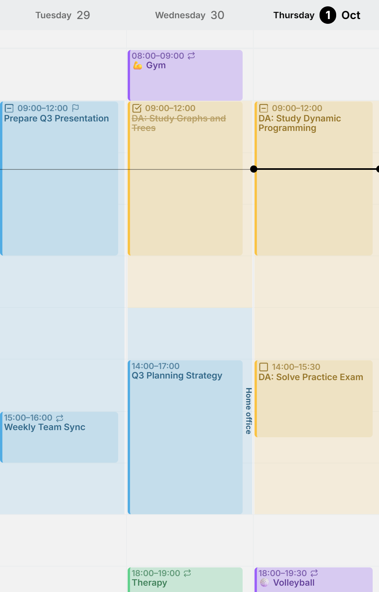
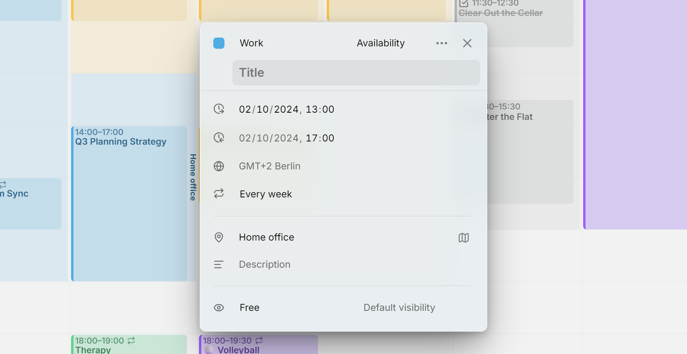

**Dostępność** to czas, który regularnie na coś rezerwujesz, na przykład praca od poniedziałku do środy, nauka w czwartek i piątek albo sprawy domowe w sobotę. Mitra zaznacza go cieniowaniem w widoku **Tydzień**, w kolorze jego kalendarza.

Dostępność należy do kalendarza, obok jego wydarzeń i zadań. Godziny pracy trafiają do kalendarza służbowego, a czas na naukę do kalendarza uczelnianego. Dostępność nie jest spotkaniem, więc Mitra przechowuje ją sama, zamiast dodawać ją do twojego konta. Jedynym wyjątkiem jest [dostępność oznaczona jako zajęta](#busy-or-free).

Wyznacza zwykły rytm twojego tygodnia, a nie sztywne granice. Wizyta u dentysty w środku godzin pracy to nic złego.

<picture>
  <source media="(prefers-color-scheme: dark)" srcset="../assets/screenshots/availability-detail-dark.webp">
  
</picture>

## Z nazwą lub bez

Przedział bez nazwy to samo cieniowanie. Większości dostępności to wystarcza, bo kolor kalendarza i tak mówi, na co jest ten czas. Jeśli nadasz przedziałowi nazwę lub miejsce, ten tekst biegnie wzdłuż krawędzi dnia, na przykład Czas na skupienie w godzinach pracy albo Biuro i Praca zdalna w różne dni.

Tam, gdzie przedziały się nakładają, ich cieniowanie łączy się w ciemniejsze, a podpisy się rozsuwają: pierwszy na początek przedziału, ostatni na jego koniec.

## Dodaj dostępność

Otwórz paletę poleceń klawiszem <kbd>/</kbd> lub skrótem <kbd>Ctrl</kbd> + <kbd>K</kbd> i uruchom polecenie **Dodaj dostępność**. Dostępność trafi do twojego domyślnego kalendarza:

- Jeśli ten kalendarz nie ma jeszcze żadnej dostępności, dostajesz godziny pracy od poniedziałku do piątku, od 9:00 do 17:00.
- W przeciwnym razie dostajesz przedział w dzisiejszym dniu tygodnia.

Otworzy się edytor, w którym możesz zmienić godziny, dni, nazwę, miejsce lub kalendarz. Wpis, który się nie powtarza, również może stać się dostępnością dzięki polu **Typ**.

<picture>
  <source media="(prefers-color-scheme: dark)" srcset="../assets/screenshots/availability-editor-detail-dark.webp">
  
</picture>

## Edytuj i przenoś

- Kliknij wewnątrz przedziału, aby go otworzyć. Przeciągnięcie przez niego nadal tworzy zwykły wpis, tak samo jak na pustym fragmencie siatki.
- Dostępność powtarza się jak każdy inny wpis. Ma strefę czasową i regułę powtarzania, a gdy zmieniasz lub usuwasz jeden jej dzień, Mitra pyta, czy chodzi ci o ten dzień, czy o wszystkie.
- Pole **Kalendarz** w edytorze przenosi ją do innego kalendarza. Przeniesienie wpisów kalendarza poleceniem **Przenieś wpisy do…** zabiera też jego dostępność.
- Dostępność jest widoczna tylko w widoku Tydzień. Nie pojawia się w widokach Miesiąc, Rok, Oś czasu ani Tabela, w wynikach wyszukiwania ani w powiązaniach.

## Pokaż i ukryj

Ikona oka przy kalendarzu w panelu bocznym ukrywa jego dostępność razem z wydarzeniami i zadaniami. Aby ukryć całą dostępność i nic poza nią, włącz **Ukryj dostępność** w **Ustawienia → Kalendarz** albo znajdź to ustawienie w palecie poleceń.

## Gdzie może być dostępność

Dostępność może zawierać każdy kalendarz, do którego możesz dodawać wpisy, w tym [kalendarze przechowywane w aplikacji Mitra](integrations/mitra.md). Nie mogą jej zawierać:

- kalendarze [Notion](integrations/notion.md), [Todoist](integrations/todoist.md) i [Tempo](integrations/tempo.md), bo ich wpisy nie mogą się powtarzać;
- kalendarze tylko do odczytu, na przykład [subskrypcje kalendarzy](integrations/subscriptions.md).

Dostępność pozostaje przy swoim kalendarzu. Usunięcie kalendarza albo odłączenie konta, do którego należy, usuwa również jego dostępność.

## Zajęty czy wolny

Dostępność ma to samo ustawienie **Pokazuj jako zajęty lub wolny** co wydarzenie. Domyślnie jest ustawiona na **Wolny**, co pasuje do godzin pracy: wtedy chętnie przyjmujesz spotkania. Wybierz **Zajęty** dla czasu, którego inni nie powinni zajmować, na przykład czasu na skupienie.

W aplikacji Mitra oba warianty wyglądają tak samo. Różnica polega na tym, co widzą inni. Dostępność oznaczona jako wolna nigdy nie jest zapisywana na żadnym z twoich kont. Dostępność oznaczona jako zajęta w [kalendarzu CalDAV, Google lub Apple](integrations/caldav.md#busy-availability) trafia do tego kalendarza jako wydarzenia z ustawieniem „zajęty”, z nazwą i miejscem, więc widać ją w telefonie, a osoby, które cię zapraszają, widzą ten czas jako zajęty.
