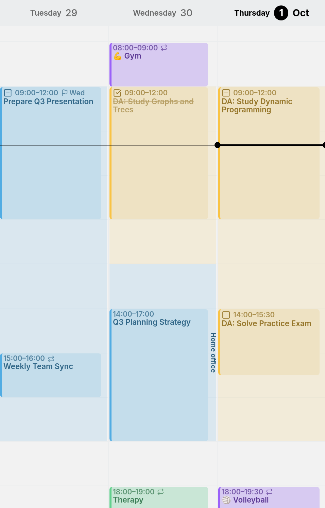
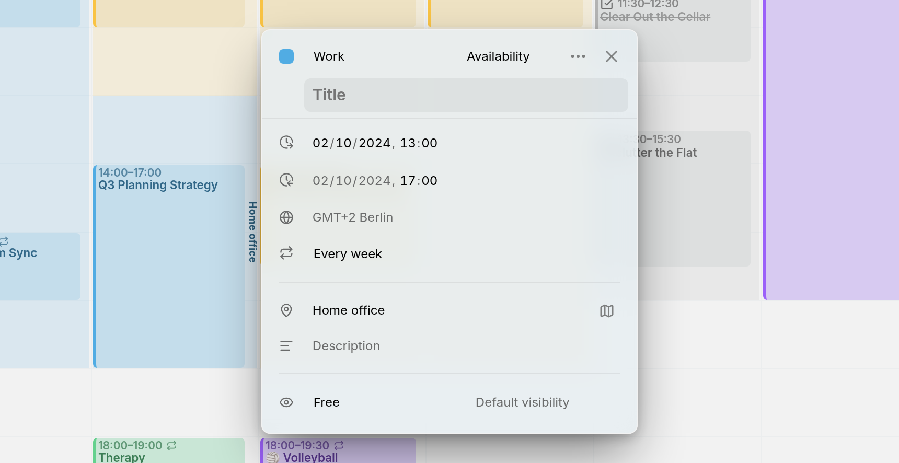

**Thời gian khả dụng** là khoảng thời gian bạn dành ra đều đặn, như làm việc từ thứ Hai đến thứ Tư, học vào thứ Năm và thứ Sáu, hoặc việc nhà vào thứ Bảy. Mitra tô bóng nó trong chế độ xem **Tuần**, bằng màu của lịch chứa nó.

Thời gian khả dụng thuộc về một lịch, bên cạnh các sự kiện và công việc của lịch đó. Giờ làm việc của bạn nằm trong lịch công việc, và thời gian học nằm trong lịch trường đại học. Nó không phải là một cuộc hẹn, nên Mitra tự giữ nó thay vì thêm vào tài khoản của bạn. [Thời gian khả dụng bận](#busy-or-free) là ngoại lệ duy nhất.

Đó là hình dạng thông thường của tuần của bạn, không phải hàng rào. Một cuộc hẹn nha sĩ giữa giờ làm việc vẫn ổn.

<picture>
  <source media="(prefers-color-scheme: dark)" srcset="../assets/screenshots/availability-detail-dark.webp">
  
</picture>

## Có tên hay không

Không có tên, một khung chỉ là một vùng bóng. Cách này hợp với phần lớn thời gian khả dụng, vì màu của lịch đã cho biết thời gian đó dành cho việc gì. Hãy đặt tên hoặc địa điểm, và dòng chữ đó chạy dọc mép ngày, như Focus time trong giờ làm việc, hoặc Office và Home office vào những ngày khác nhau.

Khi các khung chồng lên nhau, bóng của chúng trộn lại đậm hơn, và nhãn của chúng tách ra: nhãn đầu về điểm bắt đầu, nhãn cuối về điểm kết thúc.

## Thêm thời gian khả dụng

Mở bảng lệnh bằng <kbd>/</kbd> hoặc <kbd>Ctrl</kbd> + <kbd>K</kbd> và chạy **Thêm thời gian khả dụng**. Nó được thêm vào lịch mặc định của bạn:

- Nếu lịch đó chưa có thời gian khả dụng nào, bạn được giờ làm việc từ thứ Hai đến thứ Sáu, 9:00 đến 17:00.
- Nếu không, bạn được một khung vào thứ của ngày hôm nay.

Trình chỉnh sửa mở ra, để bạn đổi giờ, ngày, tên, địa điểm hoặc lịch. Một mục không lặp lại cũng có thể trở thành thời gian khả dụng qua **Loại** của nó.

<picture>
  <source media="(prefers-color-scheme: dark)" srcset="../assets/screenshots/availability-editor-detail-dark.webp">
  
</picture>

## Sửa và di chuyển

- Nhấp vào bên trong một khung để mở nó. Kéo ngang qua khung vẫn tạo một mục bình thường, giống như trên phần trống của lưới.
- Thời gian khả dụng lặp lại như mọi mục khác. Nó có múi giờ và quy tắc lặp lại, và khi bạn đổi hoặc xóa một ngày của nó, Mitra hỏi bạn muốn nói ngày đó hay tất cả các ngày.
- Trường **Lịch** của trình chỉnh sửa chuyển nó sang lịch khác. Di chuyển các mục của một lịch bằng **Di chuyển các mục đến…** sẽ mang theo cả thời gian khả dụng của nó.
- Thời gian khả dụng chỉ hiện trong chế độ xem Tuần. Nó không xuất hiện trong chế độ xem Tháng, Năm, Dòng thời gian hay Bảng, trong kết quả tìm kiếm, hay trong các quan hệ.

## Hiện và ẩn

Biểu tượng con mắt của một lịch trên thanh bên ẩn thời gian khả dụng của nó cùng với các sự kiện và công việc. Để chỉ ẩn toàn bộ thời gian khả dụng mà không ẩn gì khác, hãy bật **Ẩn thời gian khả dụng** trong **Cài đặt → Lịch**, hoặc tìm nó trong bảng lệnh.

## Thời gian khả dụng có thể nằm ở đâu

Bất kỳ lịch nào bạn thêm được mục đều chứa được thời gian khả dụng, kể cả lịch [Mitra](integrations/mitra.md). Những lịch sau thì không:

- Lịch [Notion](integrations/notion.md), [Todoist](integrations/todoist.md) và [Tempo](integrations/tempo.md), vì các mục của chúng không lặp lại được.
- Lịch chỉ đọc, như [lịch đăng ký](integrations/subscriptions.md).

Thời gian khả dụng ở lại với lịch của nó. Xóa lịch, hoặc ngắt kết nối tài khoản chứa nó, cũng xóa thời gian khả dụng của lịch đó.

## Bận hay rảnh

Thời gian khả dụng có cùng lựa chọn **Hiện là bận hay rảnh** như một sự kiện. Mặc định là **Rảnh**, hợp với giờ làm việc: bạn sẵn lòng được đặt lịch vào lúc đó. Chọn **Bận** cho thời gian người khác không nên lấy, như focus time.

Bên trong Mitra, cả hai trông giống nhau. Điểm khác là những gì người khác thấy. Thời gian khả dụng rảnh không bao giờ được ghi vào bất kỳ tài khoản nào của bạn. Thời gian khả dụng bận trong [lịch CalDAV, Google hoặc Apple](integrations/caldav.md#busy-availability) được thêm vào lịch đó dưới dạng sự kiện bận, kèm tên và địa điểm, nên nó hiện trên điện thoại của bạn và những người mời bạn thấy khoảng thời gian đó đã kín.
