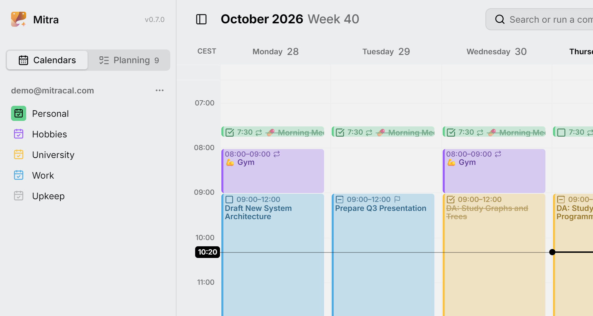

كل صف في علامة التبويب **التقويمات** في الشريط الجانبي تقويم. بعضها [محفوظ في Mitra](integrations/mitra.md)، وبعضها يأتي من حساب ربطته. تقع التقويمات تحت عنوان التكامل الذي تنتمي إليه، وكل ما في هذه الصفحة يعمل بالطريقة نفسها مع جميعها، ما لم يُذكر خلاف ذلك.

<picture>
  <source media="(prefers-color-scheme: dark)" srcset="../assets/screenshots/calendars-detail-dark.webp">
  
</picture>

التقويم صف واحد، حتى لو كان يضم الأحداث والمهام معًا، كما هي حال معظم تقويمات CalDAV. أما كون العنصر حدثًا أو مهمة فهو صفة العنصر نفسه.

## اختيار ما يُستورد

حين تربط حسابًا، يعثر Mitra على تقويماته ويعرضها كلها محددة، ويذكر لكل منها ما يضمه، مثل «أحداث · مهام». ألغِ تحديد ما لا تريده قبل الحفظ. ويمكنك تغيير رأيك لاحقًا من **⋯ ← تعديل** في الحساب، حيث تنتظرك غير محددة التقويماتُ التي أُضيفت إلى الحساب منذ ذلك الحين. لا يزامن Mitra ولا يحفظ إلا التقويمات المفعّلة، فلا تكلفك التقويمات الأخرى شيئًا.

## إضافة تقويم أو حذفه

التقويم الذي يأتي من حساب مرتبط يُنشأ ويُحذف لدى مزوّده، ويلاحظ Mitra ذلك في المزامنة التالية. تقويمات Mitra هي الاستثناء: أضف تقويمًا عبر **تقويم جديد** في القائمة **⋯** بجانب عنوان Mitra، واحذفه عبر **حذف التقويم** في قائمته **⋯**. وإن كانت فيه عناصر، يعرض عليك Mitra **نقل العناصر أولًا…**، حتى لا يضيع شيء عن طريق الخطأ.

## إخفاء تقويم

العين في آخر الصف تخفي عناصر ذلك التقويم. الإخفاء يتعلق بما تراه فقط: يستمر التقويم في المزامنة، وتعود عناصره فورًا حين تُظهره من جديد. ويظل البحث يجدها، باهتة.

الإخفاء لا يُسكت التقويم، فتظل [تذكيراته](reminders.md) تنطلق. لإيقاف التقويم تمامًا، أوقفه من **⋯ ← تعديل** في حسابه.

### إظهار تقويم واحد فقط

لإبعاد كل ما عداه، اختر **إظهار هذا التقويم فقط** من القائمة **⋯** في التقويم، أو انقر على عينه مع الضغط على <kbd>Alt</kbd>. تُخفى التقويمات الأخرى كلها، ويتذكر Mitra ما كان ظاهرًا منها. يصبح عنصر القائمة نفسه بعد ذلك **إظهار التقويمات التي كانت ظاهرة**، ويعيدها.

التقويمات التي كانت مخفية من قبل تبقى مخفية. والتقويم الذي ربطته في الأثناء يظهر، لأنه لم يكن ضمن ما أبعدته. ولا يُفقدك إظهار تقويم يدويًا طريق العودة إلى البقية. ويمكنك أيضًا فعل الأمرين من [لوحة الأوامر](shortcuts.md) بالبحث عن اسم التقويم.

## إعادة التسمية

انقر نقرًا مزدوجًا على اسم التقويم، أو اختر **إعادة التسمية** من قائمته **⋯**. الاسم اسمك: لا تستبدله المزامنة أبدًا. ولا يأخذ Mitra اسم المزوّد من جديد إلا إذا أُعيدت تسمية التقويم هناك فعلًا.

## تغيير اللون

اختر لونًا من القائمة **⋯** في التقويم. إلى أن تفعل، يستخدم التقويم اللون الذي يعطيه إياه مزوّده. وإن لم يعطه المزوّد لونًا، يختار Mitra لونًا من عنوان التقويم، فيبدو بالشكل نفسه على كل جهاز. تأخذ العناصر لون تقويمها ما لم يكن لها لون خاص بها.

## تغيير الترتيب

تبدأ التقويمات بالترتيب الذي عثر عليها به Mitra، والحسابات بالترتيب الذي ربطتها به. لترتيبها بنفسك، اسحب تقويمًا إلى الأعلى أو الأسفل داخل حسابه، أو اسحب حسابًا من عنوانه لتنقله مع كل تقويماته. على شاشة اللمس، اضغط مطولًا لحظة قبل السحب، لأن التمرير العادي يمرر القائمة. ويفعل **نقل لأعلى** و**نقل لأسفل** في القائمة **⋯** الشيء نفسه دون سحب.

لا يتحرك التقويم إلا داخل حسابه. والتقويم الذي تفعّله لاحقًا ينضم إلى آخر حسابه، فلا يُخل بالترتيب الذي وضعته.

## أين تذهب العناصر الجديدة

التقويم ذو الرمز الممتلئ هو تقويمك الافتراضي: تذهب إليه العناصر الجديدة ما لم تختر غيره. انقر على رمز تقويم لتجعله الافتراضي، وانقر على رمز الافتراضي مرة أخرى لإلغاء ذلك. إن لم يكن هناك تقويم افتراضي، أو كان تقويمك الافتراضي مخفيًا، تذهب العناصر الجديدة إلى أول تقويم ظاهر، وينتقل الرمز الممتلئ إليه، فنقل تقويم إلى الأعلى يجعله الافتراضي أيضًا. وتجد الخيار نفسه في **الإعدادات ← العناصر**.

العناصر الجديدة أحداث، ما لم يكن التقويم لا يقبل إلا المهام، كما في عرض Notion. ما دام العنصر جديدًا، يكون في محرره مفتاح **حدث** / **مهمة**. وبعد حفظه، غيّره عبر **النوع** في المحرر، ما دام تقويمه يقبل النوع الآخر. يحتفظ العنصر المتكرر بنوعه.

## نقل كل العناصر أو نسخها إلى تقويم آخر

**نقل العناصر إلى…** في القائمة **⋯** في التقويم، أو **نقل العناصر من …** في لوحة الأوامر، ينقل كل ما فيه إلى تقويم آخر دفعة واحدة. اختر وجهتها، وقبل أن يحدث أي شيء، يعرض عليك Mitra ما سيكلفه النقل:

```
19 of 21 entries move to Personal
✓ 15 arrive with everything they carry
! 4 lose their reminders
⨯ 2 repeat and stay here
```

يعتمد التقرير على ما تستطيع الوجهة حفظه، فيختلف لتقويم CalDAV عنه لعرض Notion. والعناصر التي لا تقبلها الوجهة إطلاقًا، مثل عنصر متكرر ذاهب إلى Notion، تبقى حيث هي وتُذكر بأسمائها.

**النسخ بدلًا من ذلك** يترك الأصول حيث هي ويضع نسخة من كل منها في الوجهة. وبهذا أيضًا تُخرج العناصر من تقويم للقراءة فقط، مثل الاشتراك: يمكن النسخ منه، ولكن لا يمكن النقل منه.

تنتقل الروابط بين العناصر التي تنقلها معها، حتى إلى Notion الذي يعطي كل صفحة معرفًا جديدًا. وتظل الروابط من العناصر التي بقيت في مكانها تشير إلى العناصر التي انتقلت.

إذا كانت الوجهة لا تدعم تكرار العناصر، يسألك Mitra عما يفعله بالعناصر المتكررة: أن يتركها هنا، أو أن يفككها إلى عناصر منفردة لا تتكرر، واحد لكل تكرار في السنة القادمة. ولا يفككها أبدًا دون أن يسألك.

> [!NOTE]
> ينسخ Mitra أولًا، ولا يحذف الأصول إلا بعد وصول نسخها. لا يوجد تراجع يشمل مزوّدين اثنين، لذا فهذا الترتيب هو شبكة الأمان: إذا حدث خطأ، فقد ينتهي بك الأمر بعنصر في التقويمين، ولكن لن يختفي عنصر أبدًا. وإذا فشل النسخ، يتوقف النقل كله ولا يُحذف شيء.

### نقل عنصر واحد

لنقل عنصر واحد، افتحه واختر تقويمًا آخر في محرره. وفي حالة العنصر المتكرر، يسألك Mitra أي العناصر تقصد. **هذا العنصر** ينقل ذلك التكرار وحده، و**هذا العنصر والعناصر التالية** ينقل بقية السلسلة ويترك التكرارات السابقة في مكانها، و**كل العناصر** ينقل السلسلة كلها مع قاعدة تكرارها.

## التقويمات للقراءة فقط

بعض التقويمات لا يمكن تغييرها من Mitra: [الاشتراكات في التقويمات](integrations/subscriptions.md)، والتقويمات التي شاركها أحدهم معك للعرض فقط. يلاحظ Mitra ذلك من تلقاء نفسه ويضع عليها علامة «للقراءة فقط».

يمكنك فتح عناصرها وقراءة كل ما فيها وتحديده ونسخه، لكن لا يمكنك إنشاء عناصر فيها أو تغييرها أو نقلها أو حذفها، ولا يمكن نقل عنصر إليها. أما إعادة التسمية وتغيير اللون والترتيب والإخفاء فتظل متاحة، لأنها طريقتك أنت في رؤية التقويم. وإذا سمح لك المالك لاحقًا بإجراء تغييرات، يلاحظ Mitra ذلك في المزامنة التالية.

## إعادة استيراد تقويم

**إعادة استيراد العناصر**، في القائمة **⋯** لتقويم أو لحساب كامل، تتخلص من نسخة Mitra من العناصر وتستوردها من جديد من المزوّد. لا يتغير شيء لدى المزوّد. لن تحتاج إليها في الاستخدام اليومي، لأن [المزامنة](integrations/README.md#how-syncing-works) تتولى أمرها بنفسها؛ إنما هي موجودة لحالات يبدو فيها التقويم خاطئًا أو قديمًا بعد تحديث. ولا تعرضها تقويمات Mitra، إذ لا يوجد مزوّد يُستورد منه.
