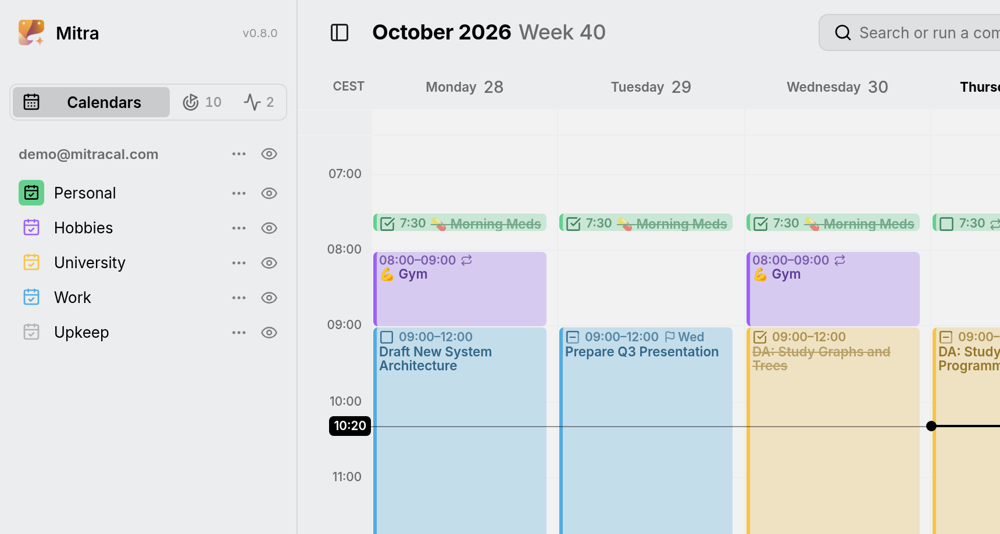

サイドバーの **カレンダー** タブの各行が1つのカレンダーです。[Mitra に保存される](integrations/mitra.md)ものと、接続したアカウントから来るものがあります。それぞれ所属する連携の見出しの下に並びます。特に断りがない限り、このページの操作はすべてのカレンダーに共通です。

<picture>
  <source media="(prefers-color-scheme: dark)" srcset="../assets/screenshots/calendars-detail-dark.webp">
  
</picture>

ほとんどの CalDAV カレンダーのように予定とタスクの両方を保持していても、カレンダーは1行です。ある項目が予定かタスクかは、項目自体が決めます。

## インポートするカレンダーを選ぶ

アカウントを接続すると、Mitra はそのカレンダーを見つけて、すべてチェックを付けた状態で一覧します。「予定 · タスク」のように、各カレンダーが何を保持するかも表示されます。保存する前に、要らないカレンダーのチェックを外してください。あとからアカウントの **⋯ → 編集** で変更できます。その後アカウントに追加されたカレンダーは、チェックなしでそこに並びます。Mitra が同期して保存するのはオンになったカレンダーだけなので、それ以外は何も消費しません。

## カレンダーの追加と削除

接続済みアカウントのカレンダーはプロバイダー側で作成・削除され、Mitra は次の同期で気付きます。Mitra カレンダーは例外です。Mitra の見出しの **⋯** メニューの **新しいカレンダー** で追加し、各カレンダーの **⋯** メニューの **カレンダーを削除** で削除します。項目が残っていれば、Mitra は **先に項目を移動…** を提案するので、うっかり失うことはありません。

## カレンダーを隠す

行の端にある目のアイコンで、そのカレンダーの項目を隠します。隠すのは見た目だけの話です。カレンダーは同期を続け、再表示すれば項目はすぐ戻ります。検索では薄く表示されつつも見つかります。

隠してもカレンダーは消音されないので、[リマインダー](reminders.md)は鳴り続けます。完全に止めるには、アカウントの **⋯ → 編集** でカレンダーをオフにします。

### 1つのカレンダーだけを表示する

他をすべて退けたいときは、カレンダーの **⋯** メニューの **このカレンダーだけを表示** を選ぶか、目のアイコンを <kbd>Alt</kbd> クリックします。他のカレンダーはすべて隠れ、表示していたカレンダーは Mitra が覚えています。同じメニュー項目は **以前表示していたカレンダーを表示** に変わり、それらを戻します。

もともと隠れていたカレンダーは隠れたままです。その間に接続したカレンダーは、退けた対象ではないため表示されます。手動でカレンダーを表示しても、残りを戻す手立ては失われません。[コマンドパレット](shortcuts.md)でカレンダー名を検索しても、同じことができます。

## 名前を変更する

カレンダー名をダブルクリックするか、**⋯** メニューの **名前を変更** を選びます。名前はあなたのものです。同期で上書きされることはありません。Mitra がプロバイダー側の名前を採用し直すのは、そちらで実際に名前が変わったときだけです。

## 色を変える

カレンダーの **⋯** メニューで色を選びます。選ぶまでは、プロバイダーが与える色が使われます。プロバイダーが色を与えない場合、Mitra はカレンダーのアドレスから色を決めるので、どのデバイスでも同じ見た目になります。項目は、自身の色を持たない限りカレンダーの色を使います。

## 並べ替える

カレンダーは Mitra が見つけた順に、アカウントは接続した順に並びます。自分で並べるには、アカウント内でカレンダーを上下にドラッグするか、見出しをドラッグしてアカウントごと全カレンダーを動かします。タッチ画面では、普通のスワイプはリストをスクロールしてしまうので、少し長押ししてからドラッグします。**⋯** メニューの **上に移動** と **下に移動** でも、ドラッグなしで同じことができます。

カレンダーが動けるのは自分のアカウント内だけです。あとからオンにしたカレンダーはアカウントの末尾に加わるので、決めた順番は乱れません。

## 新しい項目の行き先

塗りつぶされたアイコンのカレンダーがデフォルトです。別のものを選ばない限り、新しい項目はそこへ入ります。カレンダーのアイコンをクリックするとデフォルトになり、デフォルトのアイコンをもう一度クリックすると解除されます。デフォルトがないか隠れている間は、表示中の最初のカレンダーに入り、塗りつぶしアイコンもそこへ移ります。つまり、カレンダーを一番上に移すとデフォルトにもなります。同じ選択は **設定 → 項目** にもあります。

新しい項目は予定になります。Notion ビューのようにタスクしか保持できないカレンダーは例外です。新規のうちは、エディターに **予定** / **タスク** の切り替えがあります。保存後は、カレンダーがもう一方を保持できるなら、エディターの **種類** で変更できます。繰り返し項目の種類は変わりません。

## すべての項目を別のカレンダーへ移動・コピーする

カレンダーの **⋯** メニューの **項目の移動先…**、またはコマンドパレットの **… から項目を移動…** で、中のすべてを一括で別のカレンダーへ移せます。移動先を選ぶと、実行の前に、Mitra がこの移動で失われるものを示します:

```
19 of 21 entries move to Personal
✓ 15 arrive with everything they carry
! 4 lose their reminders
⨯ 2 repeat and stay here
```

報告の内容は移動先が保持できるもの次第なので、CalDAV カレンダーと Notion ビューでは違う内容になります。移動先がまったく受け取れない項目(Notion へ移そうとした繰り返し項目など)はその場に残り、名前で列挙されます。

**代わりにコピー** を使うと、元の項目を残したまま、移動先に各項目のコピーを置きます。購読のような読み取り専用カレンダーから項目を取り出す方法も同じです。読み取り専用カレンダーからはコピーできても、移動はできません。

移動する項目どうしのリンクも一緒に付いていきます。すべてのページに新しい ID を割り当てる Notion に移す場合でも同じです。残った項目からのリンクは、移動した項目を指し続けます。

移動先が項目を繰り返せない場合、Mitra は繰り返し項目の扱いを尋ねます: ここに残すか、今後1年分の各回を1つずつ、もはや繰り返さない個別の項目に展開するかです。尋ねずに展開することは決してありません。

> [!NOTE]
> Mitra は先にコピーし、コピーが届いてから元を削除します。2つのプロバイダー間で取り消しはできないため、この順序が安全網です。途中で問題が起きても、項目が両方のカレンダーに残ることはあっても、消えることはありません。コピーに失敗した場合は移動全体が止まり、何も削除されません。

### 1つの項目を移動する

1つの項目を移すには、それを開き、エディターで別のカレンダーを選びます。繰り返し項目の場合は、どれを指すかを Mitra が尋ねます。**この項目** はその1回だけを動かし、**これ以降の項目** はその回と以降を動かして以前の回を残し、**すべての項目** は繰り返しルールごとシリーズ全体を動かします。

## 読み取り専用カレンダー

Mitra から変更できないカレンダーがあります: [カレンダー購読](integrations/subscriptions.md)と、閲覧専用で共有されたカレンダーです。Mitra はそれを自分で検知し、読み取り専用と印を付けます。

その項目を開いて、読み・選択・コピーはできますが、そこで項目の作成・変更・移動・削除はできず、項目を移し込むこともできません。名前の変更・色の変更・並べ替え・非表示は、あなた自身の見え方の話なので、そのまま使えます。あとから所有者が変更を許可すれば、Mitra は次の同期で気付きます。

## カレンダーを再インポートする

カレンダーまたはアカウント全体の **⋯** メニューにある **項目を再インポート** は、Mitra が持つ項目のコピーを捨て、プロバイダーからインポートし直します。プロバイダー側は何も変わりません。[同期](integrations/README.md#how-syncing-works)は自動で行われるので、日常では不要なはずです。更新後にカレンダーの表示がおかしい、古く見えるというときのためのものです。Mitra カレンダーにはありません。インポート元のプロバイダーがないからです。
