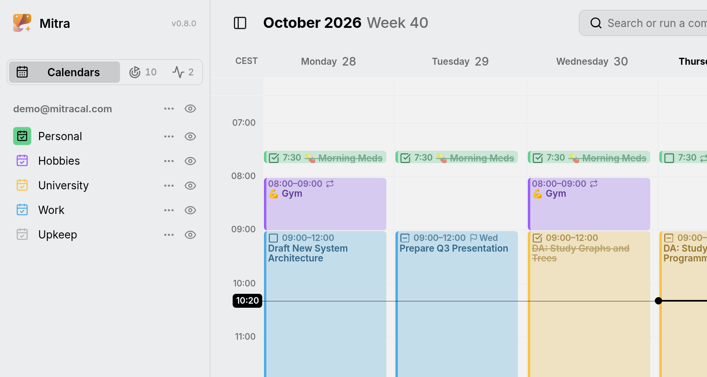

사이드바의 **캘린더** 탭에 있는 각 행이 하나의 캘린더입니다. 일부는 [Mitra에 저장](integrations/mitra.md)되고, 일부는 연결한 계정에서 옵니다. 캘린더는 자신이 속한 연동의 제목 아래에 놓이며, 따로 언급하지 않는 한 이 페이지의 내용은 모든 캘린더에 똑같이 적용됩니다.

<picture>
  <source media="(prefers-color-scheme: dark)" srcset="../assets/screenshots/calendars-detail-dark.webp">
  
</picture>

대부분의 CalDAV 캘린더처럼 일정과 작업을 모두 담고 있어도 캘린더는 한 행입니다. 어떤 항목이 일정인지 작업인지는 항목 자체가 정합니다.

## 가져올 캘린더 고르기

계정을 연결하면 Mitra가 그 계정의 캘린더를 찾아 모두 체크된 상태로 보여 주고, 각 캘린더에 "일정 · 작업"처럼 무엇을 담고 있는지 표시합니다. 저장하기 전에 원하지 않는 캘린더의 체크를 해제하세요. 나중에 계정의 **⋯ → 편집**에서 다시 바꿀 수 있으며, 그 사이 계정에 새로 추가된 캘린더는 체크되지 않은 채로 기다리고 있습니다. Mitra는 켜져 있는 캘린더만 동기화하고 저장하므로, 나머지는 아무 부담도 주지 않습니다.

## 캘린더 추가 또는 삭제

연결한 계정의 캘린더는 해당 서비스에서 만들고 삭제하며, Mitra는 다음 동기화 때 이를 알아챕니다. Mitra 캘린더는 예외입니다. Mitra 제목의 **⋯** 메뉴에서 **새 캘린더**로 추가하고, 캘린더 자체의 **⋯** 메뉴에서 **캘린더 삭제**로 삭제합니다. 캘린더에 아직 항목이 있으면 Mitra가 **먼저 항목 옮기기…** 메뉴를 제안하므로 실수로 잃어버리는 것은 없습니다.

## 캘린더 숨기기

행 끝에 있는 눈 아이콘을 누르면 그 캘린더의 항목이 숨겨집니다. 숨기기는 보이는 것에만 영향을 줍니다. 캘린더는 계속 동기화되고, 다시 표시하면 항목이 바로 돌아옵니다. 검색으로는 여전히 흐리게 표시된 항목을 찾을 수 있습니다.

숨긴다고 캘린더가 무음이 되지는 않으므로 [알림](reminders.md)은 그대로 울립니다. 캘린더를 완전히 멈추려면 계정의 **⋯ → 편집**에서 끄세요.

### 캘린더 하나만 표시

다른 캘린더를 모두 치우려면 캘린더의 **⋯** 메뉴에서 **이 캘린더만 표시**를 선택하거나, <kbd>Alt</kbd> 키를 누른 채 눈 아이콘을 클릭하세요. 다른 캘린더는 모두 숨겨지고, Mitra는 어떤 캘린더가 표시되어 있었는지 기억합니다. 그러면 같은 메뉴 항목이 **이전에 보이던 캘린더 표시**로 바뀌며, 누르면 그 캘린더들이 돌아옵니다.

이전부터 숨겨져 있던 캘린더는 계속 숨겨져 있습니다. 그 사이에 연결한 캘린더는 치워 둔 대상이 아니었으므로 표시됩니다. 캘린더 하나를 직접 표시해도 나머지로 돌아가는 길은 사라지지 않습니다. 두 가지 모두 [명령 팔레트](shortcuts.md)에서 캘린더 이름으로 검색해서 할 수도 있습니다.

## 이름 바꾸기

캘린더 이름을 더블클릭하거나 **⋯** 메뉴에서 **이름 변경**을 선택하세요. 이름은 직접 정한 그대로 유지되며, 동기화가 덮어쓰지 않습니다. 해당 서비스에서 캘린더 이름이 실제로 바뀌었을 때만 Mitra가 그 이름을 다시 가져옵니다.

## 색 바꾸기

캘린더의 **⋯** 메뉴에서 색을 고르세요. 고르기 전까지 캘린더는 서비스가 지정한 색을 씁니다. 서비스가 색을 지정하지 않으면 Mitra가 캘린더 주소를 바탕으로 색을 골라, 어느 기기에서든 같은 색으로 보이게 합니다. 항목은 자체 색이 없으면 캘린더의 색을 따릅니다.

## 순서 바꾸기

캘린더는 처음에 Mitra가 찾은 순서대로, 계정은 연결한 순서대로 놓입니다. 직접 정리하려면 캘린더를 계정 안에서 위아래로 끌거나, 계정 제목을 끌어 그 계정의 캘린더를 모두 함께 옮기세요. 터치스크린에서는 그냥 밀면 목록이 스크롤되므로, 잠시 길게 누른 뒤에 끄세요. **⋯** 메뉴의 **위로 이동**과 **아래로 이동**으로 끌지 않고도 같은 일을 할 수 있습니다.

캘린더는 자신이 속한 계정 안에서만 움직입니다. 나중에 켠 캘린더는 계정의 맨 끝에 붙으므로 정해 둔 순서를 흐트러뜨리지 않습니다.

## 새 항목이 들어가는 곳

아이콘이 채워진 캘린더가 기본 캘린더입니다. 다른 캘린더를 고르지 않으면 새 항목이 여기에 들어갑니다. 캘린더의 아이콘을 클릭하면 기본 캘린더가 되고, 기본 캘린더의 아이콘을 다시 클릭하면 해제됩니다. 기본 캘린더가 없거나 숨겨져 있으면 새 항목은 표시 중인 첫 번째 캘린더로 들어가고 채워진 아이콘도 그리로 옮겨 가므로, 캘린더를 맨 위로 옮기면 그 캘린더가 기본 캘린더가 되기도 합니다. 같은 설정은 **설정 → 항목**에도 있습니다.

새 항목은 일정입니다. 다만 Notion 보기처럼 작업만 담을 수 있는 캘린더에서는 작업이 됩니다. 새 항목인 동안에는 편집기에 **일정** / **작업** 전환이 있습니다. 저장한 뒤에는 캘린더가 다른 종류도 담을 수 있다면 편집기의 **유형**에서 바꿀 수 있습니다. 반복 항목은 유형이 바뀌지 않습니다.

## 모든 항목을 다른 캘린더로 이동 또는 복사

캘린더 **⋯** 메뉴의 **다른 캘린더로 항목 옮기기…** 또는 명령 팔레트의 **…에서 항목 옮기기…** 메뉴를 사용하면 캘린더의 모든 항목을 다른 캘린더로 한 번에 옮길 수 있습니다. 옮길 곳을 고르면, 실제로 무언가 일어나기 전에 Mitra가 이동으로 무엇을 잃게 되는지 보여 줍니다.

```
19 of 21 entries move to Personal
✓ 15 arrive with everything they carry
! 4 lose their reminders
⨯ 2 repeat and stay here
```

보고 내용은 대상 캘린더가 무엇을 담을 수 있는지에 따라 달라지므로, CalDAV 캘린더로 옮길 때와 Notion 보기로 옮길 때 다르게 표시됩니다. Notion으로 가는 반복 항목처럼 대상 캘린더가 아예 받을 수 없는 항목은 제자리에 남고 이름과 함께 나열됩니다.

**대신 복사**는 원본을 그대로 두고 대상 캘린더에 각 항목의 사본을 만듭니다. 캘린더 구독처럼 읽기 전용인 캘린더에서 항목을 꺼내는 방법도 이것입니다. 읽기 전용 캘린더는 복사는 되지만 항목을 옮겨 낼 수는 없습니다.

옮기는 항목 사이의 링크는 함께 따라갑니다. 모든 페이지에 새 ID를 부여하는 Notion으로 옮길 때도 마찬가지입니다. 남아 있는 항목에서 걸린 링크는 옮겨 간 항목을 계속 가리킵니다.

대상 캘린더가 반복을 지원하지 않으면 Mitra가 반복 항목을 어떻게 할지 묻습니다. 여기에 그대로 두거나, 앞으로 1년 동안의 회차마다 하나씩 더 이상 반복되지 않는 개별 항목으로 풀어 놓을 수 있습니다. 묻지 않고 풀어 놓는 일은 절대 없습니다.

> [!NOTE]
> Mitra는 먼저 복사하고, 사본이 모두 도착한 뒤에야 원본을 삭제합니다. 두 서비스에 걸친 작업은 실행 취소할 수 없으므로 이 순서가 안전장치입니다. 문제가 생기면 같은 항목이 두 캘린더에 모두 남을 수는 있어도 사라지는 일은 없습니다. 복사가 실패하면 이동 전체가 멈추고 아무것도 삭제되지 않습니다.

### 항목 하나 옮기기

항목 하나를 옮기려면 항목을 열고 편집기에서 다른 캘린더를 고르세요. 반복 항목이면 Mitra가 어느 회차를 뜻하는지 묻습니다. **이 항목**은 해당 회차 하나만 옮기고, **이 항목과 이후 항목**은 시리즈의 나머지를 옮기고 이전 회차는 남겨 두며, **모든 항목**은 반복 규칙까지 포함해 시리즈 전체를 옮깁니다.

## 읽기 전용 캘린더

일부 캘린더는 Mitra에서 바꿀 수 없습니다. [캘린더 구독](integrations/subscriptions.md)과, 다른 사람이 보기 전용으로 공유한 캘린더가 그렇습니다. Mitra는 이를 스스로 알아채고 읽기 전용으로 표시합니다.

이런 캘린더의 항목을 열어 읽고, 안의 내용을 모두 선택하고 복사할 수 있지만, 그곳에서 항목을 만들거나 바꾸거나 옮기거나 삭제할 수는 없으며 항목을 그 안으로 옮길 수도 없습니다. 이름 바꾸기, 색 바꾸기, 순서 바꾸기, 숨기기는 캘린더를 보는 방식에 관한 것이므로 그대로 쓸 수 있습니다. 나중에 소유자가 변경을 허락하면 Mitra가 다음 동기화 때 알아챕니다.

## 캘린더 다시 가져오기

캘린더나 계정 전체의 **⋯** 메뉴에 있는 **항목 다시 가져오기**는 Mitra가 가진 항목 사본을 버리고 서비스에서 다시 가져옵니다. 서비스 쪽에서는 아무것도 바뀌지 않습니다. [동기화](integrations/README.md#how-syncing-works)는 알아서 이루어지므로 평소에는 필요하지 않습니다. 업데이트 후 캘린더가 이상하거나 오래된 내용으로 보일 때를 위한 기능입니다. Mitra 캘린더에는 가져올 서비스가 없으므로 이 기능이 없습니다.
