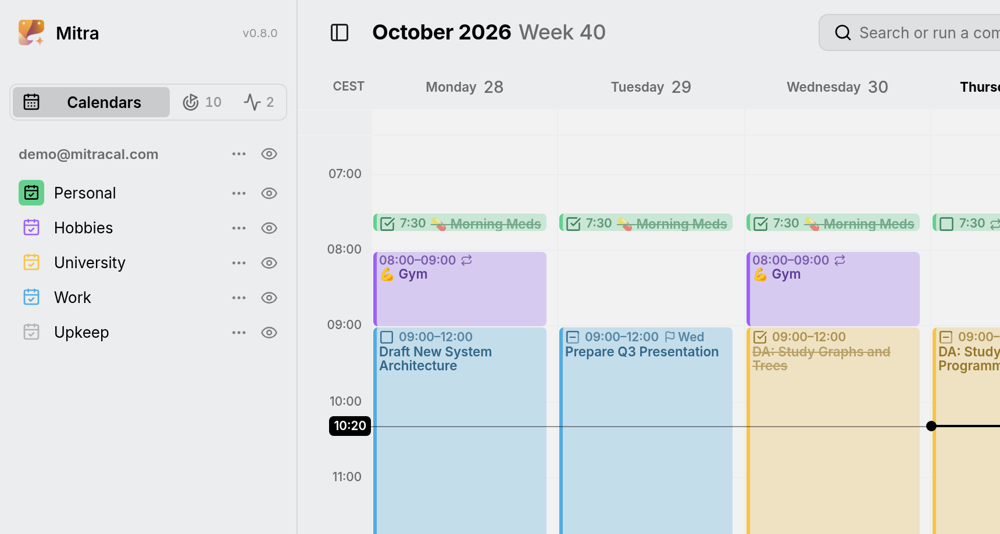

Mỗi dòng trong tab **Lịch** của thanh bên là một lịch. Một số được [lưu trong Mitra](integrations/mitra.md), số khác đến từ một tài khoản bạn đã kết nối. Chúng nằm dưới tiêu đề của tích hợp mà chúng thuộc về, và mọi thứ trên trang này hoạt động giống nhau cho tất cả, trừ khi có ghi chú khác.

<picture>
  <source media="(prefers-color-scheme: dark)" srcset="../assets/screenshots/calendars-detail-dark.webp">
  
</picture>

Một lịch là một dòng, kể cả khi nó chứa cả sự kiện lẫn công việc, như hầu hết các lịch CalDAV. Một mục là sự kiện hay công việc là do chính mục đó quyết định.

## Chọn những gì được nhập

Khi bạn kết nối một tài khoản, Mitra tìm các lịch của nó và liệt kê chúng, tất cả đều được chọn, mỗi lịch cho biết nó chứa gì, chẳng hạn “Sự kiện · Công việc”. Hãy bỏ chọn những lịch bạn không muốn trước khi lưu. Bạn có thể đổi ý sau trong **⋯ → Sửa** của tài khoản, nơi các lịch được thêm vào tài khoản kể từ đó đang chờ ở trạng thái chưa chọn. Mitra chỉ đồng bộ và lưu các lịch đang bật, nên những lịch còn lại không tốn gì cả.

## Thêm hoặc xóa một lịch

Một lịch từ tài khoản đã kết nối được tạo và xóa tại nhà cung cấp, và Mitra sẽ nhận ra ở lần đồng bộ tiếp theo. Lịch Mitra là ngoại lệ: thêm một lịch bằng **Lịch mới** trong menu **⋯** trên tiêu đề Mitra, và xóa một lịch bằng **Xóa lịch** trong menu **⋯** của chính nó. Nếu lịch vẫn còn mục, Mitra đề nghị **Di chuyển các mục trước…**, để không có gì bị mất do nhầm lẫn.

## Ẩn một lịch

Biểu tượng con mắt ở cuối dòng sẽ ẩn các mục của lịch đó. Ẩn chỉ ảnh hưởng đến những gì bạn nhìn thấy: lịch vẫn tiếp tục đồng bộ, và các mục của nó hiện lại ngay khi bạn hiện lịch trở lại. Tìm kiếm vẫn thấy chúng, ở dạng mờ.

Ẩn không tắt tiếng một lịch, nên [lời nhắc](reminders.md) của nó vẫn kêu. Để dừng hẳn một lịch, hãy tắt nó trong **⋯ → Sửa** của tài khoản.

### Chỉ hiện một lịch

Để dọn sạch mọi thứ khác, hãy chọn **Chỉ hiện lịch này** trong menu **⋯** của một lịch, hoặc <kbd>Alt</kbd>-nhấp vào biểu tượng con mắt của nó. Mọi lịch khác sẽ ẩn, và Mitra nhớ những lịch bạn đang hiện. Khi đó mục menu này đổi thành **Hiện các lịch đã hiện trước đó** và đưa chúng trở lại.

Những lịch đã ẩn từ trước vẫn ở trạng thái ẩn. Một lịch bạn kết nối trong lúc đó sẽ hiện, vì nó không nằm trong số những lịch bạn đã cất đi. Hiện một lịch bằng tay cũng không làm bạn mất đường quay lại các lịch còn lại. Bạn cũng có thể làm cả hai việc này từ [bảng lệnh](shortcuts.md) bằng cách tìm tên của một lịch.

## Đổi tên

Nhấp đúp vào tên một lịch, hoặc chọn **Đổi tên** trong menu **⋯** của nó. Tên là của bạn: đồng bộ không bao giờ ghi đè lên nó. Mitra chỉ lấy lại tên của nhà cung cấp khi lịch thực sự được đổi tên ở đó.

## Đổi màu

Chọn một màu trong menu **⋯** của lịch. Cho đến khi bạn chọn, lịch dùng màu mà nhà cung cấp đặt cho nó. Nếu nhà cung cấp không đặt màu nào, Mitra chọn một màu dựa trên địa chỉ của lịch, nên nó trông giống nhau trên mọi thiết bị. Các mục lấy màu của lịch trừ khi chúng có màu riêng.

## Sắp xếp lại

Các lịch bắt đầu theo thứ tự Mitra tìm thấy chúng, và các tài khoản theo thứ tự bạn kết nối. Để tự sắp xếp, hãy kéo một lịch lên hoặc xuống trong tài khoản của nó, hoặc kéo một tài khoản bằng tiêu đề để di chuyển nó cùng tất cả lịch của nó. Trên màn hình cảm ứng, hãy nhấn và giữ một lúc trước khi kéo, vì vuốt thông thường sẽ cuộn danh sách. **Lên trên** và **Xuống dưới** trong menu **⋯** làm việc tương tự mà không cần kéo.

Một lịch chỉ di chuyển trong tài khoản của nó. Một lịch bạn bật sau đó sẽ nằm ở cuối tài khoản của nó, nên không làm rối thứ tự bạn đã đặt.

## Nơi các mục mới được lưu

Lịch có biểu tượng được tô đầy là lịch mặc định của bạn: các mục mới được lưu vào đó trừ khi bạn chọn lịch khác. Nhấp vào biểu tượng của một lịch để đặt nó làm mặc định, và nhấp lại vào biểu tượng của lịch mặc định để bỏ. Khi không có lịch mặc định, hoặc khi lịch mặc định của bạn đang ẩn, các mục mới được lưu vào lịch đầu tiên đang hiện, và biểu tượng tô đầy chuyển sang đó, nên đưa một lịch lên đầu cũng biến nó thành lịch mặc định. Lựa chọn này cũng có trong **Cài đặt → Mục**.

Các mục mới là sự kiện, trừ khi lịch chỉ chứa được công việc, như một chế độ xem Notion. Khi một mục còn mới, trình chỉnh sửa của nó có công tắc **Sự kiện** / **Công việc**. Sau khi đã lưu, hãy đổi bằng **Loại** trong trình chỉnh sửa, miễn là lịch của nó chứa được loại còn lại. Một mục lặp lại giữ nguyên loại của nó.

## Di chuyển hoặc sao chép mọi mục sang lịch khác

**Di chuyển các mục đến…** trong menu **⋯** của một lịch, hoặc **Di chuyển các mục từ …** trong bảng lệnh, di chuyển mọi thứ trong đó sang một lịch khác cùng một lúc. Chọn nơi chúng sẽ đến, và trước khi có gì xảy ra, Mitra cho bạn thấy việc di chuyển sẽ phải đánh đổi gì:

```
19 of 21 entries move to Personal
✓ 15 arrive with everything they carry
! 4 lose their reminders
⨯ 2 repeat and stay here
```

Báo cáo phụ thuộc vào những gì nơi đến chứa được, nên với một lịch CalDAV nó khác với một chế độ xem Notion. Những mục nơi đến hoàn toàn không nhận được, như một mục lặp lại chuyển sang Notion, sẽ ở lại chỗ cũ và được liệt kê theo tên.

**Sao chép thay vì di chuyển** giữ nguyên bản gốc và đặt một bản sao của từng mục vào nơi đến. Đó cũng là cách bạn lấy mục ra khỏi một lịch chỉ đọc, chẳng hạn một lịch đăng ký: có thể sao chép từ đó, nhưng không thể di chuyển ra khỏi nó.

Các liên kết giữa những mục bạn di chuyển được đi theo, kể cả sang Notion, nơi gán cho mỗi trang một ID mới. Các liên kết từ những mục ở lại vẫn trỏ đến những mục đã được di chuyển.

Nếu nơi đến không thể lặp lại các mục, Mitra hỏi bạn muốn làm gì với những mục lặp lại: để chúng ở đây, hoặc tách chúng thành các mục riêng lẻ, mỗi lần lặp trong năm tới thành một mục không còn lặp lại. Mitra không bao giờ tách mà không hỏi.

> [!NOTE]
> Mitra sao chép trước và chỉ xóa bản gốc sau khi các bản sao đã đến nơi. Không thể hoàn tác giữa hai nhà cung cấp, nên thứ tự này là lưới an toàn: nếu có gì trục trặc, bạn có thể có một mục ở cả hai lịch, nhưng không bao giờ bị mất mục nào. Nếu việc sao chép thất bại, toàn bộ việc di chuyển dừng lại và không có gì bị xóa.

### Di chuyển một mục

Để di chuyển một mục, hãy mở nó và chọn một lịch khác trong trình chỉnh sửa. Với một mục lặp lại, Mitra hỏi bạn muốn nói đến những lần nào. **Mục này** chỉ di chuyển riêng lần lặp đó, **Mục này và các mục sau** di chuyển phần còn lại của chuỗi lặp lại và để các lần lặp trước đó ở lại, và **Tất cả các mục** di chuyển cả chuỗi, kèm quy tắc lặp lại.

## Lịch chỉ đọc

Một số lịch không thể thay đổi từ Mitra: [lịch đăng ký](integrations/subscriptions.md), và các lịch ai đó chia sẻ với bạn chỉ để xem. Mitra tự nhận ra điều này và đánh dấu chúng là chỉ đọc.

Bạn có thể mở các mục của chúng và đọc, chọn, sao chép mọi thứ trong đó, nhưng không thể tạo, thay đổi, di chuyển hay xóa mục ở đó, và cũng không thể di chuyển một mục vào đó. Đổi tên, đổi màu, sắp xếp lại và ẩn vẫn dùng được, vì đó là cách nhìn của riêng bạn về lịch. Nếu sau này chủ sở hữu cho phép bạn thay đổi, Mitra sẽ nhận ra ở lần đồng bộ tiếp theo.

## Nhập lại một lịch

**Nhập lại các mục**, trong menu **⋯** của một lịch hoặc của cả một tài khoản, bỏ bản sao các mục của Mitra và nhập chúng lại từ nhà cung cấp. Không có gì thay đổi tại nhà cung cấp. Bạn không cần đến nó hằng ngày, vì [đồng bộ](integrations/README.md#how-syncing-works) tự lo liệu; nó có đó cho lúc một lịch trông sai hoặc lỗi thời sau một lần cập nhật. Lịch Mitra không có tùy chọn này, vì không có nhà cung cấp nào để nhập.
