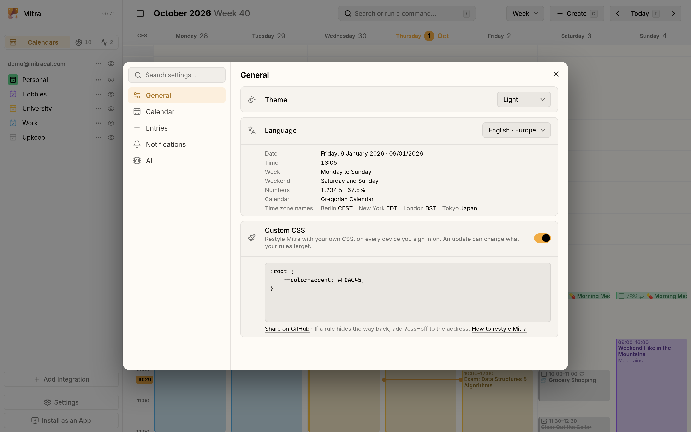

Giao diện của Mitra là CSS thuần, và bạn có thể thêm CSS của riêng mình lên trên. Ẩn những gì bạn không bao giờ dùng, viền quanh ngày hôm nay, hoặc đưa màu sắc của bạn cho cả máy chủ. Có hai chỗ để làm việc này: **Cài đặt → Chung → CSS tùy chỉnh** cho riêng bạn, và ở nơi mọi người đăng nhập, **Cài đặt → Quản trị → CSS tùy chỉnh cho mọi người** cho mọi người trên máy chủ.

<picture>
  <source media="(prefers-color-scheme: dark)" srcset="../assets/screenshots/custom-css-dark.webp">
  
</picture>

> [!WARNING]
> Cho đến Mitra 1.0, bất kỳ bản cập nhật nào cũng có thể thay đổi các phần tử, thuộc tính và biến mà quy tắc của bạn nhắm tới. Một quy tắc chạy tốt hôm nay có thể ngừng hoạt động sau một bản cập nhật, hoặc bắt đầu che mất thứ gì đó. Hãy giữ bảng định kiểu của bạn ngắn gọn, và xem lại Mitra sau khi cập nhật.

## Bảng định kiểu của riêng bạn

Mở **Cài đặt → Chung** và gõ CSS vào ô dưới **CSS tùy chỉnh**. Mitra áp dụng nó ngay khi bạn gõ, lưu lại một lát sau khi bạn ngừng, và nó theo tài khoản của bạn đến mọi thiết bị và trình duyệt bạn đăng nhập.

Công tắc bên cạnh **CSS tùy chỉnh** tắt bảng định kiểu của bạn mà không làm mất nó, và [bảng lệnh](shortcuts.md) có sẵn **CSS tùy chỉnh: Tắt** và **CSS tùy chỉnh: Bật**.

`@import` bị loại bỏ khi bảng định kiểu của bạn được lưu: hãy dán cả bảng định kiểu thay vì liên kết đến một bảng.

## Bảng định kiểu của máy chủ

Ở nơi mọi người đăng nhập, quản trị viên có thể đổi giao diện Mitra cho mọi người trên máy chủ: mở **Cài đặt → Quản trị** và gõ CSS vào ô dưới **CSS tùy chỉnh cho mọi người**. Bạn thấy nó ngay khi gõ, còn những người khác thấy từ lần tới họ tải Mitra. Công tắc của nó tắt nó cho mọi người mà không làm mất nó. Người đầu tiên đăng nhập vào một máy chủ là quản trị viên của máy chủ đó. Khi không có đăng nhập, bảng định kiểu của riêng bạn đã đến với mọi người dùng Mitra, nên nó là bảng duy nhất.

Nó hợp với những gì làm nên máy chủ của bạn, như màu sắc, phông chữ hay [cái tên](configuration.md#name-your-instance) nó đã mang. Bảng định kiểu riêng của mỗi người được áp dụng sau nó, nên bảng của họ thắng ở chỗ cả hai cùng đặt một thứ.

## Quy tắc của bạn thắng

Các quy tắc của chính Mitra nằm trong một cascade layer tên là `mitra`, còn quy tắc của bạn thì không, nên một quy tắc của bạn thắng quy tắc của Mitra bất kể bộ chọn của nó. Bạn không cần `!important`. Vài khai báo `!important` của chính Mitra vẫn đứng trên, vì các layer xếp hạng chúng theo chiều ngược lại: chúng giữ cho bố cục đứng vững.

Để bỏ đi một thứ Mitra đặt, thay vì sơn đè lên, hãy đặt thuộc tính đó thành `revert`. Quy tắc này bỏ nền của các ngày trong chế độ xem tháng:

```css
mitra-weeks mitra-day {
	background: revert;
}
```

## Ví dụ

### Ẩn các ngày ngoài tháng

```css
mitra-weeks [data-outside] {
	visibility: hidden;
}
```

Trong [chế độ xem tháng](views/month.md), quy tắc này ẩn các ngày trước và sau tháng đang hiện, cả ngày tháng lẫn nền của chúng. Các mục trên những ngày đó vẫn còn. `visibility` giữ nguyên lưới, còn `display: none` sẽ làm lưới vỡ ra. Phóng to để các ngày của tháng có thêm chỗ.

### Viền quanh ngày hôm nay

```css
mitra-weeks mitra-day[today] {
	outline: 2px solid var(--color-accent);
	outline-offset: -2px;
}
```

Dùng `outline` thay vì `border`: viền sẽ làm ngày to ra và xô lệch lưới.

### Màu sắc của riêng bạn

```css
:root {
	--color-accent: light-dark(#2e7d32, #81c784);
	--border-radius: 8px;
}
```

`light-dark()` nhận màu cho giao diện sáng, rồi màu cho giao diện tối. Mọi thứ Mitra tô màu từ các biến này đều theo, kể cả thanh tiêu đề của [ứng dụng đã cài](install-app.md):

| Biến | Tô màu cho |
| --- | --- |
| `--color-accent` | Hôm nay, thứ đang được chọn, vòng tiêu điểm và các nút chính |
| `--color-background-seed` | Nền phía sau mọi thứ; các hộp thoại lấy nền của chúng từ đây |
| `--color-surface` | Các ngày trong chế độ xem, và những gì nằm trên nền, như bảng lệnh |
| `--color-text` | Chữ |
| `--color-text-muted` | Chữ phụ, như gợi ý và giờ |
| `--color-error` | Lỗi và cảnh báo |
| `--border-radius` | Góc của nút, mục và hầu hết các điều khiển |
| `--font-family` | Kiểu chữ của văn bản |

## Tìm thứ cần nhắm tới

Công cụ dành cho nhà phát triển của trình duyệt cho thấy những gì có trên trang: nhấp chuột phải vào một thứ và chọn **Inspect**. Các phần tử của chính Mitra mang tên `mitra-…`, như các chế độ xem `mitra-days` (tuần), `mitra-weeks` (tháng), `mitra-months` (năm), `mitra-timeline` và `mitra-table`, một ngày là `mitra-day`, một mục là `mitra-entry-segment` và thanh bên là `mitra-sidebar`. Các thuộc tính nêu sự thật, như `today`, `data-outside` và `data-date`.

Nút, trường nhập, công tắc, menu và các điều khiển khác giữ phần bên trong cho riêng chúng. Hãy chạm tới chúng qua các part của chúng, như `mitra-switch::part(switch)`, và qua các biến `--mitra-…` chúng đọc. Nếu cần chạm sâu hơn, hãy đề nghị một part trong một [issue](https://github.com/a11delavar/mitra/issues).

## Những gì nên để yên

Vài thứ giữ cho Mitra đứng vững, và thay đổi chúng sẽ làm hỏng nó:

- `display` hoặc `position` trên `mitra-day`, hoặc trên `.entries` bên trong một chế độ xem: chúng nằm trên một lưới mà cả chế độ xem dùng chung, và chế độ xem tuần sẽ rất chậm nếu thiếu nó.
- Các biến bắt đầu bằng `--_`: chúng thay đổi ở mỗi khung hình khi thu phóng, và đặt chúng sẽ cản việc thu phóng.
- Kích thước của một mục: tiêu đề của mục chọn bố cục theo độ rộng của nó, nên đặt kích thước mục từ bên ngoài có thể làm bố cục đổi theo.
- `all: unset` cũng bỏ luôn việc ẩn, nên hãy nêu lại `[hidden] { display: none }` bên cạnh nó.

## Khi một quy tắc che mất đường quay lại

Thêm `?css=off` vào địa chỉ, như `https://mitra.example.com/?css=off`. Khi đó Mitra tải một lần mà không có bảng định kiểu nào, để bạn có thể mở **Cài đặt** và sửa bảng của mình. Quản trị viên sửa bảng cho mọi người theo cùng cách.

## Trước khi bạn dán

Một bảng định kiểu không chạy mã, nhưng nó có thể tải các địa chỉ, và một bảng được viết cho mục đích đó có thể gửi những gì trên màn hình của bạn đến các địa chỉ ấy. Chỉ dán CSS mà bạn hiểu. Bảng định kiểu của riêng bạn chỉ đến với bạn; bảng của máy chủ đến với mọi người trên đó.

## Chia sẻ bảng của bạn

Dưới ô nhập, **Chia sẻ trên GitHub** mở một thảo luận mới trong mục [Custom CSS](https://github.com/a11delavar/mitra/discussions/categories/custom-css) với bảng định kiểu của bạn có sẵn trong đó. Hãy nói nó làm gì, thêm ảnh chụp màn hình nếu nó thay đổi thứ gì đó nhìn thấy được, rồi đăng lên. Một bảng định kiểu quá dài cho đường liên kết sẽ được sao chép vào bộ nhớ tạm thay vào đó, để bạn dán vào thảo luận. Mục này cũng là nơi tìm các bảng định kiểu người khác đã chia sẻ: hãy đọc chúng trước khi dán.
