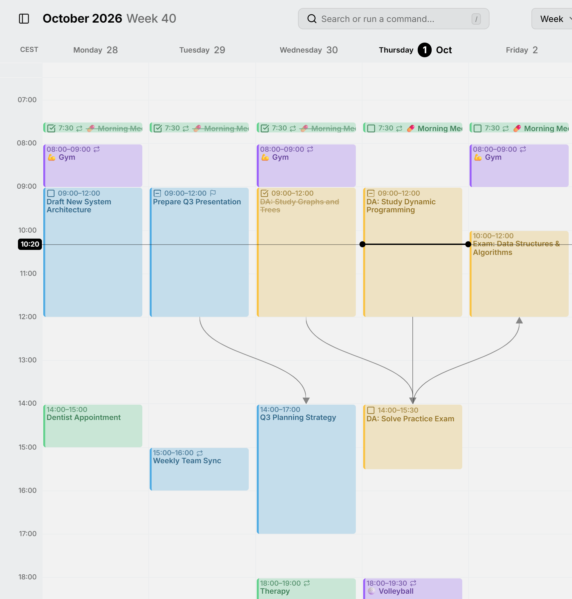

تعني **الاعتمادية** أن العنصر لا يمكن أن يبدأ قبل أن ينتهي عنصر آخر: المسودة قبل المراجعة، والمراجعة قبل الإصدار. ويُقال عن العنصر الذي ينتظر إنه «بانتظار» العنصر الآخر.

<picture>
  <source media="(prefers-color-scheme: dark)" srcset="../assets/screenshots/week-detail-dark.webp">
  
</picture>

## إضافة اعتمادية

افتح العنصر الذي ينتظر، وانقر على **＋** في صف **بانتظار**، واكتب جزءًا من عنوان العنصر الذي يجب أن ينتهي أولًا. يشمل البحث كل تقويماتك، بما فيها المخفية، فيمكن أن ينتظر العنصر عنصرًا في تقويم آخر أو حساب آخر. وتظهر العناصر الموجودة في التقويمات المخفية باهتة. بعد ذلك يُدرج العنصر الآخر هذا العنصر ضمن **يعيق**، وهو صف يكتفي بعرض الروابط: فأنت تضيف الرابط دائمًا من العنصر الذي ينتظر.

في المحرر، انقر على عنوان عنصر مرتبط لفتحه، أو انقر على **✕** بجانبه لإزالة الرابط، من أي من الطرفين. ويرفض Mitra أي رابط يشكّل حلقة مغلقة، كعنصرين ينتظر كل منهما الآخر.

وباستخدام الماوس، يمكنك أيضًا رسم اعتمادية في عرض الأسبوع أو عرض الشهر. أشر إلى العنصر الذي يأتي أولًا، وأمسك الخط القصير في نهايته، وأفلته على العنصر الذي ينبغي أن ينتظره. وأثناء السحب، يتحول الخط إلى اللون الأحمر فوق أي عنصر يبدأ مبكرًا أكثر من اللازم.

## الخطوط في التقويم

يرسم عرض الأسبوع وعرض الشهر والمخطط الزمني خطًا من نهاية كل عنصر إلى بداية العنصر الذي ينتظره. أشر إلى عنصر لإبراز خطوطه. ويمكن إخفاء خطوط كل عرض من **الإعدادات ← التقويم**، عبر **خطوط الربط في عرض الأسبوع** و**خطوط الربط في عرض الشهر** و**خطوط الربط في المخطط الزمني**.

## الاعتماديات المكسورة

عندما يبدأ عنصر قبل أن ينتهي العنصر الذي ينتظره، تكون الاعتمادية مكسورة. فيتحول خطها في التقويم إلى اللون الأحمر، ويظهر اسم العنصر في الطرف الآخر باللون الأحمر في صفَّي **بانتظار** و**يعيق** في المحرر. أعد أيًّا من العنصرين إلى الترتيب الصحيح، فيختفي التحذير.

## نقل سلسلة

عندما تسحب عنصرًا، أو أحد طرفيه، وتعتمد عليه عناصر أخرى، يسألك Mitra: **نقل العناصر المعتمدة عليه أيضًا؟** والخيارات التي تنقل عناصر أخرى تذكر عددها:

- **هذا العنصر فقط** ينقل هذا العنصر ويترك الباقي في مكانه.
- **الحفاظ على تسلسل العناصر** ينقل العناصر الأخرى بالقدر اللازم فقط لإبقائها مرتبة. فالعناصر التي تليه تنتقل إلى وقت لاحق، وإذا نقلت هذا العنصر إلى وقت أبكر، تنتقل العناصر التي تسبقه إلى وقت أبكر. أما العنصر الذي لديه متسع كافٍ من الوقت فيبقى في مكانه.
- **نقلها كلها بالمقدار نفسه** ينقل السلسلة كلها، قبل هذا العنصر وبعده، بالمقدار الزمني نفسه، فتبقى الفواصل بينها كما هي.

لا يسأل Mitra إلا عندما تؤدي الخيارات إلى نتائج مختلفة. وتغيير الأوقات في المحرر لا ينقل أبدًا عناصر أخرى.

عندما ينتقل عنصر كجزء من سلسلة، تنتقل معه مهامه الفرعية. أما العناصر المتكررة والمهام غير المجدولة في السلسلة فلا تُنقل أبدًا.

> [!TIP]
> اضغط مع الاستمرار على <kbd>Ctrl</kbd> (<kbd>⌘</kbd> على Mac) أثناء الإفلات لتتخطى السؤال وتنقل ذلك العنصر وحده. راجع [اختصارات لوحة المفاتيح](shortcuts.md).

## التقويمات التي تدعم ذلك

يُحفظ الرابط مع العنصر الذي ينتظر، في تقويم ذلك العنصر نفسه. وتحفظ [خوادم التقويم](integrations/caldav.md) و[تقويم Apple](integrations/apple.md) و[تقويمات Mitra](integrations/mitra.md) أي رابط، وفي خادم التقويم يُكتب الرابط بتنسيق التقويم القياسي، فتستطيع قراءته التطبيقات الأخرى التي تستخدم التقويم نفسه.

- في [Notion](integrations/notion.md)، يُحفظ الرابط إلى مهمة في قاعدة البيانات نفسها في خاصية العلاقة المقابلة، مثل «Blocked by». ويحتفظ Mitra بنفسه بالروابط إلى أي شيء آخر.
- لا يعرف [Todoist](integrations/todoist.md) الاعتماديات، لذا يحتفظ بها Mitra بنفسه. وتضيع إذا ألغيت ربط الحساب أو أعدت استيراد التقويم.
- يحذف [تقويم Google](integrations/google.md) الروابط، فلا يمكن أن يُجعل عنصر في تقويم Google ينتظر شيئًا. لكن يظل بإمكان العناصر في التقويمات الأخرى الارتباط به.
- [الاشتراكات في التقويمات](integrations/subscriptions.md) للقراءة فقط، و[Tempo](integrations/tempo.md) لا يدعم الروابط.
