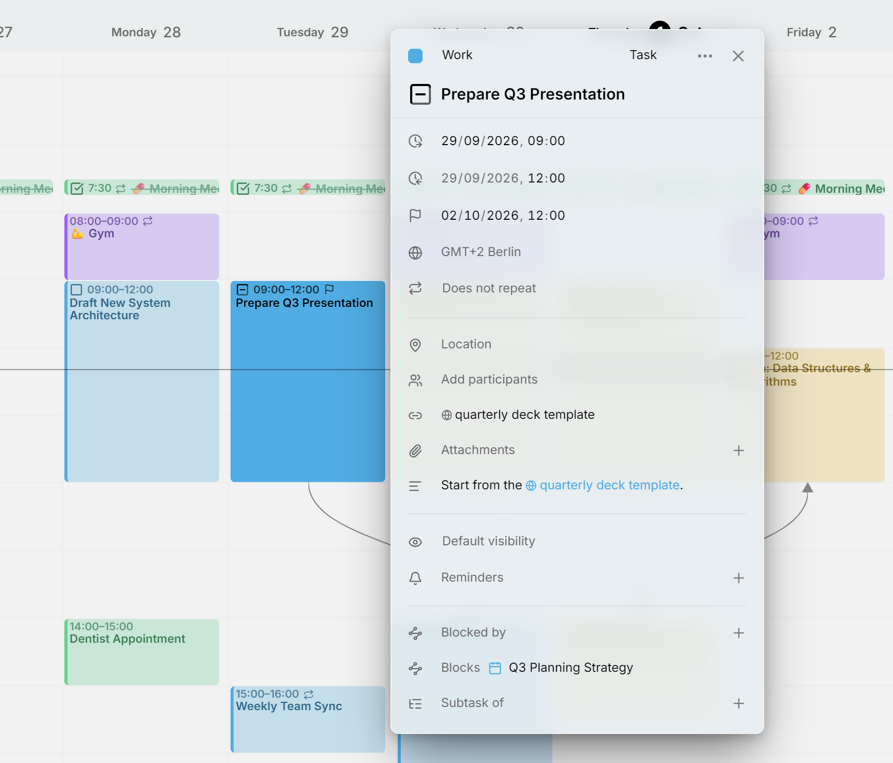

Alles in je agenda is een **item**. De meeste items zijn **afspraken**, die op een bepaald moment plaatsvinden, of **taken**, die je afwerkt en afvinkt. Een derde soort, [beschikbaarheid](availability.md), kleurt achter je afspraken en taken de tijd in die je ergens voor vrijhoudt.

Op deze pagina lees je over de editor van een item: de kop, de regels daaronder en de beschrijving.

<picture>
  <source media="(prefers-color-scheme: dark)" srcset="../assets/screenshots/due-detail-dark.webp">
  
</picture>

## De editor openen

Klik op een item om de editor ernaast te openen. Wil je een nieuw item maken, druk dan op <kbd>C</kbd> of op **Maken** bovenaan de pagina. Het nieuwe item begint op het volgende hele uur, duurt een uur en komt in je [standaardagenda](calendars.md#where-new-entries-land). In de [weekweergave](views/week.md) kun je ook over lege tijd slepen.

Elke wijziging wordt meteen opgeslagen. Sluit de editor met de **✕** of door ernaast te klikken. Op een smal scherm, zoals een telefoon, schuift de editor als een paneel van onderen omhoog.

## De kop

Op de bovenste regel van de editor staan de kleur van het item, de agenda, het type en het **⋯**-menu.

### Een item een eigen kleur geven

Een item heeft de kleur van zijn agenda. Wil je één item een eigen kleur geven, klik dan op de stip aan het begin van de kop en kies een kleur. Met **Agendakleur herstellen**, in dezelfde kiezer, krijgt het weer de kleur van de agenda.

### Een item naar een andere agenda verplaatsen

Naast de stip staat de naam van de agenda van het item. Klik erop en kies een andere agenda om het item daarheen te verplaatsen. De lijst laat agenda's weg die iets van het item niet zouden kunnen bewaren, zoals een herhaling of de status **Geannuleerd**. Zie [Eén item verplaatsen](calendars.md#move-a-single-entry).

### Het type van een item wijzigen

Verderop in de kop staat het type van het item: **Afspraak**, **Taak** of **Beschikbaarheid**. Klik erop en kies een ander type. Agendaservers houden afspraken en taken gescheiden, dus Mitra slaat het item opnieuw op als het andere type en verwijdert het oude. De editor blijft open en toont het resultaat.

Wat het nieuwe type niet kan bevatten, valt weg. Een taak die een afspraak wordt, verliest de status, de voortgang, de vervaldatum en de geschatte duur. Een afspraak die een taak wordt, verliest bezet of vrij. Beschikbaarheid heeft geen deelnemers of herinneringen.

Het type kan niet veranderen bij een terugkerend item, of in een agenda die maar één type bevat, zoals een Notion-agenda. **Beschikbaarheid** wordt alleen aangeboden waar de agenda het kan bevatten.

### Het ⋯-menu

**Dupliceren** maakt een kopie in dezelfde agenda en opent die. Houd je <kbd>Alt</kbd> ingedrukt terwijl je een item sleept, dan maak je een kopie op de plek waar je het neerzet.

**Verwijderen** verwijdert het item. Zolang de editor open is, kan dat ook met <kbd>Delete</kbd> of <kbd>Backspace</kbd>, mits je niet in een veld aan het typen bent. Herhaalt het item zich of heeft het subtaken, dan vraagt Mitra welke je bedoelt.

Een item uit Notion, Todoist of Tempo biedt ook **Openen in Notion**, **Openen in Todoist** of **Openen in Jira**, waarmee je het opent waar het vandaan komt.

## Titel en tijd

De titel is de grote regel onder de kop. De regels daaronder vertellen wanneer het item plaatsvindt: het begin, het einde, de tijdzone en of het zich herhaalt. Wil je wisselen tussen hele dagen en tijden, druk dan op **Hele dag** aan het eind van een datum; die knop verschijnt zodra je op die regel staat.

Een taak heeft ook een vervaldatum en, zolang hij niet is ingepland, een geschatte duur. Zie [Planning](planning.md). Over tijdzones lees je meer in [Tijdzones](time-zones.md), en over herhalingen in [Herhalen](repeats.md).

## Taakstatus

Een taak heeft een selectievakje voor de titel en een van vier statussen: **Te doen**, **Bezig**, **Klaar** of **Geannuleerd**. Klik op het selectievakje om de taak als klaar te markeren, en klik nog eens om hem weer te openen. Wil je een willekeurige status kiezen, klik dan met de rechtermuisknop op het selectievakje of <kbd>Alt</kbd>-klik erop. Dat werkt ook in de agenda zelf.

Afgeronde en geannuleerde taken worden doorgestreept. Een agenda zonder de status geannuleerd, zoals Notion, laat **Geannuleerd** weg uit het menu. Een taak met subtaken of een checklist toont de voortgang in het selectievakje; zie [Subtaken](subtasks.md#progress).

## Bezet of vrij, en zichtbaarheid

De regel met het oog bepaalt wat anderen over het item te weten komen als ze in je agenda kijken.

Bij afspraken kies je tussen **Bezet** en **Vrij**. Bezet, de standaard, markeert de tijd als bezet, zodat iemand die kijkt wanneer je kunt afspreken, die tijd als geblokkeerd ziet. Vrij toont het item zonder de tijd te blokkeren, handig voor een herinnering aan jezelf of een feestdag waarop je gewoon werkt. Taken hebben geen bezet of vrij. Beschikbaarheid wel, en die begint als vrij; zie [Beschikbaarheid](availability.md#busy-or-free).

Elk item heeft een zichtbaarheid. **Standaardzichtbaarheid** laat het aan de agenda over. **Openbaar** laat iedereen die je agenda kan zien het item lezen. **Privé** vraagt andere apps om mensen met wie je de agenda deelt alleen te laten zien dat de tijd bezet is, niet waarvoor. **Vertrouwelijk** is het strengst, voor items die tussen jou en de genodigden moeten blijven. Mitra bewaart je keuze bij het item, en de server en de apps die het lezen, bepalen wat ze verbergen.

## Locatie, deelnemers en meer

- [Locatie](location.md) bevat een plaats, met een kaart, of een vergaderlink.
- [Deelnemers](participants.md) toont de betrokkenen en hun antwoorden.
- [Herinneringen](reminders.md) waarschuwen je voordat het item begint, of vóór de vervaldatum van een taak.
- [Links](links.md) verzamelt de links uit de beschrijving erboven.
- [Bijlagen](attachments.md) bevat de bestanden die aan het item zijn toegevoegd.
- **Subtaak van** en **Subtaken** bouwen een boom van taken op; zie [Subtaken](subtasks.md).
- **Geblokkeerd door** en **Blokkeert** geven aan wat eerst af moet zijn; zie [Afhankelijkheden](dependencies.md).

## De beschrijving

Klik op de beschrijving om hem te bewerken, en klik ergens anders om hem weer opgemaakt te zien. Hij is geschreven in Markdown, dus koppen, lijsten met opsommingstekens of nummers, vette en cursieve tekst, code, tabellen en links worden allemaal weergegeven. Een citaat dat begint met `> [!NOTE]`, `> [!TIP]` of `> [!WARNING]` wordt een gekleurd kader. Klik je op een link, dan open je die in plaats van de tekst te bewerken.

Regels die beginnen met `- [ ]` worden een checklist, die je kunt afvinken zonder de tekst te openen. Zie [Checklists](subtasks.md#checklists).

## Relaties uit andere apps

Andere agenda-apps kunnen items koppelen op manieren die Mitra zelf niet aanmaakt. Mitra toont die koppelingen in een eigen sectie: **Gerelateerd aan** voor items die bij elkaar horen, en een sectie met de naam van het koppelingstype voor soorten die Mitra niet kent. Je kunt zo'n koppeling verwijderen met de **✕**, maar er geen toevoegen.

## Welke agenda's dit ondersteunen

Elke agenda bewaart andere dingen, en Mitra verbergt de regels die een agenda niet kan bewaren, zodat niets wat je typt bij de volgende synchronisatie verdwijnt. Een Notion-agenda bevat bijvoorbeeld alleen taken, en een Google-agenda kent geen relaties. Zie [Integraties](integrations/README.md#what-each-one-holds) voor wat elke agenda bewaart.
