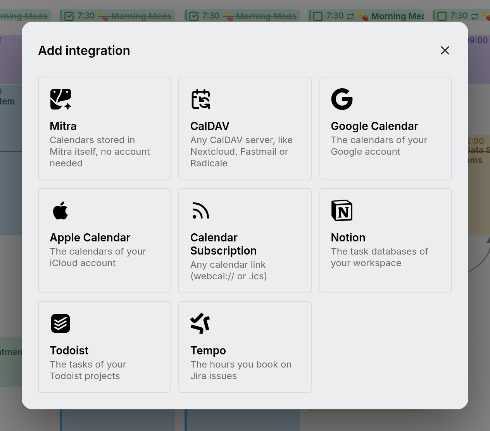

Mitra でカレンダーを管理する方法は2つあります。アカウントを背後に持たず、Mitra 自体(あなたのサーバー上)に保存する方法と、すでに持っているアカウントを接続して、Mitra がそのカレンダーと双方向に同期する方法です。多くの人は両方を使い分けており、項目はこの2つの間を自由に移動できます。

どちらも、サイドバー下部の**連携を追加**から追加します。

<picture>
  <source media="(prefers-color-scheme: dark)" srcset="../../assets/screenshots/integrations-detail-dark.webp">
  
</picture>

## それぞれが保持できるもの

| 連携 | 保持できるもの | サーバー側の設定 |
| --- | --- | --- |
| [Mitra](mitra.md) | 予定とタスク。Mitra に保存 | なし |
| [CalDAV](caldav.md) | 任意の CalDAV サーバーの予定とタスク | なし |
| [Google カレンダー](google.md) | Google アカウントのカレンダー | 1回限りの OAuth 設定 |
| [Apple カレンダー](apple.md) | iCloud アカウントのカレンダー | なし |
| [カレンダー購読](subscriptions.md) | 公開された `webcal://` または `.ics` フィード。読み取り専用 | なし |
| [Notion](notion.md) | Notion データベースビューのタスク | なし |
| [Todoist](todoist.md) | Todoist プロジェクトのタスク | なし |
| [Tempo](tempo.md) | Jira課題に計上する作業時間 | なし |

プロバイダーごとに保存できるものは異なります。たとえば Notion のタスクは繰り返せず、Tempo の作業記録には場所がありません。Mitra はカレンダーが保存できないフィールドを隠すので、入力した内容が次の同期で消えることはありません。

## 同期の仕組み

アカウントを接続すると、Mitra はその中のカレンダーを見つけて、すべてオンの状態で一覧します。保存する前に不要なものをオフにすると、残りがインポートされます。あとからアカウントに現れたカレンダーはオフの状態で届くので、あなたが選ばない限り新しいものがカレンダーに載ることはありません。オフになったカレンダーを Mitra がダウンロードすることはありません。

その後はサーバーがバックグラウンドで自動的に同期します。誰かが Mitra を開いている間は頻繁に確認し、誰も開いていなければ間隔を空けます。

| | Mitra を開いている間 | 誰も開いていない間 |
| --- | --- | --- |
| CalDAV と Apple カレンダー | 10秒ごと | 5分ごと |
| Google カレンダー、Notion、Todoist、Tempo | 約1分ごと | 5分ごと |
| カレンダー購読 | 15分ごと | 15分ごと |
| Mitra カレンダー | 同期不要 | 同期不要 |

Google、Notion、Todoist、Tempo はアプリが呼び出せる頻度を制限しているため、同期が遅くなります。Mitra を開くと、同期の時期が来ているアカウントはすべてすぐに同期するので、更新ボタンを押す必要はありません。

変更は双方向に反映されます。項目を作成、編集、移動、削除すると、Mitra は所属先のカレンダーに書き戻します。1つのアカウントが失敗しても他を待たせることはなく、Mitra は1分後に再試行します。

購読カレンダーや、閲覧のみで共有されたカレンダーなど、Mitra から変更できないカレンダーもあります。それでも名前の変更、色の変更、非表示は可能です。[読み取り専用カレンダー](../calendars.md#read-only-calendars)を参照してください。

> [!NOTE]
> 同期は変更分だけを取得します。カレンダーの表示がおかしい場合は、その **⋯** メニューの**項目を再インポート**で Mitra のコピーを破棄し、プロバイダーからインポートし直せます。[カレンダーを再インポートする](../calendars.md#re-import-a-calendar)を参照してください。どちらの方法でもプロバイダー側は変更されません。

## アカウントを変更する

各アカウントは1回だけ接続できます。パスワードや、どのカレンダーを Mitra に表示するかを変更するには、再度追加するのではなく、その **⋯** メニューの**編集**を選びます。Google カレンダーだけは例外で、同じ Google アカウントを再度接続すると、Mitra のアクセス権が更新されます。
