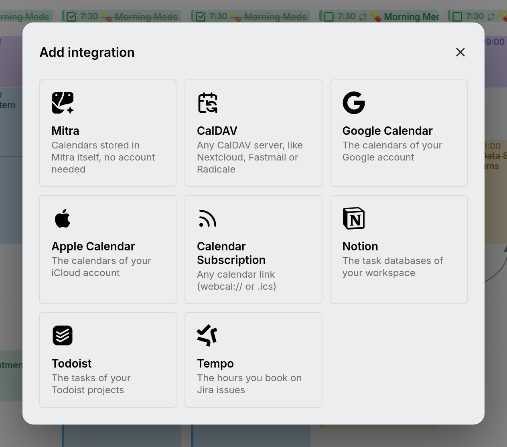

Mitra에 캘린더를 두는 방법은 두 가지입니다. 계정 없이 서버의 Mitra 자체에 저장할 수도 있고, 이미 가진 계정을 연결해 Mitra가 그 캘린더를 양방향으로 동기화하게 할 수도 있습니다. 대부분은 두 가지를 섞어 쓰게 되며, 항목은 둘 사이를 자유롭게 오갈 수 있습니다.

어느 쪽이든 추가하려면 사이드바 아래쪽에서 **연동 추가**를 고르세요.

<picture>
  <source media="(prefers-color-scheme: dark)" srcset="../../assets/screenshots/integrations-detail-dark.webp">
  
</picture>

## 연동별로 담는 것

| 연동 | 담는 것 | 서버 설정 |
| --- | --- | --- |
| [Mitra](mitra.md) | Mitra에 저장된 일정과 작업 | 없음 |
| [CalDAV](caldav.md) | 모든 CalDAV 서버의 일정과 작업 | 없음 |
| [Google 캘린더](google.md) | Google 계정의 캘린더 | 한 번의 OAuth 설정 |
| [Apple 캘린더](apple.md) | iCloud 계정의 캘린더 | 없음 |
| [캘린더 구독](subscriptions.md) | 공개된 `webcal://` 또는 `.ics` 피드, 읽기 전용 | 없음 |
| [Notion](notion.md) | Notion 데이터베이스 보기의 작업 | 없음 |
| [Todoist](todoist.md) | Todoist 프로젝트의 작업 | 없음 |
| [Tempo](tempo.md) | Jira 이슈에 기록한 근무 시간 | 없음 |

제공 업체마다 저장하는 것이 다릅니다. 예를 들어 Notion 작업은 반복할 수 없고, Tempo 작업 로그에는 위치가 없습니다. Mitra는 캘린더가 저장할 수 없는 필드를 숨기므로, 입력한 내용이 다음 동기화 때 사라지지 않습니다.

## 동기화 방식

계정을 연결하면 Mitra가 그 캘린더를 찾아 모두 체크된 상태로 나열합니다. 저장하기 전에 원하지 않는 캘린더의 체크를 해제하면 Mitra가 나머지를 가져옵니다. 나중에 계정에 새로 생긴 캘린더는 체크가 해제된 채로 들어오므로, 직접 고르지 않은 새 캘린더가 내 캘린더에 섞이는 일은 없습니다. Mitra는 꺼져 있는 캘린더를 내려받지 않습니다.

그 뒤로는 서버가 백그라운드에서 알아서 동기화합니다. 누군가 Mitra를 열어 두었을 때는 더 자주 확인하고, 아무도 열어 두지 않았을 때는 간격을 늘립니다.

| | Mitra가 열려 있을 때 | 아무도 열어 두지 않았을 때 |
| --- | --- | --- |
| CalDAV와 Apple 캘린더 | 10초마다 | 5분마다 |
| Google 캘린더, Notion, Todoist, Tempo | 약 1분마다 | 5분마다 |
| 캘린더 구독 | 15분마다 | 15분마다 |
| Mitra 캘린더 | 동기화할 것 없음 | 동기화할 것 없음 |

Google, Notion, Todoist, Tempo는 앱이 호출할 수 있는 빈도를 제한하므로 더 느립니다. Mitra를 열면 동기화할 때가 된 모든 계정이 바로 동기화되므로, 따로 누를 새로 고침 버튼이 없습니다.

변경 사항은 양방향으로 오갑니다. 항목을 만들거나, 편집하거나, 옮기거나, 삭제하면 Mitra가 그 항목이 속한 캘린더에 다시 씁니다. 한 계정이 실패해도 다른 계정은 영향을 받지 않으며, Mitra가 1분 뒤에 다시 시도합니다.

구독이나 보기 전용으로 공유받은 캘린더처럼 Mitra에서 바꿀 수 없는 캘린더도 있습니다. 그래도 이름과 색상을 바꾸거나 숨길 수는 있습니다. [읽기 전용 캘린더](../calendars.md#read-only-calendars)를 참고하세요.

> [!NOTE]
> 동기화는 바뀐 것만 가져옵니다. 캘린더가 이상해 보이면 캘린더의 **⋯** 메뉴에서 **항목 다시 가져오기**를 쓰세요. Mitra의 사본을 버리고 제공 업체에서 다시 가져옵니다. [캘린더 다시 가져오기](../calendars.md#re-import-a-calendar)를 참고하세요. 어느 경우든 제공 업체 쪽은 바뀌지 않습니다.

## 계정 변경하기

계정마다 한 번만 연결할 수 있습니다. 비밀번호나 Mitra에 표시할 캘린더를 바꾸려면 다시 추가하지 말고 계정의 **⋯** 메뉴에서 **편집**을 고르세요. 예외는 Google 캘린더입니다. 같은 Google 계정을 다시 연결하면 Mitra의 접근 권한이 갱신됩니다.
