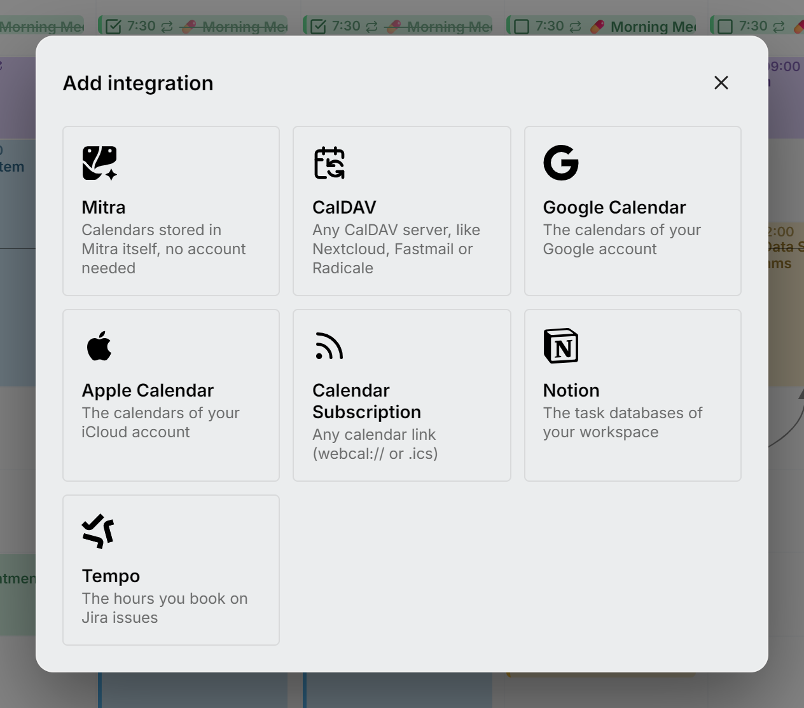

Kalendarz w aplikacji Mitra możesz prowadzić na dwa sposoby. Możesz przechowywać go w samej aplikacji Mitra, na swoim serwerze, bez żadnego konta. Możesz też połączyć konto, które już masz, a Mitra będzie synchronizować jego kalendarze w obie strony. Większość osób korzysta z obu sposobów naraz, a wpisy można swobodnie przenosić między nimi.

Aby dodać kalendarz w jeden lub drugi sposób, wybierz **Dodaj integrację** na dole panelu bocznego.

<picture>
  <source media="(prefers-color-scheme: dark)" srcset="../../assets/screenshots/integrations-detail-dark.webp">
  
</picture>

## Co przechowuje każda integracja

| Integracja | Co przechowuje | Konfiguracja na serwerze |
| --- | --- | --- |
| [Mitra](mitra.md) | Wydarzenia i zadania przechowywane w aplikacji Mitra | Brak |
| [CalDAV](caldav.md) | Wydarzenia i zadania z dowolnego serwera CalDAV | Brak |
| [Kalendarz Google](google.md) | Kalendarze konta Google | Jednorazowa konfiguracja OAuth |
| [Kalendarz Apple](apple.md) | Kalendarze konta iCloud | Brak |
| [Subskrypcje kalendarzy](subscriptions.md) | Opublikowany kanał `webcal://` lub `.ics`, tylko do odczytu | Brak |
| [Notion](notion.md) | Zadania z widoków baz danych Notion | Brak |
| [Todoist](todoist.md) | Zadania z twoich projektów w Todoist | Brak |
| [Tempo](tempo.md) | Godziny zarejestrowane na zgłoszeniach Jira | Brak |

Każdy dostawca przechowuje co innego. Na przykład zadania w Notion nie mogą się powtarzać, a wpis czasu pracy w Tempo nie ma lokalizacji. Mitra ukrywa pola, których dany kalendarz nie może przechować, więc nic, co wpiszesz, nie zniknie przy następnej synchronizacji.

## Jak działa synchronizacja

Gdy połączysz konto, Mitra znajdzie jego kalendarze i wyświetli je na liście, wszystkie zaznaczone. Przed zapisaniem odznacz te, których nie chcesz, a Mitra zaimportuje resztę. Kalendarze, które pojawią się na koncie później, są domyślnie odznaczone, więc nic nowego nie trafi do twojego kalendarza bez twojej decyzji. Mitra nigdy nie pobiera wyłączonego kalendarza.

Potem serwer sam synchronizuje kalendarze w tle. Sprawdza je częściej, gdy ktoś ma otwartą aplikację Mitra, a rzadziej, gdy nikt z niej nie korzysta:

| | Gdy aplikacja Mitra jest otwarta | Gdy nikt z niej nie korzysta |
| --- | --- | --- |
| CalDAV i Kalendarz Apple | co 10 sekund | co 5 minut |
| Kalendarz Google, Notion, Todoist i Tempo | mniej więcej raz na minutę | co 5 minut |
| Subskrypcje kalendarzy | co 15 minut | co 15 minut |
| Kalendarze Mitra | nie ma czego synchronizować | nie ma czego synchronizować |

Google, Notion, Todoist i Tempo ograniczają, jak często aplikacje mogą się z nimi łączyć, dlatego synchronizują się rzadziej. Gdy otworzysz aplikację Mitra, każde konto, na które przyszła kolej, synchronizuje się od razu, więc nie ma przycisku odświeżania.

Zmiany działają w obie strony. Gdy tworzysz, edytujesz, przenosisz lub usuwasz wpis, Mitra zapisuje zmianę w kalendarzu, do którego wpis należy. Błąd jednego konta nie wstrzymuje pozostałych: Mitra ponawia próbę minutę później.

Niektórych kalendarzy nie można zmieniać z poziomu aplikacji Mitra, na przykład subskrypcji i kalendarzy udostępnionych ci tylko do wglądu. Nadal możesz zmieniać ich nazwy i kolory oraz je ukrywać; zobacz [Kalendarze tylko do odczytu](../calendars.md#read-only-calendars).

> [!NOTE]
> Synchronizacja pobiera tylko zmiany. Jeśli kalendarz kiedyś wygląda nieprawidłowo, polecenie **Importuj wpisy ponownie** w jego menu **⋯** odrzuca kopię przechowywaną w aplikacji Mitra i importuje kalendarz od dostawcy od nowa; zobacz [Ponowny import kalendarza](../calendars.md#re-import-a-calendar). U dostawcy nic się przy tym nie zmienia.

## Zmiana konta

Każde konto można połączyć tylko raz. Aby zmienić jego hasło albo wybrać, które jego kalendarze pokazuje Mitra, wybierz **Edytuj** w jego menu **⋯**, zamiast dodawać je ponownie. Wyjątkiem jest Kalendarz Google: ponowne połączenie tego samego konta Google odnawia dostęp aplikacji Mitra do niego.
