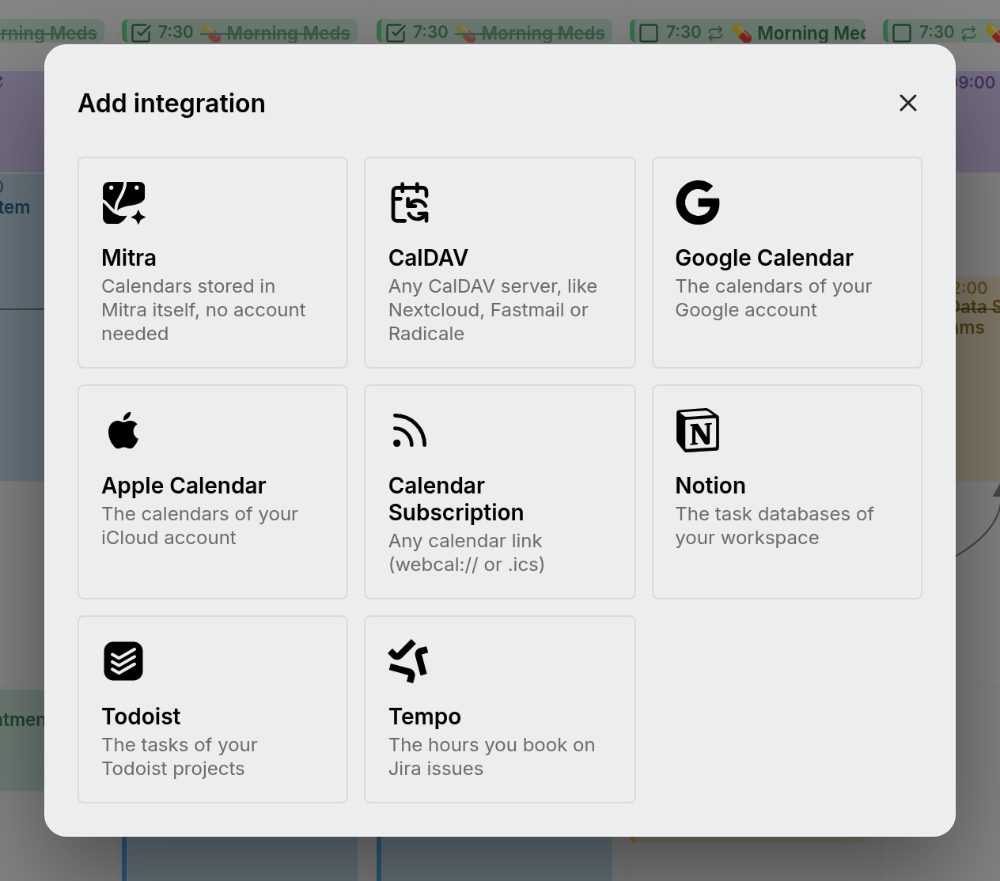

Có hai cách để giữ một lịch trong Mitra. Bạn có thể lưu nó ngay trong Mitra, trên máy chủ của bạn, không cần tài khoản nào phía sau. Hoặc bạn có thể kết nối một tài khoản sẵn có, và Mitra giữ các lịch của nó đồng bộ theo cả hai chiều. Phần lớn mọi người dùng kết hợp cả hai, và các mục di chuyển tự do giữa hai bên.

Để thêm một trong hai, chọn **Thêm tích hợp** ở cuối thanh bên.

<picture>
  <source media="(prefers-color-scheme: dark)" srcset="../../assets/screenshots/integrations-detail-dark.webp">
  
</picture>

## Mỗi loại chứa gì

| Tích hợp | Chứa gì | Thiết lập trên máy chủ |
| --- | --- | --- |
| [Mitra](mitra.md) | Sự kiện và công việc, lưu trong Mitra | Không cần |
| [CalDAV](caldav.md) | Sự kiện và công việc từ bất kỳ máy chủ CalDAV nào | Không cần |
| [Google Lịch](google.md) | Các lịch của một tài khoản Google | Thiết lập OAuth một lần |
| [Lịch Apple](apple.md) | Các lịch của một tài khoản iCloud | Không cần |
| [Lịch đăng ký](subscriptions.md) | Một nguồn cấp `webcal://` hoặc `.ics` đã công bố, chỉ đọc | Không cần |
| [Notion](notion.md) | Công việc từ các chế độ xem cơ sở dữ liệu của Notion | Không cần |
| [Todoist](todoist.md) | Công việc trong các dự án Todoist của bạn | Không cần |
| [Tempo](tempo.md) | Số giờ bạn ghi trên các issue Jira | Không cần |

Mỗi nhà cung cấp lưu những thứ khác nhau. Chẳng hạn, công việc trên Notion không thể lặp lại, và một worklog của Tempo không có địa điểm. Mitra ẩn các trường mà một lịch không lưu được, nên không có gì bạn nhập bị mất ở lần đồng bộ tiếp theo.

## Cách đồng bộ hoạt động

Khi bạn kết nối một tài khoản, Mitra tìm các lịch của nó và liệt kê ra, tất cả đều được chọn. Bỏ chọn những lịch bạn không muốn trước khi lưu, và Mitra sẽ nhập phần còn lại. Các lịch xuất hiện trong tài khoản về sau sẽ chưa được chọn, nên không có gì mới xuất hiện trên lịch của bạn nếu bạn không chọn. Mitra không bao giờ tải về một lịch đang tắt.

Sau đó, máy chủ tự đồng bộ ở chế độ nền. Nó kiểm tra thường xuyên hơn khi có người đang mở Mitra, và thưa dần khi không có ai:

| | Khi Mitra đang mở | Khi không ai mở |
| --- | --- | --- |
| CalDAV và Lịch Apple | mỗi 10 giây | mỗi 5 phút |
| Google Lịch, Notion, Todoist và Tempo | khoảng một lần mỗi phút | mỗi 5 phút |
| Lịch đăng ký | mỗi 15 phút | mỗi 15 phút |
| Lịch Mitra | không có gì để đồng bộ | không có gì để đồng bộ |

Google, Notion, Todoist và Tempo giới hạn tần suất các ứng dụng được gọi đến, đó là lý do chúng chậm hơn. Khi bạn mở Mitra, mọi tài khoản đến hạn sẽ đồng bộ ngay, nên không có nút làm mới nào để nhấn.

Thay đổi đi theo cả hai chiều. Khi bạn tạo, sửa, di chuyển hoặc xóa một mục, Mitra ghi lại vào lịch mà mục đó thuộc về. Một tài khoản bị lỗi không làm chậm các tài khoản khác: Mitra thử lại nó sau một phút.

Một số lịch không thể thay đổi từ Mitra, chẳng hạn lịch đăng ký và các lịch được chia sẻ với bạn chỉ để xem. Bạn vẫn có thể đổi tên, đổi màu và ẩn chúng; xem [Lịch chỉ đọc](../calendars.md#read-only-calendars).

> [!NOTE]
> Đồng bộ chỉ lấy những gì đã thay đổi. Nếu một lịch trông có vẻ sai, **Nhập lại các mục** trong menu **⋯** của lịch sẽ bỏ bản sao của Mitra và nhập lại từ nhà cung cấp; xem [Nhập lại một lịch](../calendars.md#re-import-a-calendar). Dù làm cách nào, không có gì thay đổi ở phía nhà cung cấp.

## Thay đổi một tài khoản

Mỗi tài khoản chỉ được kết nối một lần. Để đổi mật khẩu của nó, hoặc đổi các lịch mà Mitra hiển thị, hãy chọn **Sửa** trong menu **⋯** của nó thay vì thêm lại. Google Lịch là ngoại lệ: kết nối lại cùng một tài khoản Google sẽ gia hạn quyền truy cập của Mitra vào tài khoản đó.
