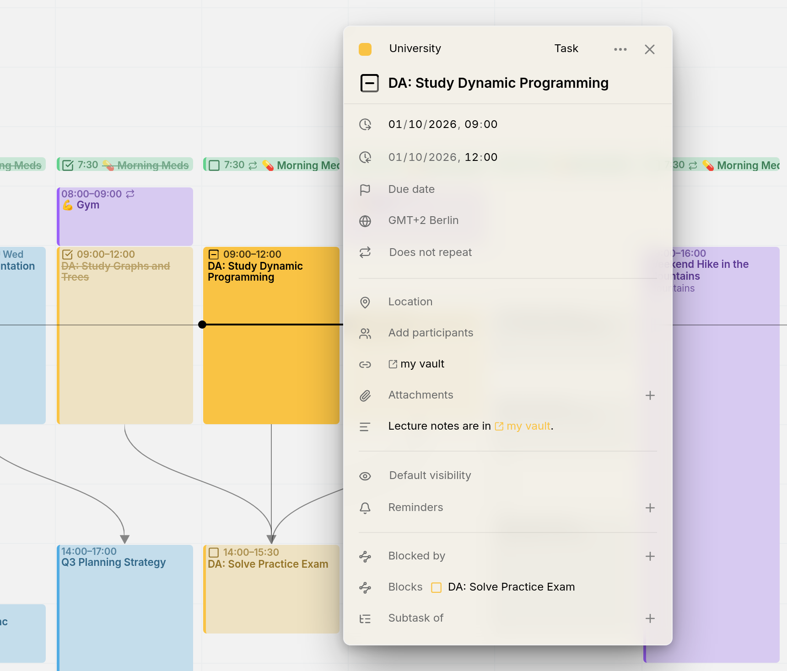

項目内のリンクは生のアドレスではなく、リンク先が分かる形で表示されます。会議リンクは **Google Meetに参加** と読め、Obsidian ノートへのリンクはノート名を、Web ページは `example.atlassian.net/browse/DEV-9177` のようにサイトとパスを表示します。

<picture>
  <source media="(prefers-color-scheme: dark)" srcset="../assets/screenshots/links-detail-dark.webp">
  
</picture>

## エディター内

項目の説明にリンクがあると、エディターは説明のすぐ上の **リンク** 行にまとめて表示するので、本文を読み通さなくても開けます。クリックすると開きます。Web ページは新しいタブで開き、それ以外のリンクはそのアプリが開きます。2 行を超えると行はスクロールします。

この行自体は何も保存していません。説明にあるものを表示しているだけです。リンクの追加や削除は説明を編集すればよく、この行もそれに従います。使っている他のカレンダーアプリでも、説明の中に同じリンクが見えます。

## 説明内

説明内のリンクには、何を開くかを示す小さなアイコンが先頭に付きます。ブラウザーから貼り付けたようなアドレスそのままのリンクは、サイトとパスに短縮されます。自分の言葉で書いたリンクは、その言葉が残ります。

Mitra は `obsidian://open?vault=…` のようなアプリのリンクも認識します。多くのカレンダーアプリではこれらはプレーンテキストのままです。`javascript:` のようなコードを実行するリンクはプレーンテキストとして表示され、決してリンクにはなりません。

## 場所にある会議リンクとアプリリンク

場所がリンク 1 つだけの場合、場所ではなくそのリンクとして扱われます。Zoom、Google Meet、Microsoft Teams、Webex、Jitsi、Whereby、FaceTime、Skype のリンクは、エディター、カレンダー、テーブルのどこでも、サービス名とともに **参加** と表示され、地図ボタンは付きません。編集するにはリンクの横をクリックします。

## アプリへのリンク

Mitra はアドレスから、そのリンクがどのアプリのものかを判別します。Obsidian、Notion、Slack、Linear、Figma、Things、OmniFocus、Bear、Craft、Drafts、DEVONthink、Evernote、OneNote、Visual Studio Code、Cursor、Spotify を認識できます。アプリのリンクは、認識できるかどうかに関係なく、すべて同じ「別のアプリで開く」アイコンで表示されます。

> [!NOTE]
> Web ページからはアプリがインストールされているかどうか分かりません。アプリのリンクを初めて開くとき、ブラウザーがアプリを開くかどうかを尋ねます。アプリがなければ何も起こりません。
