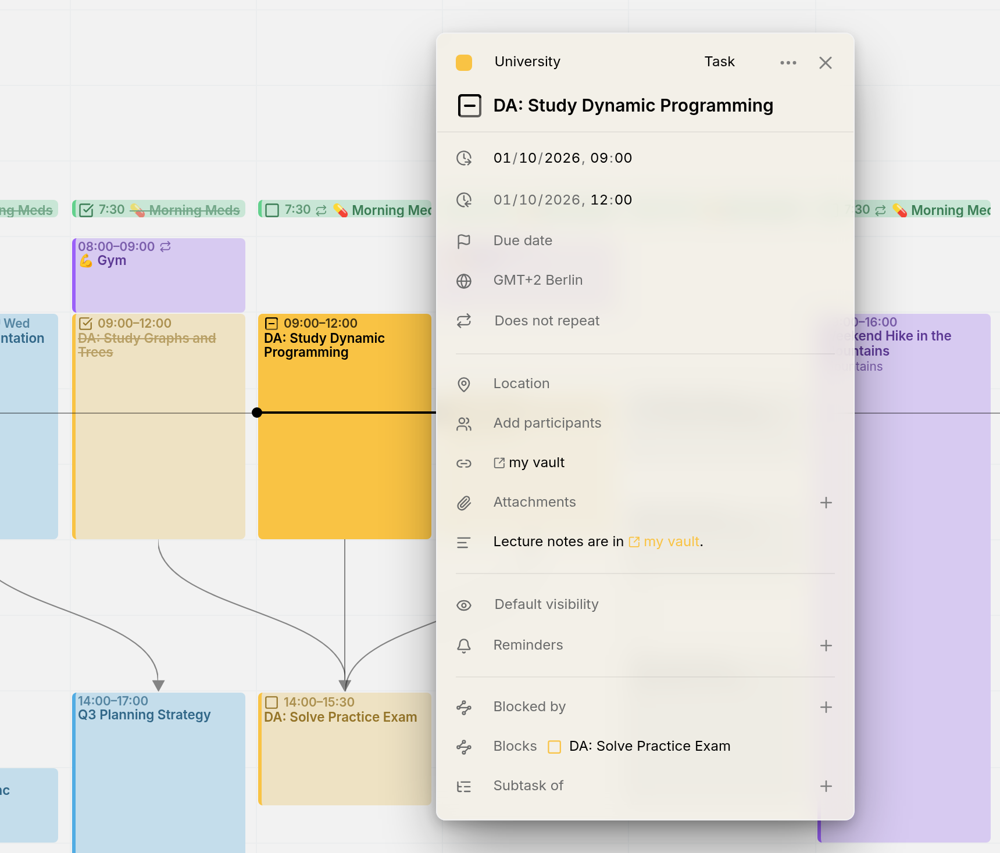

항목 안의 링크는 원래 주소 대신 어디로 이어지는지를 보여 줍니다. 회의 링크는 **Google Meet 참여**로, Obsidian 노트 링크는 노트 이름으로, 웹 페이지는 `example.atlassian.net/browse/DEV-9177`처럼 사이트와 경로로 표시됩니다.

<picture>
  <source media="(prefers-color-scheme: dark)" srcset="../assets/screenshots/links-detail-dark.webp">
  
</picture>

## 편집기에서

항목의 설명에 링크가 있으면, 편집기가 설명 바로 위의 **링크** 행에 링크를 모아 보여 주므로 글을 다 읽지 않고도 열 수 있습니다. 클릭하면 열립니다. 웹 페이지는 새 탭에서 열리고, 그 밖의 링크는 해당 앱을 엽니다. 두 줄이 넘으면 행이 스크롤됩니다.

이 행에는 따로 저장되는 내용이 없고, 설명에 있는 것을 보여 줄 뿐입니다. 링크를 추가하거나 빼려면 설명을 편집하세요. 그러면 행이 따라 바뀝니다. 사용하는 다른 캘린더 앱에서도 설명 안에서 같은 링크가 보입니다.

## 설명에서

설명 안의 링크 앞에는 무엇을 여는지 알려 주는 작은 아이콘이 붙습니다. 브라우저에서 붙여 넣은 주소처럼 주소만 있는 링크는 사이트와 경로로 줄여 표시됩니다. 직접 문구를 붙여 쓴 링크는 그 문구를 그대로 유지합니다.

Mitra는 `obsidian://open?vault=…`처럼 대부분의 캘린더 앱이 일반 텍스트로 두는 앱 링크도 알아봅니다. `javascript:`처럼 코드를 실행할 수 있는 링크는 링크가 아닌 일반 텍스트로만 표시됩니다.

## 장소의 회의 링크와 앱 링크

장소가 링크 하나뿐이면 장소가 아니라 그 링크로 취급합니다. Zoom, Google Meet, Microsoft Teams, Webex, Jitsi, Whereby, FaceTime, Skype 링크는 편집기, 캘린더, 표에서 서비스 이름과 함께 **참여**로 표시됩니다. 지도 버튼은 붙지 않습니다. 링크를 편집하려면 링크 옆을 클릭하세요.

## 앱 링크

Mitra는 링크 주소를 보고 어느 앱의 링크인지 이름을 붙입니다. Obsidian, Notion, Slack, Linear, Figma, Things, OmniFocus, Bear, Craft, Drafts, DEVONthink, Evernote, OneNote, Visual Studio Code, Cursor, Spotify를 알아봅니다. 알아보는 앱이든 아니든, 모든 앱 링크에는 다른 앱에서 연다는 같은 아이콘이 붙습니다.

> [!NOTE]
> 웹 페이지는 앱이 설치되어 있는지 알 수 없습니다. 앱 링크를 처음 열 때 브라우저가 앱을 열지 묻습니다. 앱이 없으면 아무 일도 일어나지 않습니다.
