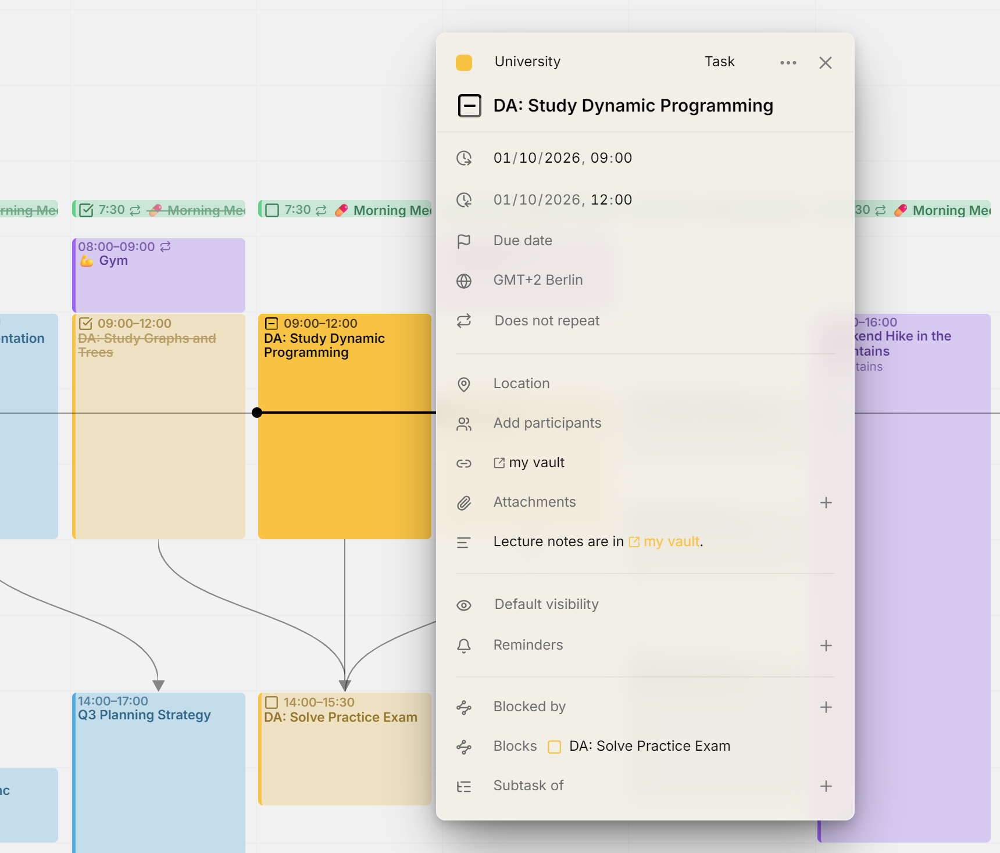

Links in een item laten zien waar ze naartoe leiden, niet hun kale adres. Een vergaderlink heet **Deelnemen via Google Meet**, een link naar een Obsidian-notitie toont de naam van de notitie, en een webpagina toont de site en het pad, zoals `example.atlassian.net/browse/DEV-9177`.

<picture>
  <source media="(prefers-color-scheme: dark)" srcset="../assets/screenshots/links-detail-dark.webp">
  
</picture>

## In de editor

Staan er links in de beschrijving van een item, dan verzamelt de editor ze in een rij **Links**, vlak boven de beschrijving. Zo open je ze zonder de tekst door te hoeven lezen. Klik op een link om hem te openen: een webpagina opent in een nieuw tabblad, elke andere link in de bijbehorende app. Beslaat de rij meer dan twee regels, dan kun je erin scrollen.

De rij slaat zelf niets op, maar toont wat er in de beschrijving staat. Wil je een link toevoegen of verwijderen, bewerk dan de beschrijving, en de rij past zich aan. Elke andere agenda-app die je gebruikt, ziet dezelfde links in de beschrijving.

## In de beschrijving

Links in de beschrijving beginnen met een klein pictogram dat aangeeft wat ze openen. Een kaal adres, bijvoorbeeld een adres dat je uit de browser hebt geplakt, wordt ingekort tot de site en het pad. Een link waarvoor je zelf woorden hebt geschreven, houdt jouw woorden.

Mitra herkent ook links naar apps, zoals `obsidian://open?vault=…`, die de meeste agenda-apps als gewone tekst laten staan. Links die code zouden uitvoeren, zoals `javascript:`, worden als gewone tekst weergegeven en nooit als link.

## Vergader- en applinks in de locatie

Een locatie die uit één link bestaat, wordt als die link behandeld en niet als plaats. Een link naar Zoom, Google Meet, Microsoft Teams, Webex, Jitsi, Whereby, FaceTime of Skype verschijnt als **Deelnemen via** met de naam van de dienst, in de editor, in de agenda en in de tabel. Zo'n locatie krijgt geen kaartknop. Klik naast de link om hem te bewerken.

## Links naar apps

Mitra leidt uit het adres van een link af bij welke app hij hoort. Het kent Obsidian, Notion, Slack, Linear, Figma, Things, OmniFocus, Bear, Craft, Drafts, DEVONthink, Evernote, OneNote, Visual Studio Code, Cursor en Spotify. Elke applink, bekend of niet, krijgt hetzelfde pictogram voor openen in een andere app.

> [!NOTE]
> Een webpagina kan niet zien of een app is geïnstalleerd. De eerste keer dat je een applink opent, vraagt je browser of de app mag worden geopend. Ontbreekt de app, dan gebeurt er niets.
