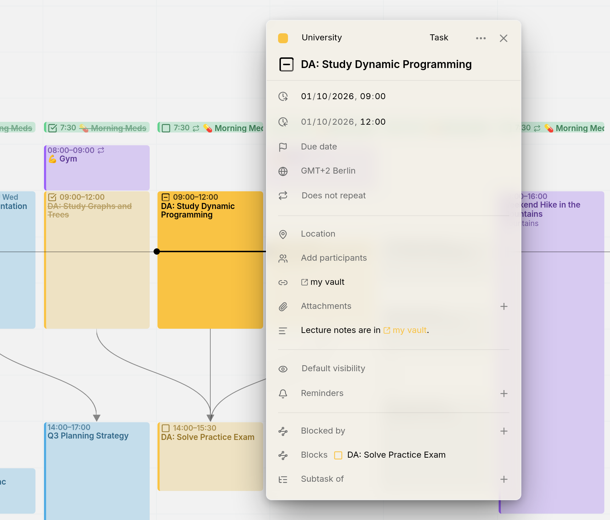

Các liên kết trong một mục hiển thị nơi chúng dẫn đến thay vì địa chỉ thô. Liên kết cuộc họp hiện là **Tham gia Google Meet**, liên kết đến một ghi chú Obsidian hiện tên của ghi chú, và một trang web hiện trang và đường dẫn của nó, như `example.atlassian.net/browse/DEV-9177`.

<picture>
  <source media="(prefers-color-scheme: dark)" srcset="../assets/screenshots/links-detail-dark.webp">
  
</picture>

## Trong trình chỉnh sửa

Khi phần mô tả của một mục có liên kết, trình chỉnh sửa gom chúng vào hàng **Liên kết** ngay phía trên phần mô tả, để bạn mở chúng mà không phải đọc hết văn bản. Nhấp vào một liên kết để mở: trang web mở trong thẻ mới, các liên kết khác mở ứng dụng của chúng. Quá hai dòng, hàng sẽ cuộn.

Hàng này không có nơi lưu riêng: nó hiển thị những gì phần mô tả chứa. Để thêm hoặc xóa một liên kết, hãy sửa phần mô tả, và hàng sẽ theo đó. Mọi ứng dụng lịch khác bạn dùng đều thấy cùng các liên kết trong phần mô tả.

## Trong phần mô tả

Các liên kết trong phần mô tả mở đầu bằng một biểu tượng nhỏ cho nơi chúng mở ra. Một địa chỉ trần, như địa chỉ dán từ trình duyệt, được rút gọn thành trang và đường dẫn của nó. Một liên kết bạn viết bằng chữ của riêng mình giữ nguyên chữ của bạn.

Mitra cũng nhận ra các liên kết của ứng dụng, như `obsidian://open?vault=…`, thứ mà hầu hết ứng dụng lịch để ở dạng văn bản thuần. Các liên kết có thể chạy mã, như `javascript:`, được hiển thị dưới dạng văn bản thuần và không bao giờ là liên kết.

## Liên kết cuộc họp và ứng dụng trong địa điểm

Một địa điểm chỉ gồm một liên kết được coi là liên kết đó thay vì một nơi chốn. Liên kết Zoom, Google Meet, Microsoft Teams, Webex, Jitsi, Whereby, FaceTime hoặc Skype hiện là **Tham gia** kèm tên dịch vụ, trong trình chỉnh sửa, trên lịch và trong bảng. Nó không có nút bản đồ. Nhấp bên cạnh liên kết để sửa nó.

## Liên kết đến ứng dụng

Mitra gọi tên ứng dụng mà một liên kết thuộc về dựa trên địa chỉ của nó. Nó biết Obsidian, Notion, Slack, Linear, Figma, Things, OmniFocus, Bear, Craft, Drafts, DEVONthink, Evernote, OneNote, Visual Studio Code, Cursor và Spotify. Mọi liên kết ứng dụng, dù biết hay không, đều hiện cùng một biểu tượng cho việc mở trong ứng dụng khác.

> [!NOTE]
> Một trang web không thể biết ứng dụng đã được cài hay chưa. Lần đầu bạn mở một liên kết ứng dụng, trình duyệt hỏi có mở ứng dụng hay không. Nếu ứng dụng không có, sẽ không có gì xảy ra.
