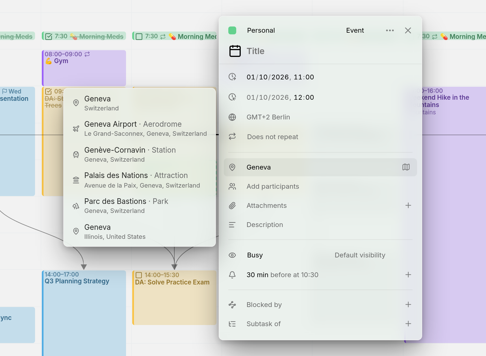

項目エディターの場所フィールドは、入力に合わせて場所の候補を表示します。API キーも登録も不要です。Mitra は OpenStreetMap を基盤とした無料のオープンソースジオコーダー [Photon](https://photon.komoot.io) を使います。

<picture>
  <source media="(prefers-color-scheme: dark)" srcset="../assets/screenshots/location-detail-dark.webp">
  
</picture>

## 候補

場所フィールドをクリックすると、カレンダーで最近使った場所が表示されます。入力すると一致するものに絞り込まれ、2 文字目以降は Photon が見つけた場所も加わります。選ぶと名前と住所が入力されます。入力し続けてもかまいません。場所はプレーンテキストなので、何を書いてもよいのです。フィールド横の地図ボタンで、その場所を Google マップで開きます。

候補は近くの場所を優先します。初めてフィールドをクリックしたとき、ブラウザーが Mitra に位置情報の使用を許可するか尋ねることがあります。許可すると検索のたびに位置が送られるので、近くの場所が先に出ます。許可しなくても候補は機能しますが、その優先付けはありません。

Mitra が英語、ドイツ語、フランス語に設定されている場合、Photon はその言語で場所の名前を返し、それ以外の言語では現地の言語で返します。

[Notion](integrations/notion.md)、[Todoist](integrations/todoist.md)、[Tempo](integrations/tempo.md) のカレンダーには場所がないため、それらの項目に場所フィールドはありません。

## プライバシー

ブラウザーが Photon と直接通信することはありません。検索は自分の Mitra サーバーに送られ、サーバーが Photon に問い合わせて結果を返すので、Photon が見るのはあなたのアドレスではなくサーバーのアドレスだけです。ただし、入力した内容と、許可した場合は位置情報は Photon に届きます。

最近使った場所は自分のカレンダーだけから来ます。複数のユーザーがいるサーバーでも、他のユーザーの場所は誰にも見えません。

## 自分の Photon サーバーを使う

デフォルトでは、Mitra は komoot の公開 Photon サーバーに問い合わせます。フェアユースの上限があり、稼働の保証もありません。これに依存したくない場合は、[Photon を自前でホスト](https://github.com/komoot/photon)して、`MITRA_PHOTON_URL` で Mitra をそこに向けます。

```yaml
environment:
  MITRA_PHOTON_URL: 'https://photon.internal.example.com'
```

再起動後、検索は自分のサーバーに送られます。アプリ側は何も変わりません。他の設定は[設定](configuration.md)を参照してください。

## トラブルシューティング

最近使った場所しか出ない場合、Photon が 5 秒以内に応答しなかったか、検索を拒否しました。公開サーバーが混雑しているか、リクエストを制限しているときに起こります。Mitra は[ログ](logging.md)に警告を書きます。フィールドには引き続き何でも入力でき、[自分の Photon サーバー](#use-your-own-photon-server)を使えばこの問題は回避できます。

場所の名前が意外な言語で表示される場合、それは Photon の制限です。Photon が知っているのは英語、ドイツ語、フランス語だけで、それ以外の言語ではその場所の現地名を使います。
