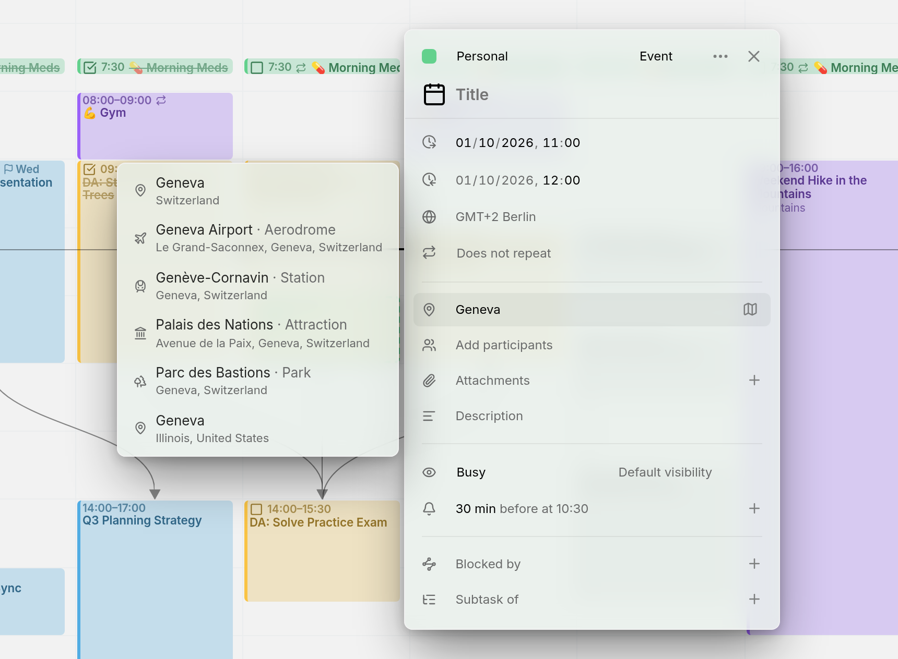

항목 편집기의 위치 필드는 입력하는 동안 장소를 제안합니다. API 키도 가입도 필요 없습니다. Mitra는 OpenStreetMap 기반의 무료 오픈 소스 지오코더인 [Photon](https://photon.komoot.io)을 사용합니다.

<picture>
  <source media="(prefers-color-scheme: dark)" srcset="../assets/screenshots/location-detail-dark.webp">
  
</picture>

## 제안

위치 필드를 클릭하면 캘린더에서 최근에 쓴 장소가 나타납니다. 입력할수록 일치하는 장소로 좁혀지고, 두 번째 글자부터는 Photon의 장소도 함께 나타납니다. 하나를 고르면 이름과 주소가 채워지고, 계속 입력해도 됩니다. 위치는 일반 텍스트이므로 무엇이든 쓸 수 있습니다. 필드 옆의 지도 버튼을 누르면 Google 지도에서 위치가 열립니다.

제안은 가까운 장소를 우선합니다. 필드를 처음 클릭하면 브라우저가 Mitra에서 위치 정보를 사용해도 되는지 물을 수 있습니다. 허용하면 검색할 때마다 현재 위치가 함께 전송되어 가까운 장소가 먼저 나옵니다. 허용하지 않아도 제안은 작동하지만, 가까운 장소를 우선하지는 않습니다.

Photon은 Mitra가 영어, 독일어, 프랑스어 중 하나로 설정되어 있으면 그 언어로, 그 밖에는 현지 언어로 장소 이름을 표시합니다.

[Notion](integrations/notion.md), [Todoist](integrations/todoist.md), [Tempo](integrations/tempo.md) 캘린더에는 위치가 없으므로, 그 항목에는 위치 필드가 없습니다.

## 개인정보 보호

브라우저는 Photon에 직접 연결하지 않습니다. 검색은 Mitra 서버로 가고, 서버가 Photon에 물어 답을 전달하므로 Photon은 사용자의 주소가 아니라 서버의 주소만 보게 됩니다. 다만 입력한 내용과, 허용했다면 현재 위치는 Photon에 전달됩니다.

최근 장소는 본인의 캘린더에서만 가져옵니다. 사용자가 여러 명인 서버에서도 다른 사용자의 장소는 보이지 않습니다.

## 직접 운영하는 Photon 서버 사용하기

기본적으로 Mitra는 komoot의 공개 Photon 서버에 묻습니다. 이 서버에는 공정 사용 제한이 있고, 계속 운영된다는 보장도 없습니다. 이 서버에 의존하지 않으려면 [Photon을 직접 호스팅](https://github.com/komoot/photon)하고 `MITRA_PHOTON_URL`로 Mitra가 그 서버를 쓰게 하세요.

```yaml
environment:
  MITRA_PHOTON_URL: 'https://photon.internal.example.com'
```

다시 시작하면 검색이 직접 운영하는 서버로 갑니다. 앱에서 달라지는 것은 없습니다. 다른 설정은 [구성](configuration.md)을 참고하세요.

## 문제 해결

최근 장소만 나타난다면 Photon이 5초 안에 답하지 않았거나 검색을 거부한 것입니다. 공개 서버가 바쁘거나 요청을 제한할 때 이런 일이 생깁니다. Mitra는 [로그](logging.md)에 경고를 남깁니다. 필드에는 여전히 무엇이든 입력할 수 있고, [직접 운영하는 Photon 서버](#use-your-own-photon-server)를 쓰면 이 문제를 피할 수 있습니다.

장소 이름이 예상과 다른 언어로 나온다면 Photon의 한계입니다. Photon은 영어, 독일어, 프랑스어만 알고, 그 밖의 언어에서는 각 장소의 현지 이름을 씁니다.
