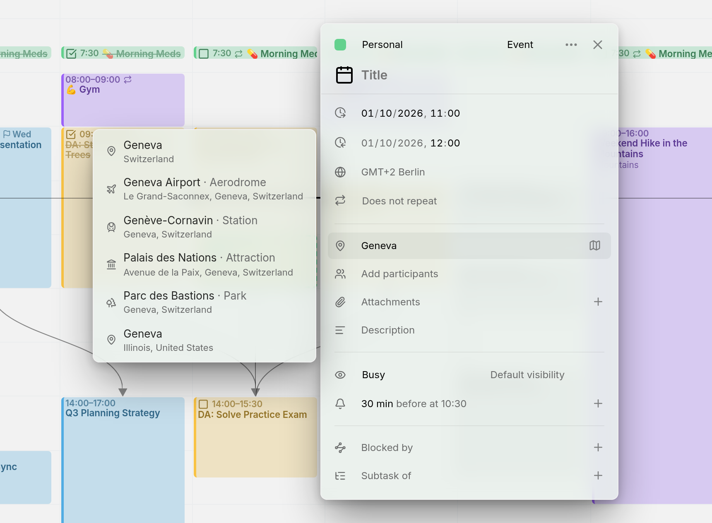

Ô địa điểm trong trình chỉnh sửa mục gợi ý các nơi chốn khi bạn gõ. Nó không cần khóa API hay đăng ký: Mitra dùng [Photon](https://photon.komoot.io), một bộ mã hóa địa lý miễn phí, mã nguồn mở, xây dựng trên OpenStreetMap.

<picture>
  <source media="(prefers-color-scheme: dark)" srcset="../assets/screenshots/location-detail-dark.webp">
  
</picture>

## Gợi ý

Nhấp vào ô địa điểm để xem các nơi đã dùng gần đây trong các lịch của bạn. Khi bạn gõ, danh sách thu hẹp còn những nơi khớp, và từ chữ cái thứ hai, các nơi từ Photon sẽ được thêm vào. Chọn một nơi để điền tên và địa chỉ của nó, hoặc cứ gõ tiếp: địa điểm là văn bản thuần túy, bạn có thể viết bất cứ điều gì. Nút bản đồ bên cạnh ô mở địa điểm trong Google Maps.

Các gợi ý ưu tiên những nơi gần bạn. Lần đầu bạn nhấp vào ô, trình duyệt có thể hỏi Mitra có được dùng vị trí của bạn hay không. Nếu bạn cho phép, vị trí của bạn được gửi kèm mỗi lần tìm kiếm, nên các nơi gần đó hiện trước. Nếu không, gợi ý vẫn hoạt động, chỉ không có ưu tiên đó.

Photon gọi tên các nơi bằng tiếng Anh, tiếng Đức hoặc tiếng Pháp khi Mitra được đặt sang một trong các ngôn ngữ đó, và bằng ngôn ngữ địa phương trong các trường hợp còn lại.

Các lịch [Notion](integrations/notion.md), [Todoist](integrations/todoist.md) và [Tempo](integrations/tempo.md) không có địa điểm, nên các mục của chúng không có ô địa điểm.

## Quyền riêng tư

Trình duyệt của bạn không bao giờ liên hệ với Photon. Các lượt tìm kiếm đi đến máy chủ Mitra của bạn, máy chủ này hỏi Photon rồi chuyển câu trả lời lại, nên Photon chỉ thấy địa chỉ của máy chủ bạn, không phải của bạn. Nó có thấy những gì bạn gõ và, nếu bạn đã cho phép, vị trí của bạn.

Các nơi gần đây chỉ lấy từ chính các lịch của bạn. Trên máy chủ có nhiều người dùng, không ai thấy các nơi của người khác.

## Dùng máy chủ Photon của riêng bạn

Theo mặc định, Mitra hỏi máy chủ Photon công cộng của komoot, nơi có giới hạn sử dụng hợp lý và không cam kết luôn hoạt động. Để không phụ thuộc vào nó, hãy [tự lưu trữ Photon](https://github.com/komoot/photon) và trỏ Mitra đến đó bằng `MITRA_PHOTON_URL`:

```yaml
environment:
  MITRA_PHOTON_URL: 'https://photon.internal.example.com'
```

Sau khi khởi động lại, các lượt tìm kiếm đi đến máy chủ của bạn. Trong ứng dụng không có gì thay đổi. Xem [Cấu hình](configuration.md) cho các cài đặt khác.

## Khắc phục sự cố

Nếu chỉ thấy các nơi gần đây, nghĩa là Photon không trả lời trong năm giây hoặc từ chối lượt tìm kiếm, điều này xảy ra khi máy chủ công cộng đang bận hoặc giới hạn yêu cầu. Mitra ghi một cảnh báo vào [nhật ký](logging.md) của nó. Ô vẫn nhận bất cứ gì bạn gõ, và [máy chủ Photon của riêng bạn](#use-your-own-photon-server) tránh được vấn đề này.

Nếu tên các nơi hiện bằng ngôn ngữ không mong muốn, đó là giới hạn của Photon: nó chỉ biết tiếng Anh, tiếng Đức và tiếng Pháp, và dùng tên địa phương của từng nơi cho mọi ngôn ngữ khác.
