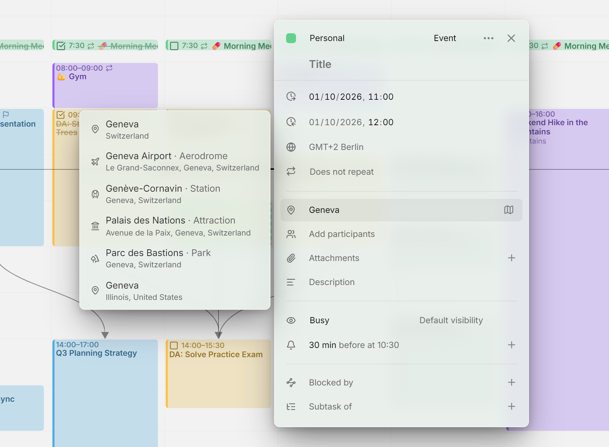

在条目编辑器的地点栏中输入时，它会为你推荐地点。无需 API 密钥，也无需注册：Mitra 使用的是 [Photon](https://photon.komoot.io)，一个基于 OpenStreetMap 的免费开源地理编码服务。

<picture>
  <source media="(prefers-color-scheme: dark)" srcset="../assets/screenshots/location-detail-dark.webp">
  
</picture>

## 地点建议

点击地点栏，就会看到你的日历中最近用过的地点。随着你输入，列表会筛选出匹配的地点；从第二个字母开始，Photon 找到的地点也会加入进来。选择一个地点，就会填入它的名称和地址；你也可以继续输入：地点只是纯文本，写什么都可以。地点栏旁边的地图按钮会在 Google 地图中打开这个地点。

建议会优先显示你附近的地点。第一次点击地点栏时，浏览器可能会询问是否允许 Mitra 使用你的位置。如果允许，每次搜索都会附带你的位置，附近的地点就会排在前面。如果不允许，建议照样可用，只是不会优先显示附近的地点。

如果 Mitra 设置为英语、德语或法语，Photon 会用对应的语言显示地名；设置为其他语言时，则使用当地语言的地名。

[Notion](integrations/notion.md) 和 [Tempo](integrations/tempo.md) 日历没有地点，所以它们的条目也没有地点栏。

## 隐私

你的浏览器从不直接联系 Photon。搜索请求会发送到你的 Mitra 服务器，由服务器向 Photon 查询，再把结果传回来，所以 Photon 只能看到你服务器的地址，看不到你的地址。不过，它能看到你输入的内容，以及你的位置（如果你允许了的话）。

最近用过的地点只来自你自己的日历。在多用户的服务器上，任何人都看不到其他用户的地点。

## 使用你自己的 Photon 服务器

默认情况下，Mitra 会查询 komoot 的公共 Photon 服务器，该服务器有合理使用限制，也不保证一直可用。如果不想依赖它，可以[自己部署 Photon](https://github.com/komoot/photon)，然后用 `MITRA_PHOTON_URL` 让 Mitra 指向它：

```yaml
environment:
  MITRA_PHOTON_URL: 'https://photon.internal.example.com'
```

重启后，搜索请求就会发送到你自己的服务器，应用中的使用方式没有任何变化。其他设置请参阅[配置](configuration.md)。

## 故障排除

如果只显示最近用过的地点，说明 Photon 没有在五秒内响应，或者拒绝了这次搜索。公共服务器繁忙或正在限制请求时，就会出现这种情况。Mitra 会在[日志](logging.md)中记录一条警告。地点栏仍然可以输入任何内容，而[使用你自己的 Photon 服务器](#use-your-own-photon-server)可以避免这个问题。

如果地名显示的语言出乎意料，这是 Photon 本身的限制：它只支持英语、德语和法语，其他语言一律使用地点在当地的名称。
