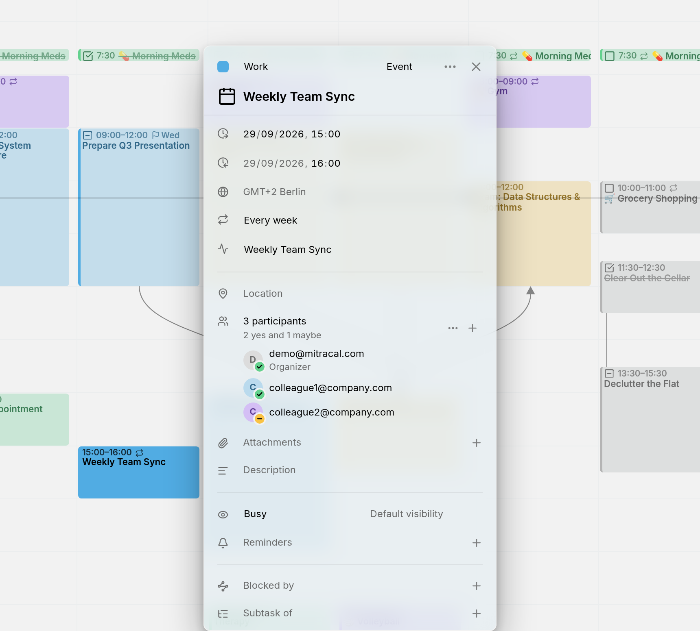

項目には、その項目に関わる人である **参加者** を設定できます。Mitra は参加者を標準的なカレンダー形式で項目と一緒に保存するので、同じカレンダーを使う他のアプリにも同じリストが見え、Apple カレンダー、Thunderbird、Web メールでされた返答も Mitra に表示されます。

<picture>
  <source media="(prefers-color-scheme: dark)" srcset="../assets/screenshots/participants-detail-dark.webp">
  
</picture>

## 誰が招待を送るのか

Mitra 自身がメールを送ることはありません。誰かを追加したときに何が起こるかは、その項目があるカレンダー次第です。

項目が[カレンダーサーバー](integrations/caldav.md)、[Google カレンダー](integrations/google.md)、[Apple カレンダー](integrations/apple.md)のカレンダーにある場合、送信するのはそのサーバーです。招待、項目が変わったときの更新通知、参加者を外したり項目を削除したりしたときのキャンセル通知を送ります。返答の回収もサーバーが行い、それで返答が Mitra に届きます。Google、iCloud、Nextcloud、Fastmail、mailbox.org、Zimbra など、ほとんどのサーバーがこれを行います。カレンダーを保存するだけのサーバーは何も送らないので、誰にも項目のことは伝わらず、すべての返答は保留のままです。

[Mitra カレンダー](integrations/mitra.md)にはカレンダーの背後にサーバーがないので、リストは誰が関わっているかの記録にすぎません。誰も招待されず、返答も届きません。

[Notion](integrations/notion.md)、[Todoist](integrations/todoist.md)、[Tempo](integrations/tempo.md) のカレンダーは参加者を持てないので、それらの項目に参加者行はありません。[カレンダー購読](integrations/subscriptions.md)では参加者は見えますが、カレンダーが読み取り専用なので変更はできません。

## 人を追加する

項目を開き、**参加者を追加** にメールアドレスを入力して Enter を押します。カンマ、セミコロン、スペースで区切れば一度に複数追加できます。あとから追加するには、参加者数の横の **＋** を押します。

アカウントが背後にあるカレンダーでは、最初の人を追加した時点であなたが **主催者** になります。あなた自身のアドレスが **主催者** の印付きで参加の返答済みとしてリストに加わります。Mitra カレンダーには使えるあなたのアドレスがないので、そのリストに主催者はいません。

各人はイニシャル、メールアドレス、カレンダーが知っていれば名前とともに表示され、該当する場合は **主催者** や **任意** も付きます。メールアドレスは選択できるので、行からアドレスを 1 つコピーできます。リストが 5 人を超えると、先頭の 4 人を表示し、残りは「他 n 人」の行に折りたたみます。

人にポインターを合わせると操作できます。1 つのボタンで任意にするか必須に戻すかが切り替わり、**✕** で削除します。タッチスクリーンではこれらのボタンは常に表示されています。

## 返答

各人のイニシャルに付くバッジが返答を示します。緑のチェックは出席、赤のバツは欠席、黄色のダッシュは仮の出席です。バッジがなければまだ返答がありません。人数の下の行に「出席 2 人、欠席 1 人、未回答 3 人」のように集計が出ます。

返答はカレンダーサーバー経由で Mitra に届くので、新しい返答は即時ではなく次の同期で表示されます。

Mitra は全員の返答を表示しますが、あなたの返答は送信しません。他の人が送った招待に参加・不参加の返答をするには、メールアプリや別のカレンダーアプリで返答してください。あなたの返答は Mitra に同期されて戻ってきます。

## 全員への操作

人数の横の **⋯** メニューはリスト全体に作用します。

- **参加者にメール**：あなた以外の全員宛のメールをメールアプリで作成します。
- **参加者のメールアドレスをコピー**：すべてのアドレスをコピーします。
- **すべて必須にする** と **すべて任意にする**：全員の役割を一度に変えます。
- **すべての参加者を削除**：リストを空にします。

## リストを変えられるのは主催者だけ

他の人が主催する項目では、人の追加、削除、変更はできません。**＋** は隠れ、メニューはメールとコピーだけになります。これはカレンダーアプリが従うスケジューリング標準のルールで、Mitra のサーバーもそのような変更を拒否します。タイトル、時刻、説明など、項目の他の部分は編集できます。

> [!CAUTION]
> 参加者のいる項目を別のカレンダーに移動すると、最初のカレンダーからは削除され、サーバーによっては参加者にキャンセルされたと通知されます。知らせたくない場合は、代わりに[コピー](calendars.md#move-or-copy-every-entry-to-another-calendar)してください。

## トラブルシューティング

- 全員が未回答のままで招待も届かない場合、その項目が Mitra カレンダーにあるか、カレンダーサーバーが招待を送りません。サーバーを確かめるには、提供元の公式アプリから同じ人たちを招待してみてください。
- 返答が届いたのにバッジが変わらない場合、Mitra の次の同期を待ってください。返答はカレンダーサーバー経由で届きます。
- 人を追加する手段がない場合、その項目は他の人が主催しているか、カレンダーが読み取り専用です。
- 項目に参加者行がない場合、そのカレンダーは参加者を持てません。Notion、Todoist、Tempo がそうです。
- 会議室がリストにない場合、それは意図的です。会議室や備品は人ではないので、Mitra は除外しています。
