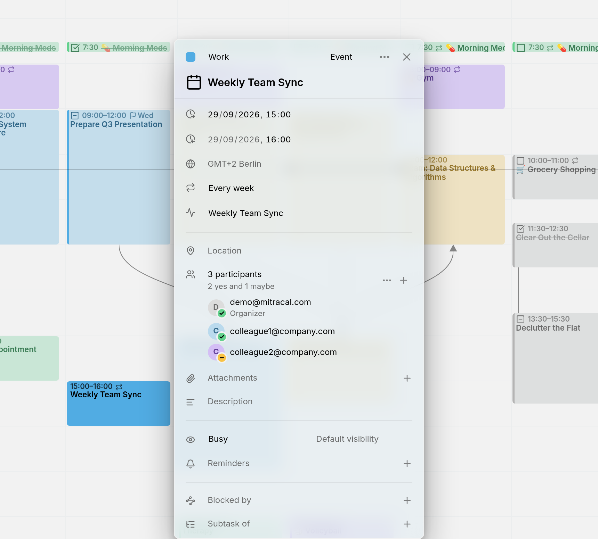

항목에는 **참석자**, 즉 항목에 관련된 사람들을 둘 수 있습니다. Mitra는 참석자를 표준 캘린더 형식으로 항목과 함께 저장하므로, 같은 캘린더를 쓰는 다른 앱에서도 같은 목록이 보이고, Apple 캘린더, Thunderbird, 웹메일에서 보낸 응답도 Mitra에 나타납니다.

<picture>
  <source media="(prefers-color-scheme: dark)" srcset="../assets/screenshots/participants-detail-dark.webp">
  
</picture>

## 초대장을 보내는 쪽

Mitra는 직접 이메일을 보내지 않습니다. 누군가를 추가했을 때 어떻게 되는지는 항목이 들어 있는 캘린더에 따라 다릅니다.

항목이 [캘린더 서버](integrations/caldav.md), [Google 캘린더](integrations/google.md), [Apple 캘린더](integrations/apple.md)의 캘린더에 있으면 그 서버가 보냅니다. 초대장, 항목이 바뀔 때의 업데이트, 누군가를 빼거나 항목을 삭제할 때의 취소 알림까지 모두 서버가 보냅니다. 응답도 서버가 모으며, 그렇게 해서 응답이 Mitra에 도착합니다. Google, iCloud, Nextcloud, Fastmail, mailbox.org, Zimbra를 비롯해 대부분의 서버가 이렇게 합니다. 캘린더를 저장만 하는 서버는 아무것도 보내지 않으므로, 아무도 항목을 알지 못하고 모든 응답이 대기 상태로 남습니다.

[Mitra 캘린더](integrations/mitra.md)에는 뒤에 서버가 없으므로 목록은 누가 관련되어 있는지 기록할 뿐입니다. 아무도 초대되지 않고 응답도 오지 않습니다.

[Notion](integrations/notion.md), [Todoist](integrations/todoist.md), [Tempo](integrations/tempo.md) 캘린더는 참석자를 담을 수 없으므로 항목에 참석자 행이 없습니다. [캘린더 구독](integrations/subscriptions.md)에서는 캘린더가 읽기 전용이라 참석자를 볼 수는 있지만 바꿀 수는 없습니다.

## 사람 추가하기

항목을 열고 **참석자 추가**에 이메일 주소를 입력한 뒤 Enter를 누르세요. 쉼표, 세미콜론, 공백으로 구분해 여러 명을 한 번에 추가할 수 있습니다. 나중에 더 추가하려면 참석자 수 옆의 **＋** 버튼을 누르세요.

계정이 연결된 캘린더에서는 처음 사람을 추가하면 본인이 **주최자**가 됩니다. 본인 주소가 **주최자** 표시와 함께 수락 상태로 목록에 들어갑니다. Mitra 캘린더에는 쓸 수 있는 본인 주소가 없으므로 목록에 주최자가 없습니다.

각 사람은 이니셜, 이메일, 캘린더가 알고 있다면 이름, 그리고 해당할 때는 **주최자** 또는 **선택**과 함께 표시됩니다. 이메일은 선택할 수 있어서 행에서 주소 하나만 복사할 수 있습니다. 목록이 다섯 명을 넘으면 처음 네 명만 보여 주고 나머지는 "더 보기" 행 뒤에 접어 둡니다.

사람을 바꾸려면 그 사람 위에 포인터를 올리세요. 버튼 하나는 선택 참석자로 표시하거나 다시 필수로 되돌리고, **✕** 버튼은 그 사람을 뺍니다. 터치스크린에서는 이 버튼들이 항상 보입니다.

## 응답

각 사람의 이니셜 위에 있는 배지가 응답을 보여 줍니다. 초록색 체크는 수락, 빨간색 엑스는 거절, 노란색 대시는 미정입니다. 배지가 없으면 아직 응답이 없다는 뜻입니다. 참석자 수 아래 줄에는 "수락 2명, 거절 1명 및 응답 대기 3명"처럼 요약이 표시됩니다.

응답은 캘린더 서버를 거쳐 Mitra에 도착하므로, 새 응답은 즉시가 아니라 다음 동기화 때 나타납니다.

Mitra는 모든 사람의 응답을 보여 주지만 본인의 응답을 보내지는 않습니다. 다른 사람이 보낸 초대를 수락하거나 거절하려면 메일 앱이나 다른 캘린더 앱에서 응답하세요. 그 응답이 Mitra로 동기화됩니다.

## 모두에게 한 번에

참석자 수 옆의 **⋯** 메뉴는 목록 전체에 적용됩니다.

- **참석자에게 이메일 보내기**는 다른 모든 사람에게 보낼 이메일을 메일 앱에서 엽니다.
- **참석자 이메일 복사**는 모든 주소를 복사합니다.
- **모두 필수 참석으로 표시**와 **모두 선택 참석으로 표시**는 모든 사람의 역할을 한 번에 바꿉니다.
- **모두 삭제**는 목록을 비웁니다.

## 목록은 주최자만 바꿀 수 있습니다

다른 사람이 주최한 항목에서는 사람을 추가하거나 빼거나 바꿀 수 없습니다. **＋** 버튼이 숨겨지고, 메뉴에서는 이메일 보내기와 복사만 할 수 있습니다. 캘린더 앱들이 따르는 일정 관리 표준의 규칙이며, Mitra 서버도 이런 변경을 거부합니다. 제목, 시간, 설명처럼 항목의 나머지 부분은 여전히 편집할 수 있습니다.

> [!CAUTION]
> 참석자가 있는 항목을 다른 캘린더로 옮기면 원래 캘린더에서는 삭제되고, 일부 서버는 참석자에게 취소되었다고 알립니다. 참석자가 알면 안 되는 경우에는 대신 [복사하세요](calendars.md#move-or-copy-every-entry-to-another-calendar).

## 문제 해결

- 모두가 계속 대기 중이고 초대장이 오지 않았다면, 항목이 Mitra 캘린더에 있거나 캘린더 서버가 초대장을 보내지 않는 것입니다. 서버를 확인하려면 서비스 자체 앱에서 같은 사람들을 초대해 보세요.
- 응답이 왔는데 배지가 바뀌지 않았다면 Mitra의 다음 동기화를 기다리세요. 응답은 캘린더 서버를 거쳐 도착합니다.
- 사람을 추가할 방법이 없다면, 다른 사람이 항목의 주최자이거나 캘린더가 읽기 전용입니다.
- 항목에 참석자 행이 없다면, Notion, Todoist, Tempo처럼 캘린더가 참석자를 담을 수 없는 것입니다.
- 회의실이 목록에 없다면 의도된 것입니다. 회의실과 장비는 사람이 아니므로 Mitra가 목록에서 뺍니다.
