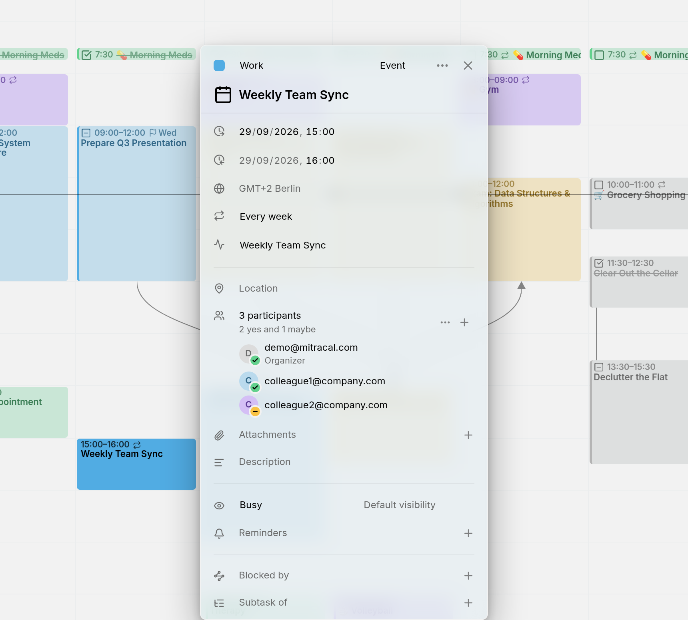

Một mục có thể có **người tham gia**: những người liên quan đến mục đó. Mitra lưu họ cùng với mục theo định dạng lịch chuẩn, nên mọi ứng dụng khác dùng cùng lịch đều thấy cùng danh sách, và phản hồi được thực hiện trong Lịch Apple, Thunderbird hoặc webmail cũng hiện trong Mitra.

<picture>
  <source media="(prefers-color-scheme: dark)" srcset="../assets/screenshots/participants-detail-dark.webp">
  
</picture>

## Ai gửi lời mời

Mitra không bao giờ tự gửi email. Điều xảy ra khi bạn thêm ai đó tùy vào lịch chứa mục.

Khi mục nằm trong lịch từ [máy chủ lịch](integrations/caldav.md), [Google Lịch](integrations/google.md) hoặc [Lịch Apple](integrations/apple.md), chính máy chủ đó sẽ gửi: lời mời, bản cập nhật khi mục thay đổi, và thông báo hủy khi bạn bỏ ai đó ra hoặc xóa mục. Máy chủ cũng thu thập phản hồi, nhờ vậy phản hồi mới đến được Mitra. Hầu hết máy chủ đều làm vậy, gồm Google, iCloud, Nextcloud, Fastmail, mailbox.org và Zimbra. Máy chủ chỉ lưu trữ lịch thì không gửi gì cả, nên không ai biết về mục này và mọi phản hồi đều ở trạng thái đang chờ.

Trong [lịch Mitra](integrations/mitra.md) không có máy chủ nào đứng sau lịch, nên danh sách chỉ là bản ghi những người liên quan. Không ai được mời và cũng không có phản hồi nào gửi đến.

Lịch [Notion](integrations/notion.md), [Todoist](integrations/todoist.md) và [Tempo](integrations/tempo.md) không thể chứa người tham gia, nên các mục của chúng không có hàng người tham gia. Trong [lịch đăng ký](integrations/subscriptions.md), bạn xem được người tham gia nhưng không thay đổi được, vì lịch chỉ đọc.

## Thêm người

Mở mục, nhập địa chỉ email vào **Thêm người tham gia** rồi nhấn Enter. Bạn có thể thêm nhiều người cùng lúc, cách nhau bằng dấu phẩy, dấu chấm phẩy hoặc khoảng trắng. Để thêm sau, nhấn **＋** bên cạnh số người tham gia.

Trong lịch có tài khoản đứng sau, người đầu tiên bạn thêm sẽ biến bạn thành **người tổ chức**: địa chỉ của chính bạn được thêm vào danh sách, đánh dấu **Người tổ chức**, ở trạng thái đã chấp nhận. Lịch Mitra không có địa chỉ nào của bạn để dùng, nên danh sách của nó không có người tổ chức.

Mỗi người hiện với chữ cái đầu, email, tên nếu lịch biết, và **Người tổ chức** hoặc **Không bắt buộc** khi phù hợp. Có thể chọn email, nên bạn sao chép được một địa chỉ từ hàng của nó. Khi danh sách có hơn năm người, danh sách hiện bốn người đầu và gộp phần còn lại vào một hàng “thêm”.

Trỏ vào một người để thay đổi họ. Một nút đánh dấu họ là không bắt buộc, hoặc bắt buộc trở lại, và nút **✕** xóa họ. Trên màn hình cảm ứng, các nút này luôn hiển thị.

## Phản hồi

Một huy hiệu trên chữ cái đầu của mỗi người cho biết phản hồi của họ: dấu tích xanh là đã chấp nhận, dấu chéo đỏ là đã từ chối, và dấu gạch ngang vàng là chưa chắc. Không có huy hiệu nghĩa là chưa phản hồi. Một dòng dưới số người tóm tắt lại, chẳng hạn “2 có, 1 không, 3 đang chờ”.

Phản hồi đến Mitra qua máy chủ lịch, nên phản hồi mới sẽ hiện ở lần đồng bộ kế tiếp chứ không tức thì.

Mitra hiện phản hồi của mọi người nhưng không gửi phản hồi của bạn. Để chấp nhận hoặc từ chối lời mời do người khác gửi, hãy trả lời trong ứng dụng thư hoặc ứng dụng lịch khác, và câu trả lời của bạn sẽ đồng bộ về Mitra.

## Thao tác với mọi người

Menu **⋯** bên cạnh số người tác động lên cả danh sách:

- **Gửi email cho người tham gia** mở ứng dụng thư của bạn với một email gửi cho mọi người còn lại.
- **Sao chép email của người tham gia** sao chép mọi địa chỉ.
- **Đánh dấu tất cả là bắt buộc** và **Đánh dấu tất cả là không bắt buộc** đổi vai trò của mọi người cùng lúc.
- **Xóa tất cả** làm trống danh sách.

## Chỉ người tổ chức mới thay đổi được danh sách

Với mục do người khác tổ chức, bạn không thể thêm, xóa hay thay đổi người: nút **＋** bị ẩn, và menu chỉ còn gửi email và sao chép. Đó là quy tắc của chuẩn lập lịch mà các ứng dụng lịch tuân theo, và máy chủ của Mitra cũng từ chối thay đổi như vậy. Bạn vẫn sửa được phần còn lại của mục, như tiêu đề, thời gian và mô tả.

> [!CAUTION]
> Di chuyển một mục có người tham gia sang lịch khác sẽ xóa mục khỏi lịch đầu tiên, và một số máy chủ khi đó sẽ báo cho người tham gia rằng mục đã bị hủy. Hãy [sao chép](calendars.md#move-or-copy-every-entry-to-another-calendar) mục nếu họ không nên biết về việc này.

## Khắc phục sự cố

- Nếu mọi người cứ ở trạng thái đang chờ và không có lời mời nào đến, mục nằm trong lịch Mitra, hoặc máy chủ lịch của nó không gửi lời mời. Để kiểm tra máy chủ, hãy mời cùng những người đó từ ứng dụng riêng của nhà cung cấp.
- Nếu phản hồi đã đến nhưng huy hiệu không đổi, hãy đợi lần đồng bộ kế tiếp của Mitra, vì phản hồi đến qua máy chủ lịch.
- Nếu không có cách nào để thêm người, thì người khác tổ chức mục này, hoặc lịch là chỉ đọc.
- Nếu mục không có hàng người tham gia, lịch của nó không thể chứa người tham gia, như trong Notion, Todoist và Tempo.
- Nếu phòng họp không có trong danh sách, đó là chủ ý: phòng và thiết bị không phải là người, nên Mitra bỏ chúng ra.
