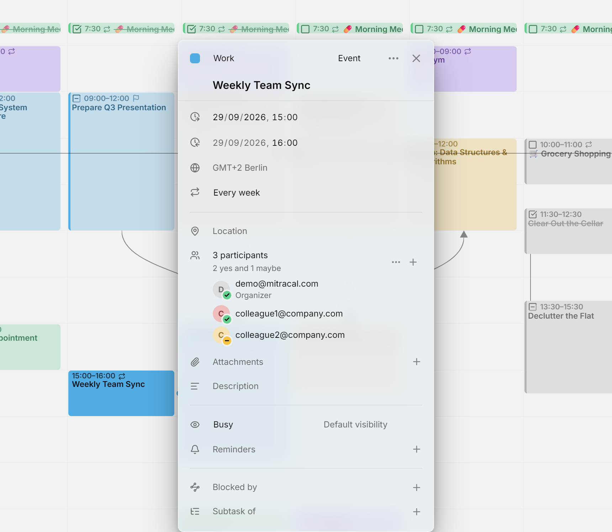

条目可以有**参与者**：也就是与它相关的人。Mitra 会以标准日历格式把参与者和条目保存在一起，所以使用同一日历的其他应用看到的都是同一份名单；在 Apple 日历、Thunderbird 或网页邮箱中做出的回复，也会显示在 Mitra 中。

<picture>
  <source media="(prefers-color-scheme: dark)" srcset="../assets/screenshots/participants-detail-dark.webp">
  
</picture>

## 由谁发送邀请

Mitra 自己从不发送邮件。添加参与者之后会发生什么，取决于条目所在的日历。

如果条目在[日历服务器](integrations/caldav.md)、[Google 日历](integrations/google.md)或 [Apple 日历](integrations/apple.md)的日历中，邮件由那台服务器发送：包括邀请、条目变更时的更新，以及你移除某人或删除条目时的取消通知。服务器还会收集回复，回复正是这样传到 Mitra 的。大多数服务器都会这样做，包括 Google、iCloud、Nextcloud、Fastmail、mailbox.org 和 Zimbra。只负责存储日历的服务器什么也不会发送，这样就没有人会知道这个条目，所有人也会一直显示为未回复。

在 [Mitra 日历](integrations/mitra.md)中，日历背后没有服务器，所以参与者名单只是记录有哪些人参与。不会邀请任何人，也不会收到回复。

[Notion](integrations/notion.md) 和 [Tempo](integrations/tempo.md) 日历无法保存参与者，所以它们的条目没有参与者这一行。在[日历订阅](integrations/subscriptions.md)中，你能看到参与者，但不能修改，因为这个日历是只读的。

## 添加参与者

打开条目，在**添加参与者**中输入邮箱地址，然后按 Enter 键。你可以一次添加多人，用逗号、分号或空格分隔。之后要再添加，点击参与者人数旁的 **＋**。

在有账号的日历中，你添加第一个人时，自己就会成为**组织者**：你的邮箱地址会加入名单，标为**组织者**，并显示为已接受。Mitra 日历没有属于你的邮箱地址可用，所以它的名单中没有组织者。

名单中的每个人都会显示名字的首字母、邮箱地址、日历中已知的姓名，以及适用时的**组织者**或**可选**标记。邮箱地址可以选中，方便你从某一行中单独复制一个地址。名单超过五人时，只显示前四人，其余的会收进一行“还有 N 位”中。

把指针移到某个人上，就可以修改。一个按钮可以把这个人设为可选参加，或改回必须参加；**✕** 则把这个人移除。在触摸屏上，这些按钮会一直显示。

## 回复

每个人首字母上的徽标显示他们的回复：绿色对勾表示接受，红色叉号表示拒绝，黄色短横表示待定。没有徽标表示还没有回复。人数下方有一行汇总，例如 2 人接受、1 人拒绝、3 人尚未回复。

回复经由日历服务器传到 Mitra，所以新回复要到下次同步时才会显示，而不是即时出现。

Mitra 会显示每个人的回复，但不会替你发送回复。要接受或拒绝别人发来的邀请，请在你的邮件应用或其他日历应用中回复，你的回复会同步回 Mitra。

## 对所有人操作

人数旁的 **⋯** 菜单会对整份名单进行操作：

- **给参与者发邮件**会打开你的邮件应用，写一封发给其他所有人的邮件。
- **复制参与者的邮箱地址**会复制所有地址。
- **全部设为必须参加**和**全部设为可选**会一次性更改所有人的参加要求。
- **全部移除**会清空名单。

## 只有组织者才能修改名单

如果条目是别人组织的，你就不能添加、移除或修改参与者：**＋** 会隐藏，菜单中也只剩发邮件和复制功能。这是各日历应用共同遵循的日程安排标准中的规则，Mitra 的服务器同样会拒绝这类修改。你仍然可以编辑条目的其他内容，比如标题、时间和描述。

> [!CAUTION]
> 把有参与者的条目移动到另一个日历，会将它从原来的日历中删除，有些服务器随后会通知参与者这个条目已取消。如果不想让他们收到通知，请改为[复制](calendars.md#move-or-copy-every-entry-to-another-calendar)。

## 故障排除

- 如果所有人都一直没有回复，也没有人收到邀请，说明条目在 Mitra 日历中，或者它所在的日历服务器不发送邀请。要检查服务器，可以用服务提供商自己的应用邀请同样的人试试。
- 如果收到了回复，但徽标没有变化，请等待 Mitra 的下一次同步，因为回复是经由日历服务器传来的。
- 如果无法添加参与者，说明这个条目由别人组织，或者日历是只读的。
- 如果条目没有参与者这一行，说明它所在的日历无法保存参与者，比如 Notion 和 Tempo。
- 如果名单中没有会议室，这是有意为之：会议室和设备不是人，所以 Mitra 不会列出它们。
