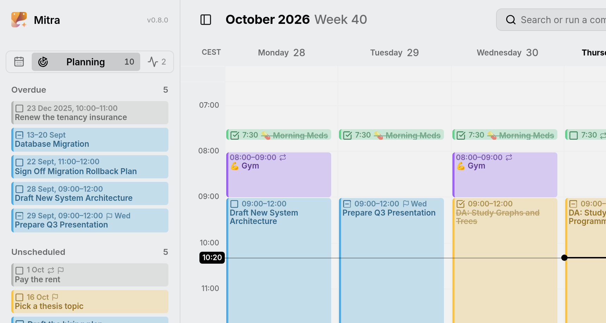

計画とは、まだ週の中に居場所がないタスクのための機能です。取っておきたいアイデア、期日はあるが予定のない仕事、単にまだ手を付けていないこと。これらは期日と見積もりを持ったまま、サイドバーの **計画** タブで、週の中にドラッグされるのを待っています。

このページでは、計画タブ、期日、見積もり、タスクのスケジュールと解除、期限切れのタスクを説明します。

<picture>
  <source media="(prefers-color-scheme: dark)" srcset="../assets/screenshots/planning-detail-dark.webp">
  
</picture>

## スケジュール、制約、計画

Mitra はタスクの時間に関する情報を 2 種類に分けています。

- **スケジュール**は、そのタスクにいつ取り組むか、つまり開始と終了です。各ビューが表示するのはこれです。スケジュールのあるタスクは**日付が確定した**タスク、ないタスクは**日付未定**のタスクです。
- **制約**は、スケジュールが守らなければならない条件です。タスクには 2 つあります。いつまでに終わっていなければならないかの**期日**と、どのくらいかかるかの**見積もり**です。

**計画**とは、日付未定のタスクにスケジュールを設定して、各スケジュールがその制約に合うようにすることです。期日より前に終わり、見積もりと同じ長さにします。見積もりは Mitra が考慮してくれるので、スケジュールしたタスクは最初から正しい長さになっています。

スケジュールも制約も必須ではありません。タスクは期日だけ、スケジュールだけ、両方、どちらもなし、のどれでもかまいません。

たとえば、水曜 14:00 に始まる計画会議がプレゼン資料の期日で、準備に火曜の午前をスケジュールするとします。ビューにはそのタスクが火曜に表示され、横の小さなフラグが期日のあることを示します。

<picture>
  <source media="(prefers-color-scheme: dark)" srcset="../assets/screenshots/due-detail-dark.webp">
  
</picture>

## 計画タブ

サイドバーの **計画** タブが、計画を立てる場所です。日付未定のタスクが、スケジュールされるまでそこで待っています。サイドバーを開いて **計画** に切り替えます。**カレンダー** から横にスワイプしても移動できます。トラックパッドでは 2 本指、タッチスクリーンでは 1 本指です。

タブには 2 つのリストがあります。

- **日付未定**には、すべての日付未定タスクが入ります。[自分で順番を付ける](#put-tasks-in-order)までは、期日のあるタスクが先に来て最も近いものが上に、そのほかはアルファベット順に続き、完了したタスクは一番下に移ります。
- **期限切れ**には、遅れてしまったタスクが入ります。[期限切れのタスク](#overdue-tasks)を参照してください。

タブの数字は両方のリストを数えているので、**カレンダー** タブからもどれだけ待っているか分かります。タスクをクリックすると、ビューと同じように開きます。

あとでやるタスクを書き留めるには、タブ下部の **タスクを追加** を押します。聞かれるのはタイトルだけです。タスクは[デフォルトのカレンダー](calendars.md#where-new-entries-land)に入り、デフォルトがタスクを持てない場合は、持てる最初のカレンダーに入ります。

## タスクに順番を付ける

**日付未定** リスト内でタスクを上下にドラッグすると並べ替えられます。順序は保存され、タスクが別のカレンダーに移っても位置は保たれます。

自分の順序は期日より優先されます。新しいタスクは自分で置いたものの下に現れ、完了したタスクは一番下のままです。

この順序は Mitra 自身が保持するので、他のアプリからは見えません。

## 期日を設定する

タスクを開き、**期日** を押して日付を選びます。期日を外すには、その横の **✕** を押します。

期日のあるタスクには、ビューと計画タブで小さなフラグが付きます。スケジュールされたタスクでは、フラグはできるだけ短く期日も示します。同じ日なら時刻、これから 1 週間以内なら曜日、それ以外は日付です。タスクが期日を過ぎて終わるスケジュールになると、フラグは赤い塗りつぶしに変わります。週ビューや月ビュー、タイムラインでタスクにポインターを合わせると、期日まで伸びます。タイムラインは各タスクの行にも期日を示します。スケジュール、解除、移動のどれをしても期日は変わりません。

終日タスクの期日は日です。時刻を付けるには、その行にいる間に表示される、期日の行末の **終日** をオフにします。するとタスク全体が時刻を持つようになり、期日は同じ日の 17:00 になります。そこから変更できます。

## 見積もりを設定する

日付未定のタスクには、スケジュールされたタスクで終了時刻が来る位置に、砂時計付きの **見積もり** フィールドがあります。クリックして時間と分を入力するか、一覧から長さを選びます。

見積もりがあるのは日付未定のタスクだけです。タスクをスケジュールすると、見積もりはスケジュールの長さになります。解除すると、スケジュールの長さが再び見積もりになるので、どちらに変えても失われるものはありません。

## タスクをスケジュールする

スケジュールするとタスクに開始と終了が付きます。方法は 2 つあります。

### ビューにドラッグする

計画タブからタスクをドラッグして、ビューにドロップします。

- **週ビューの時刻に置くと**、タスクはそこに開始し、見積もりと同じ長さになります。見積もりがなければ、あなたの[デフォルトの所要時間](settings.md#entries)になります。
- **週ビューの終日レーンや、月・年ビューの日付に置くと**、タスクは終日になります。見積もりと同じ日数を占め、最低 1 日です。

あとは他の項目と同じように、端をドラッグして長くしたり短くしたりできます。

### 開始日を設定する

タスクを開き、**開始日** を押して日付を選びます。

- 見積もりが 1 日より短い場合、タスクは 9:00 に開始し、見積もりと同じ長さになります。
- それ以外の場合、タスクは終日になり、見積もりと同じ日数を占め、最低 1 日です。

ビューはその日に移動し、タスクは開いたままなのですぐに時刻を調整できます。これはどこでも使えます。サイドバーを開くとビューが隠れてドラッグ先がない携帯電話でも使えます。

## タスクのスケジュールを解除する

解除するとタスクのスケジュールが消え、計画タブに戻ります。方法は 2 つあります。

- タスクをビューから**ドラッグ**して、**日付未定** リストにドロップします。
- **タスクを開いて、開始日の横の ✕ を押します**。計画タブが開き、タスクは開いたままです。

タスクは期日を保ち、スケジュールの長さは見積もりになります。カウントダウンの対象となる期日があればリマインダーも残り、なければ削除されます。

終了日の横の **✕** は別の働きをします。タスクを解除するのではなく、[時点](#moments)に変えます。

> [!NOTE]
> 解除できるのはタスクだけです。予定には必ず日付があります。週次レビューのように、スケジュールに沿って繰り返すタスクも解除できません。

## 期限切れのタスク

タスクが終わっておらず、その日が過ぎたものが**期限切れ**です。その日とは期日、期日がなければスケジュールの最終日です。**期限切れ** リストにはこれらのタスクが、最も遅れているものから順に並びます。

Mitra は丸ごとの日で数えるので、今朝が期日のタスクが期限切れになるのは明日です。

完了にするとリストから外れます。期日を先に延ばすか、期日がなければ後の日にスケジュールしても外れます。

## 繰り返す期日

毎月 1 日までに家賃を払うように、何度も期日がやってくるタスクもあります。タスクに期日を付けて繰り返しに設定します。

**日付未定** リストには次の 1 回だけが出るので、毎月分でいっぱいになることはありません。スケジュールするのはその月の分だけで、翌月分がリストの中のその場所に入ります。

繰り返すタスクが期限切れになることはありません。

## 時点

**時点**は、開始があって終了がない、スケジュールされたタスクです。朝 7:30 に薬を飲むような、ひと続きの時間ではなく時点でやるもののためのものです。週ビューでは、開始時刻に細い 1 行の項目として表示されます。

タスクを時点にするには、開いて終了日の横の **✕** を押します。終了を付け戻すには **終了日** を押します。

## どのカレンダーが対応するか

どの変更も、そのタスクが属するカレンダーに直接保存されます。

- **Mitra に保存されるカレンダー**は、このページのすべてに対応します。
- [**カレンダーサーバー**](integrations/caldav.md)もすべてに対応します。同じカレンダーを使う他のアプリにもタスクの開始と期日が見えます。
- [**Notion**](integrations/notion.md)はスケジュールに対応しますが、制約には対応しません。Notion のデータベースはタスクごとに 1 つの日付しか持たないためです。
- [**Todoist**](integrations/todoist.md)はすべてに対応します。タスクの日付がスケジュール、所要時間が見積もり、締め切りが期日です。Todoist が締め切りを保持するのは Pro と Business プランだけで、日単位のみです。
