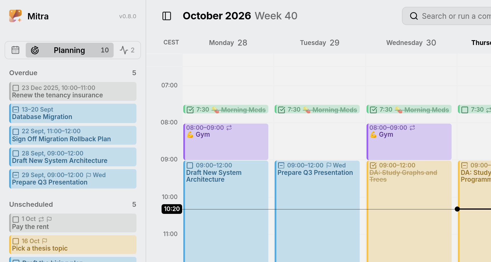

계획은 아직 한 주 안에 자리가 없는 작업을 다룹니다. 잊지 않으려고 적어 둔 아이디어, 마감일은 있지만 계획이 없는 일, 아직 손대지 못한 일들입니다. 이런 작업은 마감일과 예상 시간을 지닌 채 사이드바의 **계획** 탭에서 기다리다가, 한 주 안으로 드래그하면 그곳에 자리를 잡습니다.

이 페이지에서는 계획 탭, 마감일, 예상 시간, 작업의 일정 잡기와 일정 해제, 기한 지난 작업을 다룹니다.

<picture>
  <source media="(prefers-color-scheme: dark)" srcset="../assets/screenshots/planning-detail-dark.webp">
  
</picture>

## 일정, 제약 조건, 계획

Mitra는 작업의 시간에 관한 정보를 두 가지로 나눕니다.

- **일정**은 작업을 언제 할지, 즉 시작과 종료입니다. 보기에 표시되는 것이 바로 일정입니다. 일정이 있는 작업은 **일정이 잡힌** 작업이고, 일정이 없는 작업은 **날짜 미정** 작업입니다.
- **제약 조건**은 일정이 지켜야 하는 조건입니다. 작업에는 두 가지 제약 조건이 있습니다. 언제까지 끝내야 하는지를 나타내는 **마감일**과, 얼마나 걸릴지를 나타내는 **예상 시간**입니다.

**계획**이란 날짜 미정 작업의 일정을 잡되, 각 일정이 제약 조건에 맞도록 하는 것입니다. 즉 마감일 전에 끝나고, 길이는 예상 시간과 같아야 합니다. 예상 시간은 Mitra가 알아서 반영하므로, 일정을 잡은 작업은 처음부터 알맞은 길이를 갖습니다.

일정도 제약 조건도 필수는 아닙니다. 작업에는 마감일만 있을 수도, 일정만 있을 수도, 둘 다 있을 수도, 둘 다 없을 수도 있습니다.

예를 들어 수요일 14:00에 시작하는 기획 회의 때까지 발표 자료를 준비해야 해서, 화요일 오전에 준비할 일정을 잡았다고 해 봅시다. 보기에는 작업이 화요일에 표시되고, 옆의 작은 깃발이 마감일이 있음을 알려 줍니다.

<picture>
  <source media="(prefers-color-scheme: dark)" srcset="../assets/screenshots/due-detail-dark.webp">
  
</picture>

## 계획 탭

사이드바의 **계획** 탭은 계획을 세우는 곳입니다. 날짜 미정 작업은 일정을 잡을 때까지 이곳에서 기다립니다. 사이드바를 열고 **계획**으로 전환하세요. **캘린더** 탭에서 옆으로 스와이프해도 됩니다. 트랙패드에서는 두 손가락으로, 터치스크린에서는 한 손가락으로 스와이프하세요.

탭에는 두 개의 목록이 있습니다.

- **날짜 미정** 목록에는 날짜 미정 작업이 모두 들어 있습니다. [순서를 직접 정하기](#put-tasks-in-order) 전까지는 마감일이 있는 작업이 먼저 오고, 마감일이 가장 가까운 작업이 맨 위에 옵니다. 나머지는 가나다순으로 이어지고, 끝난 작업은 맨 아래로 내려갑니다.
- **기한 지남** 목록에는 밀려 버린 작업이 들어 있습니다. [기한 지난 작업](#overdue-tasks)을 참고하세요.

탭에 표시되는 숫자는 두 목록을 합친 개수이므로, **캘린더** 탭에서도 기다리는 작업이 얼마나 되는지 알 수 있습니다. 작업을 클릭하면 보기에서처럼 작업이 열립니다.

나중에 할 작업을 적어 두려면 탭 아래쪽의 **작업 추가**를 누르세요. 제목만 입력하면 됩니다. 작업은 [기본 캘린더](calendars.md#where-new-entries-land)에 들어가고, 기본 캘린더에 작업을 담을 수 없으면 작업을 담을 수 있는 첫 번째 캘린더에 들어갑니다.

## 작업 순서 정하기

**날짜 미정** 목록에서 작업을 위아래로 드래그해 순서를 바꾸세요. 순서는 저장되며, 작업을 다른 캘린더로 옮겨도 자리가 유지됩니다.

직접 정한 순서가 마감일보다 우선합니다. 새 작업은 자리를 정해 둔 작업들 아래에 나타나고, 끝난 작업은 맨 아래에 남습니다.

순서는 Mitra가 자체적으로 보관하므로 다른 앱에서는 보이지 않습니다.

## 마감일 정하기

작업을 열고 **마감일**을 누른 다음 날짜를 고르세요. 마감일을 없애려면 옆의 **✕** 버튼을 누르세요.

마감일이 있는 작업에는 보기와 계획 탭 모두에서 작은 깃발이 표시됩니다. 일정이 잡힌 작업이라면 깃발에 마감일도 최대한 짧게 표시됩니다. 같은 날 마감이면 시각을, 앞으로 일주일 안이면 요일을, 그 밖에는 날짜를 보여 줍니다. 작업의 일정이 마감일보다 늦게 끝나면 깃발이 빨갛게 채워집니다. 주 보기나 월 보기, 또는 타임라인에서 작업을 가리키면 작업이 마감일까지 늘어나 보입니다. 타임라인은 각 작업의 줄에 마감일도 표시합니다. 일정을 잡거나, 해제하거나, 작업을 옮겨도 마감일은 바뀌지 않습니다.

종일 작업은 날짜 단위로 마감됩니다. 시각을 지정하려면 마감일을 편집하는 동안 그 끝에 나타나는 **종일**을 끄세요. 그러면 작업 전체에 시각이 생기고, 마감일은 같은 날 17:00이 됩니다. 이 시각은 바꿀 수 있습니다.

## 예상 시간 정하기

날짜 미정 작업에는 일정이 잡힌 작업의 종료 자리에 모래시계가 달린 **예상 시간** 필드가 있습니다. 클릭해서 시간과 분을 입력하거나 목록에서 길이를 고르세요.

예상 시간은 날짜 미정 작업에만 있습니다. 작업의 일정을 잡으면 예상 시간이 일정의 길이가 됩니다. 일정을 해제하면 일정의 길이가 다시 예상 시간이 되므로, 어느 쪽으로든 잃는 것이 없습니다.

## 작업 일정 잡기

일정을 잡으면 작업에 시작과 종료가 생깁니다. 방법은 두 가지입니다.

### 보기로 드래그하기

계획 탭에서 작업을 끌어다 보기에 놓으세요.

- **주 보기의 특정 시각에 놓으면** 작업이 놓은 자리에서 시작하고 예상 시간만큼 이어집니다. 예상 시간이 없으면 [기본 길이](settings.md#entries)만큼 이어집니다.
- **주 보기의 종일 영역이나 월 보기, 연도 보기의 날짜에 놓으면** 작업이 종일 작업이 됩니다. 예상 시간만큼의 날짜에 걸치며, 최소 하루입니다.

그런 다음 다른 항목처럼 가장자리를 드래그해 길이를 늘리거나 줄이세요.

### 시작일 정하기

작업을 열고 **시작일**을 누른 다음 날짜를 고르세요.

- 예상 시간이 하루보다 짧으면 작업은 9:00에 시작해 예상 시간만큼 이어집니다.
- 그렇지 않으면 작업이 종일 작업이 되어 예상 시간만큼의 날짜에 걸치며, 최소 하루입니다.

보기가 그 날짜로 이동하고 작업은 열린 채로 남아 있어 바로 시각을 조정할 수 있습니다. 이 방법은 어디서나 통합니다. 열린 사이드바가 보기를 가려 드래그할 곳이 없는 휴대폰에서도 마찬가지입니다.

## 작업 일정 해제하기

일정을 해제하면 작업의 일정이 사라지고 작업이 계획 탭으로 돌아갑니다. 방법은 두 가지입니다.

- 작업을 보기에서 **드래그**해 **날짜 미정** 목록에 놓습니다.
- **작업을 열고 시작일 옆의 ✕를 누릅니다.** 계획 탭이 열리고 작업은 열린 채로 남아 있습니다.

작업의 마감일은 그대로 유지되고, 일정의 길이가 예상 시간이 됩니다. 알림은 기준이 될 마감일이 있으면 남고, 없으면 삭제됩니다.

종료일 옆의 **✕** 버튼은 다른 일을 합니다. 작업의 일정을 해제하지 않고 [순간](#moments)으로 바꿉니다.

> [!NOTE]
> 일정을 해제할 수 있는 것은 작업뿐입니다. 유형이 일정인 항목에는 항상 날짜가 있습니다. 주간 회고처럼 정해진 주기로 반복되는 작업도 일정을 해제할 수 없습니다.

## 기한 지난 작업

작업이 끝나지 않았는데 그 날짜가 지나면 **기한 지남** 상태가 됩니다. 작업의 날짜는 마감일이고, 마감일이 없으면 일정의 마지막 날입니다. **기한 지남** 목록에는 이런 작업이 기한이 가장 많이 지난 순서대로 표시됩니다.

Mitra는 하루 단위로 세므로, 오늘 아침이 마감인 작업은 내일이 되어야 기한 지남이 됩니다.

작업을 완료로 표시하면 목록에서 빠집니다. 마감일을 더 뒤로 미루거나, 마감일이 없다면 더 뒤의 날짜로 일정을 잡아도 됩니다.

## 반복되는 마감일

매달 1일까지 월세를 내는 것처럼 계속 돌아오는 마감이 있는 작업도 있습니다. 작업에 마감일을 정하고 반복하도록 설정하세요.

**날짜 미정** 목록에는 다음 회차만 표시되므로 모든 달이 한꺼번에 목록을 채우지 않습니다. 일정을 잡으면 그달의 작업만 일정이 잡히고, 다음 달 작업이 목록의 그 자리를 이어받습니다.

반복 작업은 기한 지남이 되지 않습니다.

## 순간

**순간**은 시작만 있고 종료가 없는, 일정이 잡힌 작업입니다. 아침 7:30에 약 먹기처럼 일정 시간 동안이 아니라 한 시점에 하는 일에 씁니다. 주 보기에서는 시작 시각에 가늘고 한 줄짜리 항목으로 표시됩니다.

작업을 순간으로 바꾸려면 작업을 열고 종료일 옆의 **✕** 버튼을 누르세요. 다시 종료를 지정하려면 **종료일**을 누르세요.

## 지원하는 캘린더

모든 변경 사항은 작업이 속한 캘린더에 바로 저장됩니다.

- **Mitra에 저장된 캘린더**는 이 페이지의 모든 기능을 지원합니다.
- [**캘린더 서버**](integrations/caldav.md) 역시 모든 기능을 지원합니다. 같은 캘린더를 쓰는 다른 앱에서도 작업의 시작과 마감일이 보입니다.
- [**Notion**](integrations/notion.md) 캘린더는 일정은 지원하지만 제약 조건은 지원하지 않습니다. Notion 데이터베이스는 작업마다 날짜를 하나만 담기 때문입니다.
- [**Todoist**](integrations/todoist.md) 캘린더는 모든 기능을 지원합니다. 작업의 날짜가 일정이 되고, 소요 시간이 예상 시간, 기한이 마감일이 됩니다. Todoist는 Pro와 Business 요금제에서만 기한을 보관하며, 날짜만 보관합니다.
