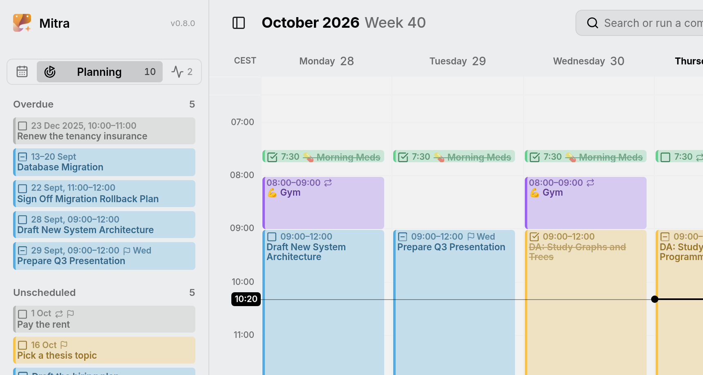
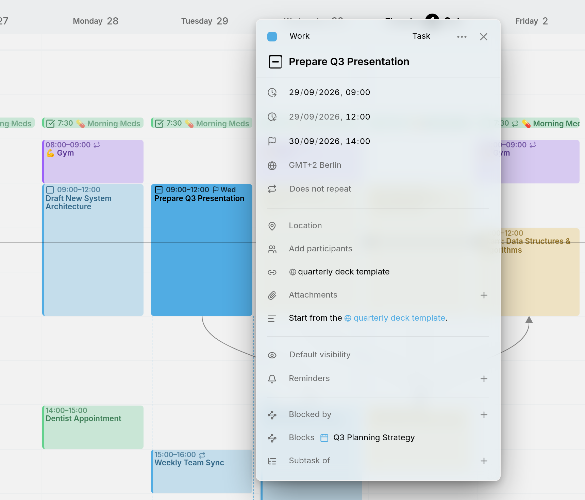

Lập kế hoạch dành cho những công việc chưa có chỗ trong tuần của bạn: những ý tưởng bạn muốn giữ lại, việc có hạn chót nhưng chưa có kế hoạch, và những việc bạn chưa làm đến. Chúng chờ trong tab **Kế hoạch** của thanh bên cùng với hạn chót và ước tính, cho đến khi bạn kéo chúng vào tuần của mình.

Trang này nói về tab Kế hoạch, hạn chót, ước tính, việc lên lịch và bỏ lịch cho công việc, và công việc quá hạn.

<picture>
  <source media="(prefers-color-scheme: dark)" srcset="../assets/screenshots/planning-detail-dark.webp">
  
</picture>

## Lịch trình, ràng buộc và kế hoạch

Mitra tách thông tin về thời gian của một công việc thành hai loại.

- **Lịch trình** là lúc bạn sẽ làm công việc: ngày bắt đầu và kết thúc. Đây là thứ các chế độ xem hiển thị. Công việc có lịch trình là **đã lên lịch**, và công việc không có là **chưa lên lịch**.
- **Ràng buộc** là những gì lịch trình phải tuân theo. Một công việc có hai ràng buộc: **hạn chót**, lúc nó phải xong, và **ước tính**, thời gian nó sẽ mất.

**Lập kế hoạch** là lên lịch cho các công việc chưa lên lịch sao cho mỗi lịch trình khớp với ràng buộc của nó: kết thúc trước hạn chót và dài bằng ước tính. Mitra tự tính đến ước tính, nên công việc bạn lên lịch đã có độ dài đúng.

Cả lịch trình lẫn ràng buộc đều không bắt buộc. Một công việc có thể có hạn chót mà không có lịch trình, có lịch trình mà không có hạn chót, có cả hai, hoặc không có gì.

Ví dụ, một bài thuyết trình đến hạn khi cuộc họp kế hoạch thứ Tư bắt đầu lúc 14:00, và bạn lên lịch sáng thứ Ba để chuẩn bị. Các chế độ xem hiển thị công việc vào thứ Ba, và một lá cờ nhỏ bên cạnh cho biết nó có hạn chót.

<picture>
  <source media="(prefers-color-scheme: dark)" srcset="../assets/screenshots/due-detail-dark.webp">
  
</picture>

## Tab Kế hoạch

Tab **Kế hoạch** của thanh bên là nơi bạn lập kế hoạch: các công việc chưa lên lịch chờ ở đó cho đến khi bạn lên lịch. Mở thanh bên và chuyển sang **Kế hoạch**. Bạn cũng có thể vuốt ngang từ **Lịch**, bằng hai ngón trên bàn di chuột hoặc một ngón trên màn hình cảm ứng.

Tab có hai danh sách:

- **Chưa lên lịch** chứa mọi công việc chưa lên lịch. Cho đến khi bạn [sắp xếp thứ tự](#put-tasks-in-order), công việc có hạn chót đứng đầu, việc gần nhất ở trên cùng. Phần còn lại theo thứ tự bảng chữ cái, và công việc đã xong chuyển xuống cuối.
- **Quá hạn** chứa những công việc bạn đã chậm. Xem [công việc quá hạn](#overdue-tasks).

Con số trên tab đếm cả hai danh sách, nên bạn cũng thấy được có bao nhiêu việc đang chờ từ tab **Lịch**. Nhấp vào một công việc để mở nó, như trong các chế độ xem.

Để ghi lại một công việc cho sau này, nhấn **Thêm công việc** ở cuối tab. Nó chỉ hỏi tiêu đề. Công việc được đưa vào [lịch mặc định](calendars.md#where-new-entries-land) của bạn, hoặc vào lịch đầu tiên có thể chứa công việc nếu lịch mặc định không chứa được.

## Sắp xếp thứ tự công việc

Kéo một công việc lên hoặc xuống trong danh sách **Chưa lên lịch** để sắp xếp lại. Thứ tự được lưu, và công việc giữ nguyên vị trí khi chuyển sang lịch khác.

Thứ tự của bạn được ưu tiên hơn hạn chót. Công việc mới xuất hiện bên dưới những việc bạn đã sắp xếp, và công việc đã xong ở lại cuối danh sách.

Mitra tự giữ thứ tự này, nên các ứng dụng khác không thấy nó.

## Đặt hạn chót

Mở công việc, nhấn **Hạn chót** và chọn một ngày. Để xóa hạn chót, nhấn **✕** bên cạnh.

Công việc có hạn chót hiển thị một lá cờ nhỏ, trong các chế độ xem và trong tab Kế hoạch. Với công việc đã lên lịch, lá cờ còn ghi hạn chót ngắn gọn nhất có thể: giờ nếu đến hạn trong cùng ngày, thứ trong tuần nếu trong tuần tới, và ngày tháng trong các trường hợp còn lại. Lá cờ chuyển sang màu đỏ và được tô đầy khi công việc được lên lịch kết thúc sau hạn chót. Trỏ vào một công việc trong chế độ xem tuần hoặc tháng, hoặc trên dòng thời gian, và nó sẽ kéo dài đến hạn chót. Dòng thời gian cũng đánh dấu hạn chót trên hàng của mỗi công việc. Việc lên lịch, bỏ lịch hay di chuyển công việc không bao giờ thay đổi hạn chót của nó.

Một công việc cả ngày đến hạn vào một ngày. Để đặt giờ cho nó, tắt **Cả ngày** ở cuối hạn chót, nút này hiện khi bạn đang ở hàng đó. Việc đó đặt giờ cho cả công việc, nên hạn chót của nó trở thành 17:00 cùng ngày, và bạn có thể thay đổi.

## Đặt ước tính

Công việc chưa lên lịch có ô **Ước tính**, với biểu tượng đồng hồ cát, ở chỗ công việc đã lên lịch có ngày kết thúc. Nhấp vào đó và nhập số giờ và phút, hoặc chọn một độ dài từ danh sách.

Chỉ công việc chưa lên lịch mới có ước tính. Khi bạn lên lịch cho một công việc, ước tính của nó trở thành độ dài lịch trình. Khi bạn bỏ lịch, độ dài lịch trình lại trở thành ước tính, nên không mất gì theo cả hai chiều.

## Lên lịch cho công việc

Lên lịch cho một công việc là đặt ngày bắt đầu và kết thúc. Có hai cách.

### Kéo vào một chế độ xem

Kéo công việc ra khỏi tab Kế hoạch và thả vào một chế độ xem.

- **Vào một giờ trong ngày ở chế độ xem tuần**, công việc bắt đầu tại nơi bạn thả và kéo dài bằng ước tính của nó. Nếu không có ước tính, nó kéo dài bằng [thời lượng mặc định](settings.md#entries) của bạn.
- **Vào vùng cả ngày của chế độ xem tuần, hoặc vào một ngày trong chế độ xem tháng hoặc năm**, công việc trở thành cả ngày. Nó trải qua số ngày bằng ước tính, và tối thiểu một ngày.

Sau đó, kéo mép của nó để làm dài hoặc ngắn hơn, như mọi mục khác.

### Đặt ngày bắt đầu

Mở công việc, nhấn **Ngày bắt đầu** và chọn một ngày.

- Nếu ước tính ngắn hơn một ngày, công việc bắt đầu lúc 9:00 và kéo dài bằng ước tính.
- Nếu không, công việc trở thành cả ngày, trải qua số ngày bằng ước tính, và tối thiểu một ngày.

Chế độ xem chuyển đến ngày đó, và công việc vẫn mở, nên bạn có thể chỉnh giờ ngay. Cách này dùng được ở mọi nơi, kể cả trên điện thoại, nơi thanh bên đang mở che mất chế độ xem và không có chỗ nào để kéo tới.

## Bỏ lịch cho công việc

Bỏ lịch là xóa lịch trình của công việc và đưa nó về tab Kế hoạch. Có hai cách:

- **Kéo** công việc ra khỏi chế độ xem và thả vào danh sách **Chưa lên lịch**.
- **Mở công việc và nhấn ✕** bên cạnh ngày bắt đầu. Tab Kế hoạch mở ra, với công việc vẫn đang mở.

Công việc giữ hạn chót, và độ dài lịch trình của nó trở thành ước tính. Lời nhắc của nó được giữ nếu có hạn chót để đếm ngược tới, và bị xóa nếu không.

Nút **✕** bên cạnh ngày kết thúc làm việc khác. Nó không bỏ lịch công việc, mà biến công việc thành một [khoảnh khắc](#moments).

> [!NOTE]
> Chỉ công việc mới có thể bỏ lịch. Sự kiện luôn có ngày. Một công việc lặp lại theo lịch, chẳng hạn buổi xem lại hằng tuần, cũng không thể bỏ lịch.

## Công việc quá hạn

Một công việc **quá hạn** khi nó chưa xong và ngày của nó đã qua. Ngày của nó là hạn chót, hoặc, nếu không có hạn chót, là ngày cuối của lịch trình. Danh sách **Quá hạn** hiển thị các công việc này, việc quá hạn lâu nhất đứng đầu.

Mitra đếm theo ngày trọn vẹn, nên công việc đến hạn sáng nay chỉ trở thành quá hạn vào ngày mai.

Một công việc rời khỏi danh sách khi bạn đánh dấu nó đã xong. Bạn cũng có thể đặt cho nó hạn chót muộn hơn, hoặc, nếu nó không có hạn chót, lên lịch vào một ngày muộn hơn.

## Hạn chót lặp lại

Một số công việc đến hạn hết lần này đến lần khác, chẳng hạn trả tiền nhà trước ngày 1 hằng tháng. Hãy đặt hạn chót cho công việc và cho nó lặp lại.

Danh sách **Chưa lên lịch** chỉ hiển thị lần kế tiếp, để không bị đầy bởi mọi tháng cùng lúc. Khi bạn lên lịch, chỉ công việc của tháng đó được lên lịch, và công việc của tháng sau thế chỗ nó trong danh sách.

Công việc lặp lại không bao giờ quá hạn.

## Khoảnh khắc

Một **khoảnh khắc** là công việc đã lên lịch có ngày bắt đầu nhưng không có ngày kết thúc, dành cho việc bạn làm tại một thời điểm chứ không phải trong một khoảng thời gian, chẳng hạn uống thuốc buổi sáng lúc 7:30. Trong chế độ xem tuần, nó hiện thành một mục mảnh, một dòng, tại giờ bắt đầu.

Để biến một công việc thành khoảnh khắc, mở nó và nhấn **✕** bên cạnh ngày kết thúc. Để cho nó ngày kết thúc trở lại, nhấn **Ngày kết thúc**.

## Những lịch nào hỗ trợ điều này

Mọi thay đổi được lưu thẳng vào lịch mà công việc thuộc về.

- **Lịch lưu trong Mitra** hỗ trợ mọi thứ trên trang này.
- **[Máy chủ lịch](integrations/caldav.md)** cũng hỗ trợ mọi thứ. Các ứng dụng khác dùng cùng lịch sẽ thấy ngày bắt đầu và hạn chót của công việc.
- **[Notion](integrations/notion.md)** hỗ trợ lịch trình, nhưng không hỗ trợ ràng buộc, vì cơ sở dữ liệu Notion chỉ giữ một ngày cho mỗi công việc.
- **[Todoist](integrations/todoist.md)** hỗ trợ mọi thứ: ngày của công việc là lịch trình, thời lượng là ước tính và deadline là hạn chót. Todoist chỉ giữ deadline trên gói Pro và Business, và chỉ giữ ngày.
