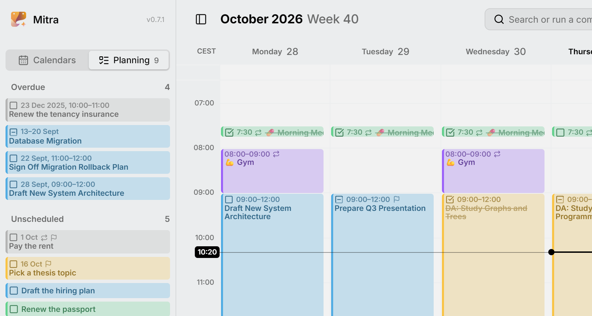

规划针对的是那些在你的一周里还没有位置的任务：想先记下来的点子、有截止日期却还没定计划的工作，以及一直没顾上的事情。它们带着截止日期和预估时长，在侧边栏的**规划**标签页里等着，直到你把它们拖进自己的一周。

本页介绍“规划”标签页、截止日期、预估时长、如何安排和取消安排任务，以及已逾期的任务。

<picture>
  <source media="(prefers-color-scheme: dark)" srcset="../assets/screenshots/planning-detail-dark.webp">
  
</picture>

## 时间安排、约束条件与规划

Mitra 把任务的时间信息分成两类。

- **时间安排**是你打算什么时候做这个任务，也就是它的开始时间和结束时间。各个视图显示的就是时间安排。有时间安排的任务是**已安排**的，没有的则是**未安排**的。
- **约束条件**是时间安排必须遵守的要求。任务有两个约束条件：**截止日期**，即必须完成的时间；**预估时长**，即做完需要多久。

**规划**就是给未安排的任务安排时间，并让每个时间安排都符合它的约束条件：在截止日期之前结束，长度与预估时长一致。预估时长由 Mitra 替你考虑，所以你安排好的任务一开始就是合适的长度。

时间安排和约束条件都不是必填的。一个任务可以只有截止日期没有时间安排，可以只有时间安排没有截止日期，也可以两者都有，或者都没有。

举个例子：一份演示文稿要在周五中午前交，你把周二上午安排出来准备它。各个视图会在周二显示这个任务，旁边的小旗子表示它有截止日期。

<picture>
  <source media="(prefers-color-scheme: dark)" srcset="../assets/screenshots/due-detail-dark.webp">
  
</picture>

## “规划”标签页

侧边栏的**规划**标签页就是你做规划的地方：未安排的任务都在这里等着，直到你给它们安排时间。打开侧边栏，切换到**规划**即可。你也可以在**日历**标签页上横向滑动过去：在触控板上用两根手指，在触摸屏上用一根手指。

这个标签页有两个列表：

- **未安排**列出所有未安排的任务。在你[自己排序](#put-tasks-in-order)之前，有截止日期的任务排在前面，截止日期最近的在最上方；其余任务按字母顺序排在后面，已完成的任务移到最底部。
- **已逾期**列出你落下的任务，详见[已逾期的任务](#overdue-tasks)。

标签页上的数字是两个列表的任务总数，所以你在**日历**标签页上也能看到有多少任务在等着。点击任务即可打开它，和在视图中一样。

想先记下一个以后再做的任务，就点击标签页底部的**添加任务**，只需要填写标题。任务会进入你的[默认日历](calendars.md#where-new-entries-land)；如果默认日历不能存放任务，就进入第一个可以存放任务的日历。

## 给任务排序

在**未安排**列表中上下拖动任务，就能调整顺序。顺序会被保存，任务移到别的日历后也会保持原来的位置。

你排好的顺序优先于截止日期。新任务出现在你排过的任务下方，已完成的任务仍在最底部。

这个顺序由 Mitra 自己保存，其他应用看不到。

## 设定截止日期

打开任务，点击**截止日期**，然后选一天。要移除截止日期，点击它旁边的 **✕**。

有截止日期的任务会在视图和“规划”标签页中显示一面小旗子。安排、取消安排或移动任务，都不会改变它的截止日期。

全天任务的截止日期是某一天，不带具体时间。想给它加上时间，就关掉截止日期这一行末尾的**全天**（指向或选中这一行时才会出现）。这样整个任务都会变成有具体时间的任务，截止时间变为当天 17:00，你可以再改。

## 设定预估时长

未安排的任务有一个带沙漏图标的**预估时长**字段，位置就是已安排任务显示结束时间的地方。点击它，输入小时和分钟，或者从列表中选一个时长。

只有未安排的任务才有预估时长。给任务安排时间时，预估时长就成为时间安排的长度；取消安排时，时间安排的长度又变回预估时长，所以怎么切换都不会丢失信息。

## 给任务安排时间

安排时间就是给任务设定开始时间和结束时间，有两种方法。

### 拖进视图

把任务从“规划”标签页拖出来，放到视图中。

- **放在周视图中的某个时间点上**，任务从你放下的位置开始，持续时间等于它的预估时长。没有预估时长的，则使用你的[默认时长](settings.md#entries)。
- **放在周视图的全天栏中，或月视图、年视图中的某一天上**，任务会变成全天任务，覆盖的天数与预估时长相当，至少一天。

之后可以像其他条目一样，拖动它的边缘来调整长短。

### 设定开始时间

打开任务，点击**开始时间**，然后选一天。

- 如果预估时长不到一天，任务从 9:00 开始，持续时间等于预估时长。
- 否则任务会变成全天任务，覆盖的天数与预估时长相当，至少一天。

视图会跳到那一天，任务也保持打开状态，方便你马上调整时间。这种方法在任何地方都能用，包括手机：在手机上，打开的侧边栏会盖住视图，没有地方可以拖放。

## 取消任务的安排

取消安排会移除任务的时间安排，并把它放回“规划”标签页。有两种方法：

- 把任务从视图中**拖出来**，放到**未安排**列表上。
- **打开任务，点击开始时间旁边的 ✕**。“规划”标签页会随之打开，任务仍保持打开状态。

任务会保留截止日期，时间安排的长度变为预估时长。如果它有截止日期，提醒会保留并改为在截止日期前提醒；没有截止日期的，提醒会被移除。

结束时间旁边的 **✕** 作用不同：它不会取消安排，而是把任务变成一个[时刻](#moments)。

> [!NOTE]
> 只有任务可以取消安排，日程总是有日期的。按时间安排重复的任务（比如每周回顾）也不能取消安排。

## 已逾期的任务

任务没有完成，而它的那一天已经过去，就是**已逾期**。这一天指的是它的截止日期；没有截止日期的，则是时间安排的最后一天。**已逾期**列表会列出这些任务，逾期最久的排在最前面。

Mitra 按整天计算，所以今天上午到期的任务要到明天才算逾期。

把任务标为完成，它就会离开这个列表。你也可以把截止日期改到以后；没有截止日期的任务，可以把它安排到以后的某一天。

## 重复的截止日期

有些任务要一次又一次地按期完成，比如每月 1 日前交房租。给这样的任务设定截止日期，再让它重复即可。

**未安排**列表只显示最近的一次，不会一下子把每个月都列出来。你给它安排时间时，只有这个月的那一次会被安排，下个月的随即出现在列表中。

重复任务永远不会逾期。

## 时刻

**时刻**是只有开始时间、没有结束时间的已安排任务，适合在某个时间点做、而不是持续一段时间的事情，比如早上 7:30 吃药。在周视图中，它在开始时间处显示为一个细长的单行条目。

要把任务变成时刻，打开它，点击结束时间旁边的 **✕**。想重新给它加上结束时间，点击**结束时间**。

## 哪些日历支持这些功能

每次修改都会直接保存到任务所在的日历。

- **Mitra 日历**支持本页介绍的所有功能。
- **[日历服务器](integrations/caldav.md)** 同样全部支持。使用同一日历的其他应用能看到任务的开始时间和截止日期。
- **[Notion](integrations/notion.md)** 支持时间安排，但不支持约束条件，因为 Notion 数据库中的每个任务只有一个日期。
- **[Todoist](integrations/todoist.md)** 全部支持：任务的日期就是它的时间安排，时长就是预估时长，最后期限就是截止日期。Todoist 只在 Pro 和 Business 套餐中保存最后期限，而且只精确到天。
