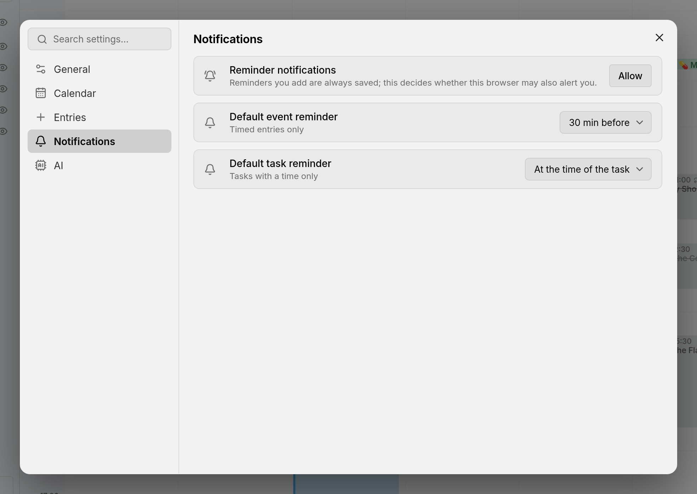

リマインダーは、Mitra を開いていなくても、予定やタスクが近づいたことをシステムの通知で知らせてくれます。自分の Mitra サーバーから届くので、他のサービスに登録する必要はありません。iPhone や iPad でリマインダーを受け取るには、Mitra を[アプリとしてインストール](install-app.md)しておく必要があります。それ以外ではブラウザーだけで十分です。

<picture>
  <source media="(prefers-color-scheme: dark)" srcset="../assets/screenshots/notifications-detail-dark.webp">
  
</picture>

## リマインダーを追加する

項目を開き、ベルの付いたリマインダーの行で **＋** を押します。通知するタイミングを選びます。**予定の開始時**（タスクなら **タスクの時刻**）、5 分前、10 分前、30 分前、1 時間前、1 日前のほか、その他の時刻なら **カスタム…** を選びます。1 つの項目に複数付けられ、隣の **✕** で削除できます。

リマインダーは項目の開始時刻からさかのぼって計算されます。開始時刻のないタスクでは期日からさかのぼります。初めて追加するとき、ブラウザーが Mitra に通知の表示を許可するか尋ねます。許可しなくても、リマインダーは項目と一緒に保存されます。

繰り返しの項目では毎回通知されます。完了やキャンセル済みにしたタスクは鳴りませんが、非表示にしたカレンダーは鳴り続けます。鳴らないようにするには、そのカレンダーが属するアカウントの **⋯ → 編集** でオフにします。[Notion](integrations/notion.md)、[Todoist](integrations/todoist.md)、[Tempo](integrations/tempo.md) のカレンダーにはリマインダーを保存できません。

## デフォルトのリマインダー

**設定 → 通知** で、新しい項目に最初から付くリマインダーを設定します。変更しない限り、予定は 30 分前、タスクはタスクの時刻です。**なし** を選ぶこともできます。終日の項目にはリマインダーが付きません。

## リマインダーが鳴ったとき

通知には、項目のタイトル、日時、場所が、そのデバイスの言語とタイムゾーンで表示されます。閉じるまで残り、タップすると項目が開きます。**10分後に再通知** を押すとあとでもう一度届き、タスクでは **完了** を押せば Mitra を開かずにタスクを完了にできます。Safari と Firefox ではこれらのボタンは表示されません。

リマインダーが送信されたときにオフラインだったデバイスは、遅れて表示する代わりに、項目の開始から 5 分後にその通知を破棄します。

## デバイス

通知を許可したブラウザーやインストール済みアプリはすべてデバイスになり、すべてのデバイスにすべてのリマインダーが届きます。**設定 → 通知** にデバイスが一覧表示され、今使っているものには **このデバイス** と付きます。鉛筆で名前を変更し、**✕** で削除し、**テスト予定** や **テストタスク** で自分宛にサンプルを送れます。

## トラブルシューティング

- リマインダーが届かないときは、**テスト予定** を送ってみます。テストが届くなら、その項目はオフになっているカレンダーにあると考えられます。権限はブラウザーとアドレスごとに付与されるので、あるアドレスで Mitra を許可しても、別のアドレスには及びません。
- **設定 → 通知** に **リマインダー通知** の行がない場合、このブラウザーは Mitra の通知を受け取れません。iPhone や iPad では Safari ではなく[インストール済みのアプリ](install-app.md)を開いてください。それ以外では、Mitra が HTTPS 経由で配信されている必要があります。
- その行に **ブロック中** と出る場合は、ブラウザーのサイト設定で Mitra の通知を許可してください。
- Windows で Chrome を閉じていると何も届かない場合は、Chrome の設定で **Google Chrome を閉じてもバックグラウンドアプリの実行を続行する** をオンにするか、Edge から Mitra をインストールしてください。

## サーバー側

リマインダーに設定は不要で、[HTTPS](configuration.md#put-it-behind-https) だけが必要です。Mitra は初回起動時に生成してデータベースに保管している鍵で通知に署名します。そのため[バックアップ](backups.md)から復元するときはデータフォルダー全体を復元してください。新しいデータベースでは Mitra が新しい鍵を作り、古い鍵で登録されたデバイスにはリマインダーが届かなくなります。各リマインダーは送信されるたびに[ログ](logging.md)に記録されます。
