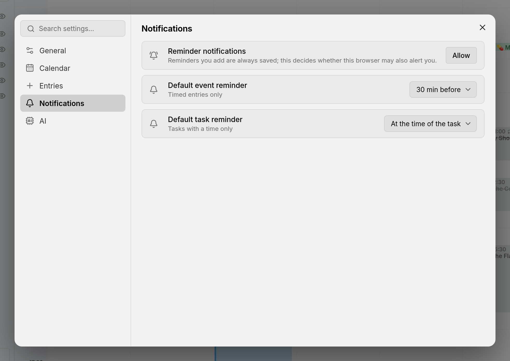

알림은 일정이나 작업을 미리 알려 줍니다. Mitra가 열려 있지 않아도 시스템 알림으로 옵니다. 알림은 직접 운영하는 Mitra 서버에서 보내므로 따로 가입할 서비스가 없습니다. iPhone이나 iPad에서는 Mitra를 [앱으로 설치](install-app.md)해야 알림을 받을 수 있고, 그 밖의 기기에서는 브라우저만 있으면 됩니다.

<picture>
  <source media="(prefers-color-scheme: dark)" srcset="../assets/screenshots/notifications-detail-dark.webp">
  
</picture>

## 알림 추가하기

항목을 열고 종 모양이 있는 알림 행의 **＋** 버튼을 누르세요. 언제 울릴지 고릅니다. **일정 시작 시**(작업이라면 **작업 시각에**), 5분 전, 10분 전, 30분 전, 1시간 전, 하루 전 중에서 고르거나, 다른 시각이 필요하면 **직접 지정…** 옵션을 고르세요. 항목 하나에 알림을 여러 개 둘 수 있으며, 옆의 **✕** 버튼을 누르면 지워집니다.

알림은 항목의 시작 시각을 기준으로, 시작이 없는 작업이라면 마감일을 기준으로 거꾸로 셉니다. 처음 알림을 추가하면 브라우저가 Mitra의 알림 표시를 허용할지 묻습니다. 허용하지 않아도 알림은 항목에 저장됩니다.

반복 항목은 회차마다 알림을 보냅니다. 완료하거나 취소한 작업은 알림이 울리지 않지만, 숨긴 캘린더는 그렇지 않습니다. 캘린더의 알림을 끄려면 그 계정의 **⋯ → 편집**에서 캘린더를 끄세요. [Notion](integrations/notion.md), [Todoist](integrations/todoist.md), [Tempo](integrations/tempo.md) 캘린더에는 알림을 둘 수 없습니다.

## 기본 알림

**설정 → 알림**에서 새 항목에 기본으로 들어갈 알림을 정합니다. 바꾸거나 **없음**을 고르지 않으면 일정은 30분 전, 작업은 작업 시각에 알림이 들어갑니다. 종일 항목은 알림 없이 시작합니다.

## 알림이 울릴 때

알림에는 항목의 제목, 시각, 장소가 기기의 언어와 시간대로 표시됩니다. 닫을 때까지 남아 있으며, 탭하면 항목이 열립니다. **10분 후 다시 알림**을 누르면 나중에 다시 오고, 작업이라면 **완료**를 눌러 Mitra를 열지 않고도 완료로 표시할 수 있습니다. Safari와 Firefox에는 이 버튼이 나오지 않습니다.

알림이 나갈 때 오프라인이었던 기기는 늦게 보여 주는 대신 항목 시작 5분 뒤에 그 알림을 버립니다.

## 내 기기

알림을 허용한 브라우저나 설치한 앱은 모두 기기이며, 모든 기기가 모든 알림을 받습니다. **설정 → 알림**에 기기 목록이 나오고, 지금 쓰고 있는 기기에는 **이 기기**라고 표시됩니다. 연필 아이콘으로 이름을 바꾸고, **✕** 버튼으로 지우고, **일정 테스트**이나 **작업 테스트**으로 샘플 알림을 보내 볼 수 있습니다.

## 문제 해결

- 알림이 오지 않으면 **일정 테스트**을 보내 보세요. 테스트 알림이 온다면 항목이 꺼진 캘린더에 있을 가능성이 큽니다. 권한은 브라우저별, 주소별로 따로 있으므로 한 주소에서 Mitra를 허용해도 다른 주소에는 적용되지 않습니다.
- **설정 → 알림**에 **알림 표시** 행이 없다면 이 브라우저는 Mitra의 알림을 받을 수 없습니다. iPhone이나 iPad에서는 Safari 대신 [설치한 앱](install-app.md)을 여세요. 그 밖의 기기에서는 Mitra가 HTTPS로 제공되어야 합니다.
- 행에 **차단됨**이라고 나오면 브라우저의 사이트 설정에서 Mitra의 알림을 허용하세요.
- Windows에서 Chrome을 닫았을 때 아무 알림도 오지 않으면 Chrome 설정에서 **Google Chrome이 닫혀 있을 때 백그라운드 앱 계속 실행**을 켜거나, Edge에서 Mitra를 설치하세요.

## 서버 쪽

알림에는 따로 설정할 것이 없고 [HTTPS](configuration.md#put-it-behind-https)만 있으면 됩니다. Mitra는 처음 시작할 때 만든 키로 알림에 서명하고 그 키를 데이터베이스에 보관합니다. 그러니 [백업](backups.md)에서 복원할 때는 데이터 폴더를 통째로 복원하세요. 새 데이터베이스에서는 Mitra가 새 키를 만들고, 이전 키로 등록된 기기는 더 이상 알림을 받지 못합니다. 알림이 나갈 때마다 [로그](logging.md)에 기록됩니다.
