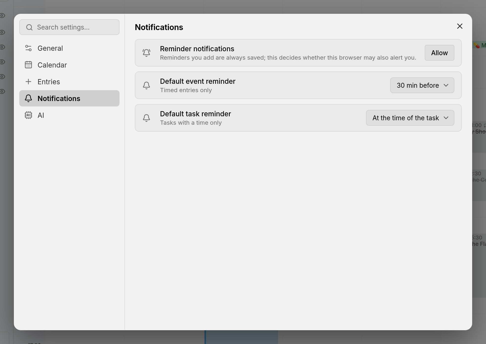

Lời nhắc báo cho bạn về một sự kiện hoặc công việc trước thời điểm đó, dưới dạng thông báo từ hệ thống của bạn, kể cả khi Mitra không mở. Nó đến từ chính máy chủ Mitra của bạn, nên không cần đăng ký dịch vụ nào khác. Trên iPhone hoặc iPad, lời nhắc cần Mitra được [cài thành ứng dụng](install-app.md); ở mọi nơi khác, trình duyệt là đủ.

<picture>
  <source media="(prefers-color-scheme: dark)" srcset="../assets/screenshots/notifications-detail-dark.webp">
  
</picture>

## Thêm lời nhắc

Mở một mục và nhấn **＋** ở hàng lời nhắc của nó, hàng có hình cái chuông. Chọn thời điểm lời nhắc kêu: **Lúc sự kiện bắt đầu** (**Đúng thời điểm của công việc** với công việc), trước 5 hoặc 10 phút, nửa giờ, một giờ hay một ngày, hoặc **Tùy chỉnh…** cho mọi thời điểm khác. Một mục có thể có nhiều lời nhắc, và nhấn **✕** bên cạnh một lời nhắc sẽ xóa nó.

Lời nhắc được tính lùi từ lúc bắt đầu của mục, hoặc, với công việc không có thời điểm bắt đầu, từ hạn chót của nó. Lần đầu bạn thêm một lời nhắc, trình duyệt sẽ hỏi Mitra có được hiện thông báo hay không. Nếu bạn từ chối, lời nhắc vẫn được lưu cùng mục.

Một mục lặp lại sẽ nhắc bạn cho từng lần lặp. Các công việc bạn đã đánh dấu xong hoặc đã hủy sẽ im lặng, nhưng một lịch bị ẩn thì không: để tắt tiếng một lịch, hãy tắt nó trong **⋯ → Sửa** của tài khoản chứa nó. Các lịch [Notion](integrations/notion.md), [Todoist](integrations/todoist.md) và [Tempo](integrations/tempo.md) không chứa được lời nhắc.

## Lời nhắc mặc định

**Cài đặt → Thông báo** đặt các lời nhắc mà mục mới bắt đầu với: trước 30 phút với sự kiện, và đúng thời điểm của công việc với công việc, trừ khi bạn thay đổi hoặc chọn **Không có**. Các mục cả ngày bắt đầu mà không có lời nhắc.

## Khi lời nhắc kêu

Thông báo hiển thị tiêu đề của mục, thời gian và địa điểm của nó, theo ngôn ngữ và múi giờ của thiết bị. Thông báo ở lại cho đến khi bạn tắt nó, và chạm vào sẽ mở mục. **Nhắc lại sau 10 phút** đưa nó trở lại sau đó, và với công việc, **Xong** đánh dấu công việc đã xong mà không cần mở Mitra. Safari và Firefox không hiện các nút này.

Một thiết bị ngoại tuyến lúc lời nhắc được gửi sẽ bỏ nó năm phút sau thời điểm bắt đầu của mục, thay vì hiện muộn.

## Thiết bị của bạn

Mỗi trình duyệt hoặc ứng dụng đã cài mà bạn cho phép thông báo là một thiết bị, và mọi thiết bị đều nhận tất cả lời nhắc của bạn. **Cài đặt → Thông báo** liệt kê chúng, với thiết bị bạn đang dùng được đánh dấu **thiết bị này**. Đổi tên một thiết bị bằng biểu tượng cây bút chì, xóa bằng **✕**, và gửi cho chính mình một thông báo mẫu bằng **Sự kiện thử** hoặc **Công việc thử**.

## Khắc phục sự cố

- Nếu lời nhắc không đến, hãy gửi một **Sự kiện thử**. Nếu thông báo thử đến nơi, nhiều khả năng mục đó nằm trong một lịch đang bị tắt. Quyền được cấp theo từng trình duyệt và từng địa chỉ, nên cho phép Mitra ở một địa chỉ không áp dụng cho địa chỉ khác.
- Nếu không có hàng **Thông báo lời nhắc** trong **Cài đặt → Thông báo**, trình duyệt này không nhận được thông báo từ Mitra: trên iPhone hoặc iPad, hãy mở [ứng dụng đã cài](install-app.md) thay vì Safari, còn ở nơi khác, Mitra phải được phục vụ qua HTTPS.
- Nếu hàng đó ghi **Đã chặn**, hãy cho phép thông báo cho Mitra trong cài đặt trang web của trình duyệt.
- Nếu không có gì đến trên Windows khi Chrome đã đóng, hãy bật **Continue running background apps when Google Chrome is closed** trong cài đặt của Chrome, hoặc cài Mitra từ Edge.

## Trên máy chủ

Lời nhắc không cần thiết lập gì, chỉ cần [HTTPS](configuration.md#put-it-behind-https). Mitra ký các thông báo của mình bằng một khóa nó tạo ra khi khởi động lần đầu và giữ trong cơ sở dữ liệu, nên hãy khôi phục nguyên vẹn thư mục dữ liệu từ [bản sao lưu](backups.md): với cơ sở dữ liệu mới, Mitra tạo khóa mới, và các thiết bị đã đăng ký bằng khóa cũ sẽ không nhận được lời nhắc nữa. [Nhật ký](logging.md) ghi lại từng lời nhắc khi nó được gửi đi.
