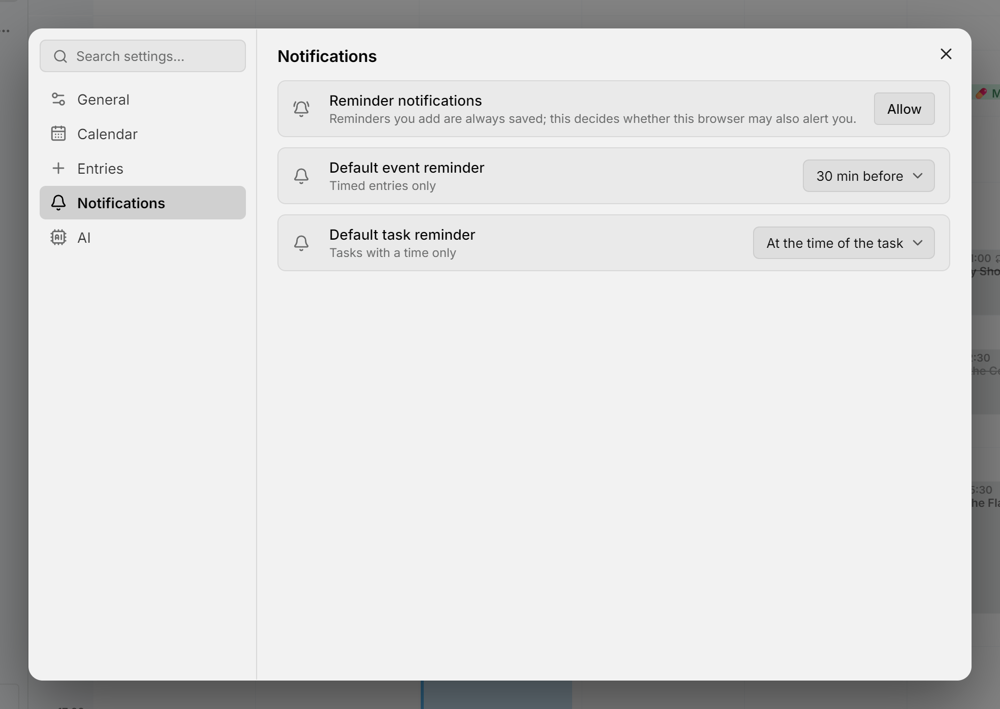

提醒会在日程或任务到来之前，以系统通知的形式告诉你，即使 Mitra 没有打开也一样。提醒由你自己的 Mitra 服务器发出，不需要再注册任何其他服务。在 iPhone 或 iPad 上，必须先把 Mitra [安装为应用](install-app.md)才能收到提醒；在其他设备上，用浏览器就够了。

<picture>
  <source media="(prefers-color-scheme: dark)" srcset="../assets/screenshots/notifications-detail-dark.webp">
  
</picture>

## 添加提醒

打开一个条目，在带铃铛图标的提醒那一行按 **＋**，然后选择提醒时间：**日程开始时**（任务则是 **任务时间到时**）、提前 5 或 10 分钟、半小时、一小时或一天，也可以选 **自定义…** 设置其他时间。一个条目可以有多个提醒，点提醒旁边的 **✕** 即可删除。

提醒从条目的开始时间往前算；如果任务没有开始时间，就从截止日期往前算。第一次添加提醒时，浏览器会询问是否允许 Mitra 显示通知。即使你选择不允许，提醒也照样会保存在条目里。

重复条目的每一次都会提醒你。已完成或已取消的任务不会再提醒，但隐藏的日历仍会提醒：要让某个日历不再提醒，请在它所属账号的 **⋯ → 编辑** 中把它关掉。[Notion](integrations/notion.md) 和 [Tempo](integrations/tempo.md) 日历不支持提醒。

## 默认提醒

在 **设置 → 通知** 中可以设置新条目默认带的提醒：日程默认提前 30 分钟，任务默认在任务时间到时提醒。你可以修改它们，也可以选择 **无**。全天条目默认不带提醒。

## 提醒到来时

通知会显示条目的标题、时间和地点，语言和时区以所在设备为准。通知会一直保留，直到你关闭它；点按通知即可打开对应的条目。**10 分钟后再提醒** 会让它稍后再次出现；如果是任务，按 **完成** 就能直接把任务标为完成，无需打开 Mitra。Safari 和 Firefox 不显示这些按钮。

如果提醒发出时设备正处于离线状态，这条提醒会在条目开始五分钟后失效，不会延迟显示。

## 你的设备

每个允许了通知的浏览器或已安装的应用都算一台设备，每台设备都会收到你的全部提醒。**设置 → 通知** 中列出了所有设备，你正在使用的那台标有 **本设备**。点铅笔图标可以重命名设备，点 **✕** 可以移除设备，点 **测试日程** 或 **测试任务** 可以给自己发一条示例通知。

## 故障排除

- 如果收不到提醒，先发一条 **测试日程**。如果测试通知能收到，那么条目很可能位于一个已关闭的日历中。通知权限是按浏览器和网址分别授予的，在一个网址上允许了 Mitra，换一个网址还得重新允许。
- 如果 **设置 → 通知** 中没有 **提醒通知** 这一行，说明当前浏览器无法接收 Mitra 的通知：在 iPhone 或 iPad 上，请打开[已安装的应用](install-app.md)，而不是 Safari；在其他设备上，Mitra 必须通过 HTTPS 访问。
- 如果这一行显示 **已屏蔽**，请在浏览器的网站设置中允许 Mitra 发送通知。
- 如果在 Windows 上关闭 Chrome 后就收不到任何提醒，请在 Chrome 设置中打开 **关闭 Google Chrome 后继续运行后台应用**，或者改用 Edge 安装 Mitra。

## 服务器端

提醒无需任何设置，只要求使用 [HTTPS](configuration.md#put-it-behind-https)。Mitra 会用一个密钥为通知签名，这个密钥在首次启动时生成并保存在数据库中。因此，从[备份](backups.md)恢复时请完整恢复整个数据文件夹：如果换成全新的数据库，Mitra 会生成新的密钥，用旧密钥注册的设备就再也收不到提醒了。每条提醒发出时，都会记录在[日志](logging.md)中。
