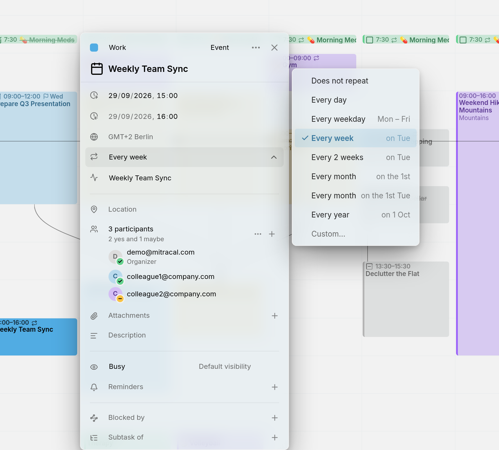
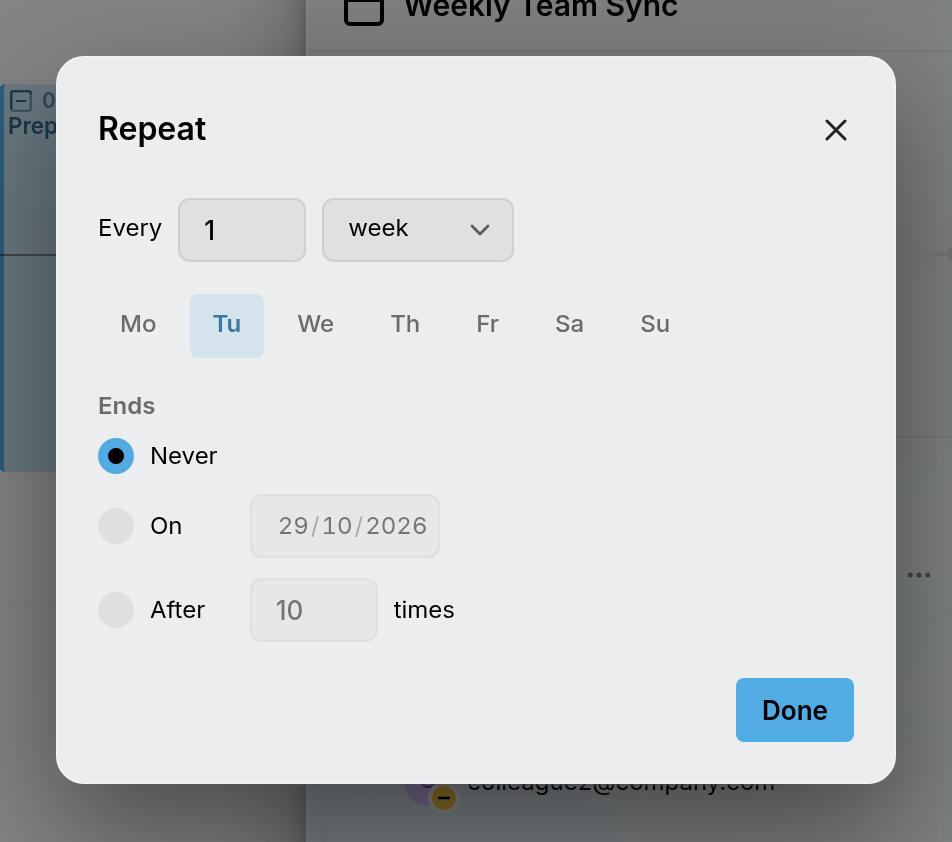

繰り返しの項目は、毎週月曜のチームミーティングや毎月 1 日に支払う家賃のように、繰り返しルールを持つ 1 つの項目です。このページでは、全体をシリーズ、個々の日付を回と呼びます。各回にはビューで小さな繰り返しアイコンが表示されます。

<picture>
  <source media="(prefers-color-scheme: dark)" srcset="../assets/screenshots/repeat-detail-dark.webp">
  
</picture>

## 項目を繰り返しにする

項目を開き、**繰り返し** の行でルールを選びます。この行は、項目に日付（開始時刻、または日付未定のタスクの期日）があると表示されます。

あとからの回を開いていても、リストにはシリーズの開始日をもとにしたルールが並びます。例えば 13 日（火曜日）の項目なら、**毎日**、**毎平日**（月曜〜金曜）、**毎週**火曜日、**2週間ごと**の火曜日、**毎月**13 日、**毎月**第 2 火曜日、そしてその日付での**毎年**が候補になります。開始日が月の最後の 7 日間に入る場合は、**毎月**最終火曜日も表示されます。

繰り返しをやめるには **繰り返さない** を選びます。ルールの変更は常にシリーズ全体に適用されるので、どの回を対象にするかは尋ねられません。

### カスタムルール

それ以外のルールなら **カスタム…** を選びます。

<picture>
  <source media="(prefers-color-scheme: dark)" srcset="../assets/screenshots/repeat-custom-detail-dark.webp">
  
</picture>

**毎** に数字を入力し、日・週・月・年から単位を選びます。週単位のルールでは曜日が表示されるので、繰り返す曜日をそれぞれオンにします。少なくとも 1 つはオンのままです。月単位のルールは、13 日のように開始日と同じ日付か、第 2 火曜日のように月内の同じ曜日で繰り返します。開始日が月の最後の 7 日間にある場合は、最終火曜日での繰り返しも選べます。

**終了** では、**終了しない**、**日付**、**回数** のいずれかを選びます。**完了** を押すと、**繰り返し** の行にルールが要約表示されます。例：「2週間ごとの木曜日、12 月 18 日まで」。

## 1 回を変更・削除する

1 回を変更すると、Mitra はどの項目を対象にするか尋ねます。その回を別の時刻へドラッグしたとき、端をドラッグしたとき、削除したとき、タイトルなどエディター内のフィールドを変えたときに尋ねられます。

- **この項目** は、選んだ回だけを変更します。
- **これ以降の項目** は、その回とそれ以降のすべてを変更します。シリーズはその直前で終わり、変更を適用した新しいシリーズがそこから始まるので、それより前の回はそのまま残ります。最初の回ではシリーズ全体を意味するため、この選択肢は出ません。
- **すべての項目** は、すべての回を変更します。1 回を 1 日ずらせば全部がずれるので、月曜の週次ミーティングは火曜の週次ミーティングになります。1 つの長さを変えれば、すべてが新しい長さになります。

削除も同じです。**この項目** は 1 つの日付を消し、**これ以降の項目** はその前でシリーズを終わらせ、**すべての項目** はシリーズごと削除します。

確認を飛ばしてこの回だけを変更するには、ドロップするときに <kbd>Ctrl</kbd>（Mac では <kbd>⌘</kbd>）を押したままにするか、開いている状態で <kbd>Ctrl</kbd> + <kbd>Delete</kbd> を押します。

中には確認されない変更もあります。タスクの 1 回を完了にする操作はその回だけに適用され、期日で繰り返すタスクの 1 回に日時を設定する場合も同様です。

予定の 1 回は、削除の代わりにキャンセルすることもできます。その場合、取り消し線が付いたままカレンダーに残ります。[予定のステータス](entries.md#event-status)を参照してください。

## 変更・削除された回

**この項目** で変更した回はシリーズを離れ、独立した項目になります。シリーズはその日付をスキップするので二重に表示されることはなく、以後シリーズ全体への変更も届きません。

削除した回は削除されたままです。あとでシリーズ全体を移動・変更しても戻らず、同じカレンダーを使う他のアプリでも表示されません。

## シリーズを別のカレンダーへ移動する

ある回のエディターで別のカレンダーを選ぶと、同じ確認によって、その回だけを移動するか、残りの回を移動するか、シリーズ全体を移動するかが決まります。詳しくは[単一の項目を移動する](calendars.md#move-a-single-entry)を参照してください。

## 繰り返しタスク

繰り返しタスクの各回は、それぞれ完了にできる独立したタスクです。毎月 1 日までに家賃を払うように、期日だけで繰り返すタスクもあります。[繰り返しの期日](planning.md#repeating-due-dates)を参照してください。繰り返しタスクが期限切れになることはなく、日付未定にもできません。日付がシリーズを形作っているからです。

## 繰り返しの表示

毎日の運動のように頻繁に繰り返すものは、月ビューと年ビューでは[ルーティン](routines.md)として表示され、日ごとのバーの代わりに小さなマークが並びます。[タイムライン](views/timeline.md)には繰り返しタスクのうち期日のある回だけが表示されるので、毎日のタスクで埋まることはありません。

## 繰り返しに対応するカレンダー

[Mitra に保存されるカレンダー](integrations/mitra.md)と、Google・Apple を含む[カレンダーサーバー](integrations/caldav.md)には、繰り返しの項目を保存できます。[Notion](integrations/notion.md)、[Todoist](integrations/todoist.md)、[Tempo](integrations/tempo.md) のカレンダーには保存できないため、それらのエディターには **繰り返し** の行がなく、シリーズのエディターでもカレンダーの候補に出ません。Todoist で繰り返すタスクは次の日付に表示されます。完了にすると Todoist と同じようにその次の日付へ進み、ルールの変更は Todoist 側で行います。

カレンダーの[すべての項目を](calendars.md#move-or-copy-every-entry-to-another-calendar)繰り返しに対応しないカレンダーへ移動するとき、Mitra は繰り返しの項目をどうするか尋ねます。**ここに残す** はその場に残します。**単一の項目に平坦化** は、これから 1 年分の各回を、繰り返さない独立した項目として書き出します。

[対応可能時間](availability.md)も繰り返しの項目で、初期設定は毎週です。同じ理由で、Notion・Todoist・Tempo のカレンダーには置けません。
