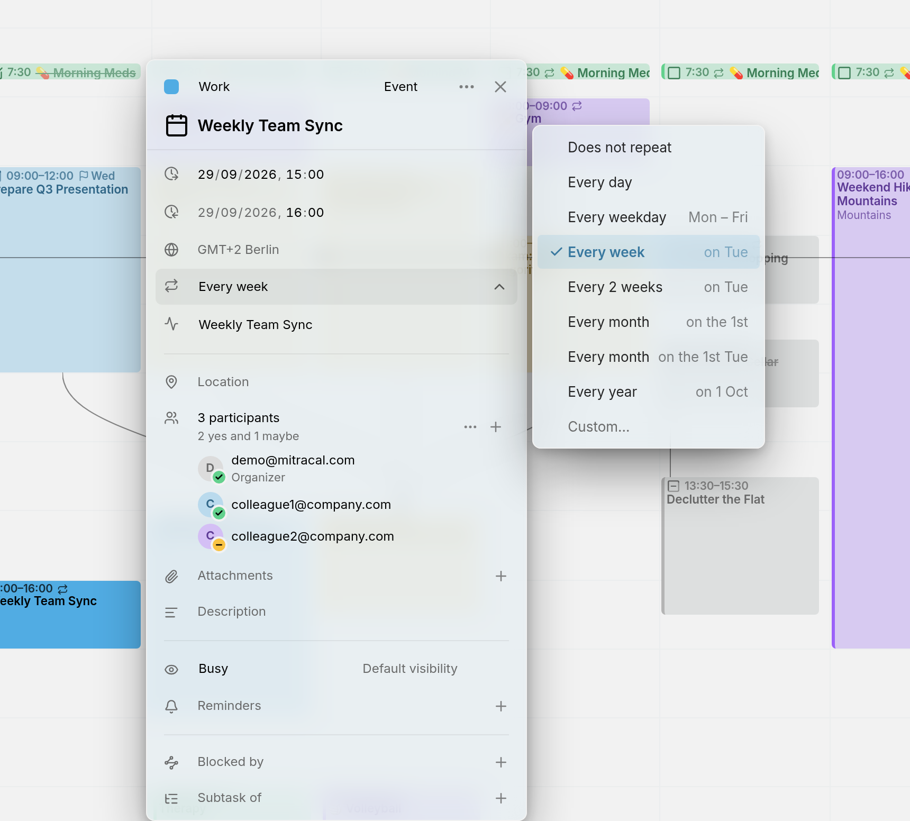
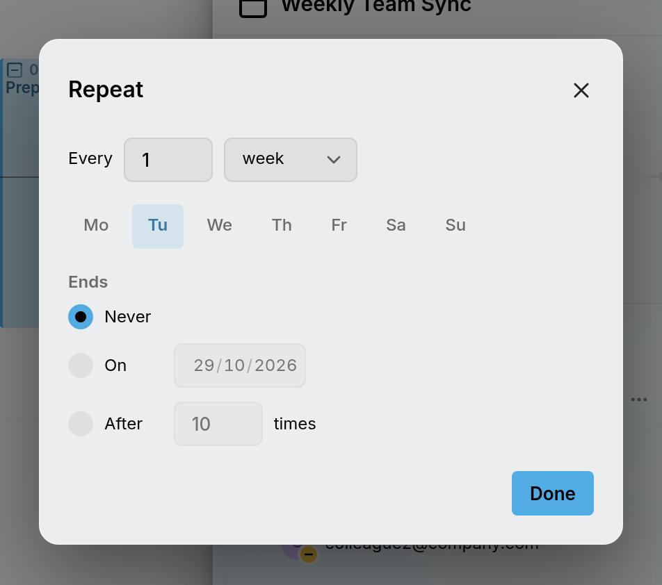

반복 항목은 매주 월요일 팀 회의나 매달 1일에 내는 월세처럼 반복 규칙이 있는 하나의 항목입니다. 이 문서에서는 전체를 시리즈, 그 안의 날짜 하나하나를 회차라고 부릅니다. 모든 회차에는 보기에서 작은 반복 아이콘이 붙습니다.

<picture>
  <source media="(prefers-color-scheme: dark)" srcset="../assets/screenshots/repeat-detail-dark.webp">
  
</picture>

## 항목을 반복하게 만들기

항목을 열고 **반복** 행에서 규칙을 고르세요. 이 행은 항목에 날짜가 있을 때 나타납니다. 시작 날짜가 있거나, 날짜 미정 작업이라면 마감일이 있으면 됩니다.

목록에 나오는 규칙은 나중 회차를 열었더라도 시리즈가 시작하는 날짜를 기준으로 만들어집니다. 13일 화요일에 있는 항목이라면 **1일마다**, **평일마다**(월요일부터 금요일까지), 화요일에 **1주마다**, 화요일에 **2주마다**, 13일에 **1개월마다**, 2번째 화요일에 **1개월마다**, 그 날짜에 **1년마다**가 나옵니다. 시작 날짜가 그 달의 마지막 7일 안에 있으면 마지막 화요일에 **1개월마다**도 나옵니다.

항목의 반복을 멈추려면 **반복 안 함**을 고르세요. 규칙을 바꾸면 항상 시리즈 전체에 적용되므로 Mitra는 어떤 회차를 말하는지 묻지 않습니다.

### 사용자 지정 규칙

그 밖의 규칙이 필요하면 **직접 지정…** 옵션을 고르세요.

<picture>
  <source media="(prefers-color-scheme: dark)" srcset="../assets/screenshots/repeat-custom-detail-dark.webp">
  
</picture>

**매** 뒤에 숫자를 입력하고 일, 주, 월, 년 중에서 고르세요. 주 단위 규칙이면 요일이 나옵니다. 항목이 반복할 요일을 모두 켜세요. 최소 하나는 켜져 있어야 합니다. 월 단위 규칙은 13일처럼 시작 날짜와 같은 날짜에 반복하거나, 2번째 화요일처럼 그 달의 같은 순번 요일에 반복합니다. 시작 날짜가 그 달의 마지막 7일 안에 있으면 마지막 화요일에 반복할 수도 있습니다.

**종료**에서 **안 함**, 특정 날짜에 끝나는 **날짜**, 일정 횟수 뒤에 끝나는 **횟수** 중 하나를 고르세요. **완료**를 누르면 **반복** 행에 "2주마다 목요일, 12월 18일까지"처럼 규칙이 표시됩니다.

## 회차 하나 바꾸기 또는 삭제하기

회차를 바꾸면 Mitra가 어떤 항목을 말하는지 묻습니다. 회차를 다른 시간으로 드래그하거나, 가장자리를 드래그하거나, 삭제하거나, 편집기에서 제목 같은 필드를 바꿀 때 묻습니다.

- **이 항목**은 고른 회차만 바꿉니다.
- **이 항목과 이후 항목**은 고른 회차와 그 뒤의 모든 회차를 바꿉니다. 원래 시리즈는 그 회차 바로 앞에서 끝나고, 그 자리에서 바뀐 내용으로 새 시리즈가 시작되므로 앞선 회차는 그대로 남습니다. 첫 회차에서는 이 선택지가 나오지 않습니다. 첫 회차에서는 시리즈 전체와 같은 뜻이기 때문입니다.
- **모든 항목**은 모든 회차를 바꿉니다. 회차 하나를 하루 옮기면 전부 옮겨지므로, 월요일 주간 회의가 화요일 주간 회의가 됩니다. 하나의 길이를 바꾸면 모두 새 길이가 됩니다.

삭제도 같은 방식입니다. **이 항목**은 날짜 하나를 지우고, **이 항목과 이후 항목**은 시리즈를 그 회차 앞에서 끝내고, **모든 항목**은 시리즈를 삭제합니다.

질문 없이 이 회차만 바꾸려면 놓을 때 <kbd>Ctrl</kbd>(Mac에서는 <kbd>⌘</kbd>)을 누르고 있거나, 회차가 열려 있을 때 <kbd>Ctrl</kbd> + <kbd>Delete</kbd>를 누르세요.

몇 가지 변경은 묻지 않습니다. 작업 회차를 완료로 표시하면 그 회차에만 적용되고, 마감일로 반복하는 작업의 회차 하나에 날짜를 잡을 때도 그 회차에만 적용됩니다.

일정의 회차는 삭제하는 대신 취소할 수도 있습니다. 그러면 취소선이 그어진 채 캘린더에 남습니다. [일정 상태](entries.md#event-status)를 참고하세요.

## 바뀐 회차와 삭제된 회차

**이 항목**으로 바꾼 회차는 시리즈에서 떨어져 나와 별도의 항목이 됩니다. 시리즈는 그 날짜를 건너뛰므로 두 번 나오지 않고, 나중에 시리즈 전체를 바꿔도 그 회차에는 영향이 없습니다.

삭제한 회차는 계속 삭제된 상태로 남습니다. 나중에 시리즈 전체를 옮기거나 바꿔도 돌아오지 않으며, 같은 캘린더를 쓰는 다른 앱에서도 빠집니다.

## 시리즈를 다른 캘린더로 옮기기

회차의 편집기에서 다른 캘린더를 고르면 같은 질문으로 그 회차, 시리즈의 나머지, 시리즈 전체 중 무엇을 옮길지 정합니다. 자세한 내용은 [항목 하나 옮기기](calendars.md#move-a-single-entry)를 참고하세요.

## 반복 작업

반복 작업의 각 회차는 따로 완료로 표시하는 별도의 작업입니다. 매달 1일까지 월세 내기처럼 마감일만으로 반복할 수도 있습니다. [반복 마감일](planning.md#repeating-due-dates)을 참고하세요. 반복 작업은 기한 지남이 되지 않으며, 날짜 미정으로 돌릴 수도 없습니다. 날짜가 바로 시리즈를 이루기 때문입니다.

## 반복이 보이는 방식

매일 하는 운동처럼 자주 반복되는 일은 월 보기와 연도 보기에서 [루틴](routines.md)으로 나타납니다. 하루마다 막대를 그리는 대신 작은 표시가 한 줄로 이어집니다. [타임라인](views/timeline.md)에는 반복 작업 중 마감이 된 회차만 나오므로 매일 하는 작업이 타임라인을 채우지 않습니다.

## 반복을 지원하는 캘린더

[Mitra에 저장되는 캘린더](integrations/mitra.md)와 Google, Apple을 포함한 [캘린더 서버](integrations/caldav.md)는 반복 항목을 담을 수 있습니다. [Notion](integrations/notion.md), [Todoist](integrations/todoist.md), [Tempo](integrations/tempo.md) 캘린더는 담을 수 없으므로 편집기에 **반복** 행이 없고, 시리즈의 편집기에서도 이 캘린더들을 고를 수 없습니다. Todoist에서 반복하는 작업은 다음 날짜에 표시됩니다. 완료하면 Todoist에서처럼 그다음 날짜로 넘어가며, 규칙은 계속 Todoist에서 바꿉니다.

[캘린더의 모든 항목을](calendars.md#move-or-copy-every-entry-to-another-calendar) 반복을 지원하지 않는 캘린더로 옮기면 Mitra가 반복 항목을 어떻게 할지 묻습니다. **여기에 두기**는 그 항목들을 그대로 둡니다. **개별 항목으로 펼치기**는 앞으로 1년 동안의 모든 회차를 더 이상 반복하지 않는 별도의 항목으로 만듭니다.

[가용 시간](availability.md)도 반복 항목이며 처음에는 매주 반복합니다. 같은 이유로 Notion, Todoist, Tempo 캘린더에는 둘 수 없습니다.
