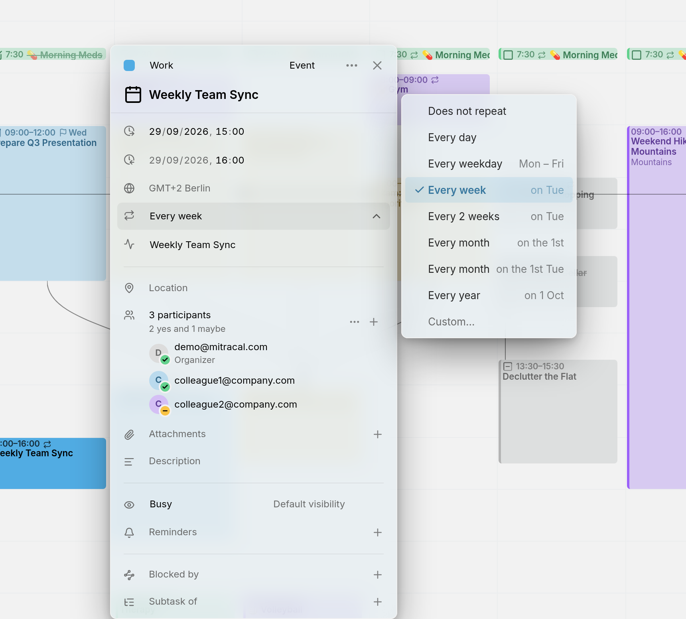
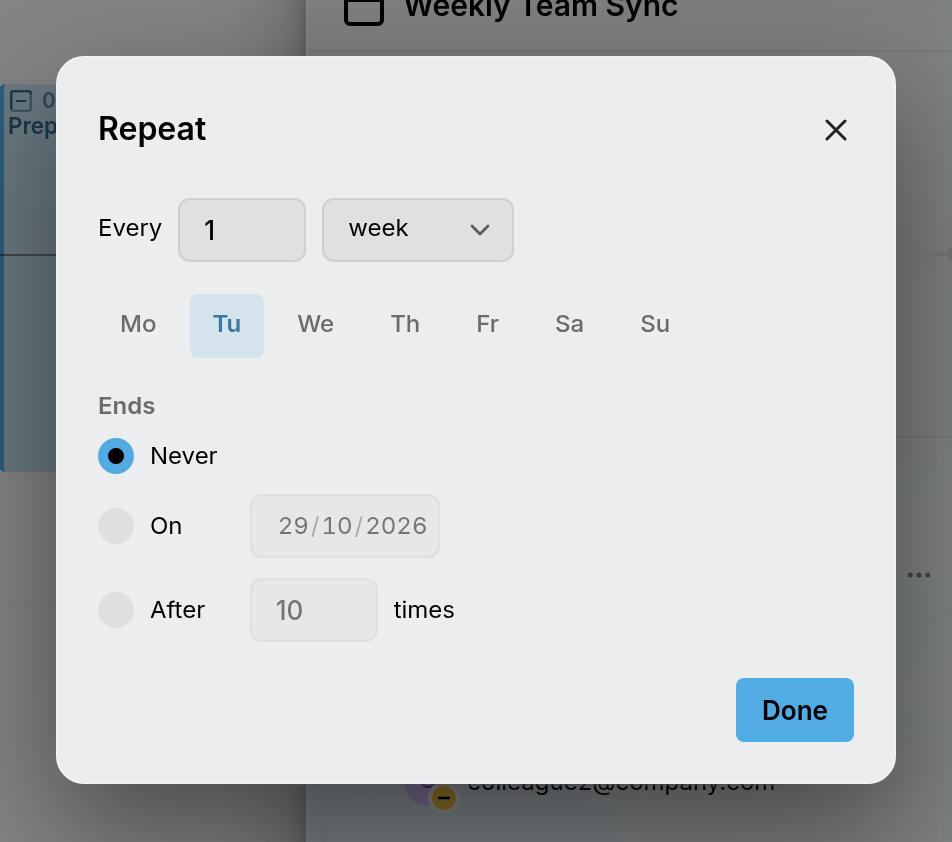

Một mục lặp lại là một mục có quy tắc lặp lại, chẳng hạn cuộc họp nhóm mỗi thứ Hai hoặc tiền thuê nhà đến hạn vào ngày 1 hằng tháng. Trang này gọi toàn bộ là một chuỗi lặp lại, và mỗi ngày của nó là một lần lặp. Mỗi lần lặp hiện một biểu tượng lặp lại nhỏ trong các chế độ xem.

<picture>
  <source media="(prefers-color-scheme: dark)" srcset="../assets/screenshots/repeat-detail-dark.webp">
  
</picture>

## Cho một mục lặp lại

Mở mục và chọn một quy tắc trong dòng **Lặp lại** của nó. Dòng này hiện khi mục đã có ngày: ngày bắt đầu, hoặc hạn chót với một công việc chưa lên lịch.

Danh sách đưa ra các quy tắc dựa trên ngày chuỗi lặp lại bắt đầu, kể cả khi bạn mở một lần lặp sau đó. Với một mục vào Thứ Ba ngày 13, nó đưa ra **Mỗi ngày**, **Mỗi ngày làm việc** (Thứ Hai đến Thứ Sáu), **Mỗi tuần** vào Thứ Ba, **Mỗi 2 tuần** vào Thứ Ba, **Mỗi tháng** vào ngày 13, **Mỗi tháng** vào Thứ Ba tuần thứ 2, và **Mỗi năm** vào ngày đó. Khi ngày bắt đầu nằm trong bảy ngày cuối của tháng, còn có **Mỗi tháng** vào Thứ Ba cuối cùng.

Để một mục ngừng lặp lại, hãy chọn **Không lặp lại**. Một thay đổi ở quy tắc luôn áp dụng cho cả chuỗi lặp lại, nên Mitra không hỏi bạn muốn nói đến những lần lặp nào.

### Quy tắc tùy chỉnh

Với mọi trường hợp khác, hãy chọn **Tùy chỉnh…**.

<picture>
  <source media="(prefers-color-scheme: dark)" srcset="../assets/screenshots/repeat-custom-detail-dark.webp">
  
</picture>

Sau **Mỗi**, gõ một số và chọn ngày, tuần, tháng hoặc năm. Quy tắc theo tuần khi đó hiển thị các ngày trong tuần: bật từng ngày mà mục lặp lại, và luôn có ít nhất một ngày được bật. Quy tắc theo tháng lặp lại vào cùng số ngày với ngày bắt đầu, chẳng hạn ngày 13, hoặc vào cùng thứ trong tháng, chẳng hạn Thứ Ba tuần thứ 2. Khi ngày bắt đầu nằm trong bảy ngày cuối của tháng, nó cũng có thể lặp lại vào Thứ Ba cuối cùng.

Trong **Kết thúc**, chọn **Không bao giờ**, **Vào ngày** một ngày nào đó, hoặc **Sau** một số lần. Nhấn **Xong**, và dòng **Lặp lại** sẽ đọc lại quy tắc, chẳng hạn “Mỗi 2 tuần vào Thứ Năm đến 18 thg 12”.

## Thay đổi hoặc xóa một lần lặp

Khi bạn thay đổi một lần lặp, Mitra hỏi bạn muốn nói đến những mục nào. Mitra hỏi khi bạn kéo lần lặp sang giờ khác, kéo cạnh của nó, xóa nó, hoặc đổi một trường trong trình chỉnh sửa của nó, chẳng hạn tiêu đề.

- **Mục này** chỉ thay đổi lần lặp bạn đã chọn.
- **Mục này và các mục sau** thay đổi nó và mọi lần lặp sau đó. Chuỗi lặp lại kết thúc ngay trước nó, và một chuỗi mới bắt đầu từ đó cùng thay đổi của bạn, nên các lần lặp trước đó giữ nguyên. Lần lặp đầu tiên không có tùy chọn này, vì ở đó nó có nghĩa là cả chuỗi.
- **Tất cả các mục** thay đổi mọi lần lặp. Dời một lần lặp đi một ngày sẽ dời tất cả, nên cuộc họp hằng tuần vào Thứ Hai trở thành cuộc họp hằng tuần vào Thứ Ba. Thay đổi kích thước một lần lặp sẽ cho tất cả cùng độ dài mới.

Xóa cũng hoạt động tương tự: **Mục này** xóa một ngày, **Mục này và các mục sau** kết thúc chuỗi lặp lại trước nó, và **Tất cả các mục** xóa cả chuỗi.

Để bỏ qua câu hỏi và chỉ thay đổi lần lặp này, hãy giữ <kbd>Ctrl</kbd> (<kbd>⌘</kbd> trên Mac) khi bạn thả nó, hoặc nhấn <kbd>Ctrl</kbd> + <kbd>Delete</kbd> khi nó đang mở.

Một vài thay đổi không bao giờ hỏi. Đánh dấu một lần lặp của công việc là đã xong chỉ áp dụng cho riêng lần lặp đó, và việc lên lịch một lần lặp của công việc lặp lại theo hạn chót cũng vậy.

Một lần lặp của sự kiện cũng có thể bị hủy thay vì xóa, giúp giữ nó trên lịch, với dòng gạch ngang. Xem [Trạng thái sự kiện](entries.md#event-status).

## Các lần lặp đã thay đổi và đã xóa

Một lần lặp bạn thay đổi bằng **Mục này** rời khỏi chuỗi lặp lại và trở thành một mục riêng. Chuỗi lặp lại bỏ qua ngày của nó, nên nó không bao giờ hiện hai lần, và các thay đổi sau này đối với cả chuỗi sẽ không ảnh hưởng đến nó.

Một lần lặp đã xóa vẫn bị xóa. Nó không quay lại khi bạn sau đó di chuyển hoặc thay đổi cả chuỗi, và các ứng dụng khác dùng cùng lịch cũng bỏ nó đi.

## Di chuyển một chuỗi lặp lại sang lịch khác

Chọn một lịch khác trong trình chỉnh sửa của một lần lặp, và cùng câu hỏi đó quyết định lần lặp đó, phần còn lại của chuỗi hay cả chuỗi sẽ được di chuyển, như mô tả trong [Di chuyển một mục](calendars.md#move-a-single-entry).

## Công việc lặp lại

Mỗi lần lặp của một công việc lặp lại là một công việc riêng để đánh dấu đã xong. Một công việc cũng có thể chỉ lặp lại theo hạn chót, chẳng hạn trả tiền thuê nhà trước ngày 1 hằng tháng: xem [hạn chót lặp lại](planning.md#repeating-due-dates). Công việc lặp lại không bao giờ quá hạn, và không thể chưa lên lịch, vì ngày của chúng là thứ tạo nên chuỗi lặp lại.

## Cách mục lặp lại được hiển thị

Thứ gì lặp lại thường xuyên, như tập thể dục hằng ngày, hiển thị là một [thói quen](routines.md) trong chế độ xem tháng và năm: một hàng các dấu nhỏ thay vì một thanh cho mỗi ngày. [Dòng thời gian](views/timeline.md) chỉ hiển thị các lần lặp đến hạn của một công việc lặp lại, nên một công việc hằng ngày không làm nó đầy ắp.

## Lịch nào có thể lặp lại

[Các lịch lưu trong Mitra](integrations/mitra.md) và [máy chủ lịch](integrations/caldav.md), gồm cả Google và Apple, chứa được các mục lặp lại. Các lịch [Notion](integrations/notion.md), [Todoist](integrations/todoist.md) và [Tempo](integrations/tempo.md) thì không, nên trình chỉnh sửa của chúng không có dòng **Lặp lại**, và trình chỉnh sửa của một chuỗi lặp lại không đưa chúng ra làm lịch của nó. Một công việc lặp lại trong Todoist hiển thị ở ngày kế tiếp của nó: hoàn thành nó sẽ chuyển nó sang ngày sau đó, như Todoist làm, và quy tắc của nó vẫn do Todoist thay đổi.

Khi bạn [di chuyển mọi mục của một lịch](calendars.md#move-or-copy-every-entry-to-another-calendar) vào một lịch không lặp lại được, Mitra hỏi bạn muốn làm gì với các mục lặp lại. **Để chúng ở đây** giữ chúng ở chỗ cũ. **Tách thành các mục riêng lẻ** ghi ra mọi lần lặp trong năm tới thành từng mục riêng không còn lặp lại.

[Thời gian khả dụng](availability.md) cũng là một mục lặp lại, và bắt đầu ở dạng hằng tuần. Vì lý do đó, nó không thể nằm trong các lịch Notion, Todoist hay Tempo.
