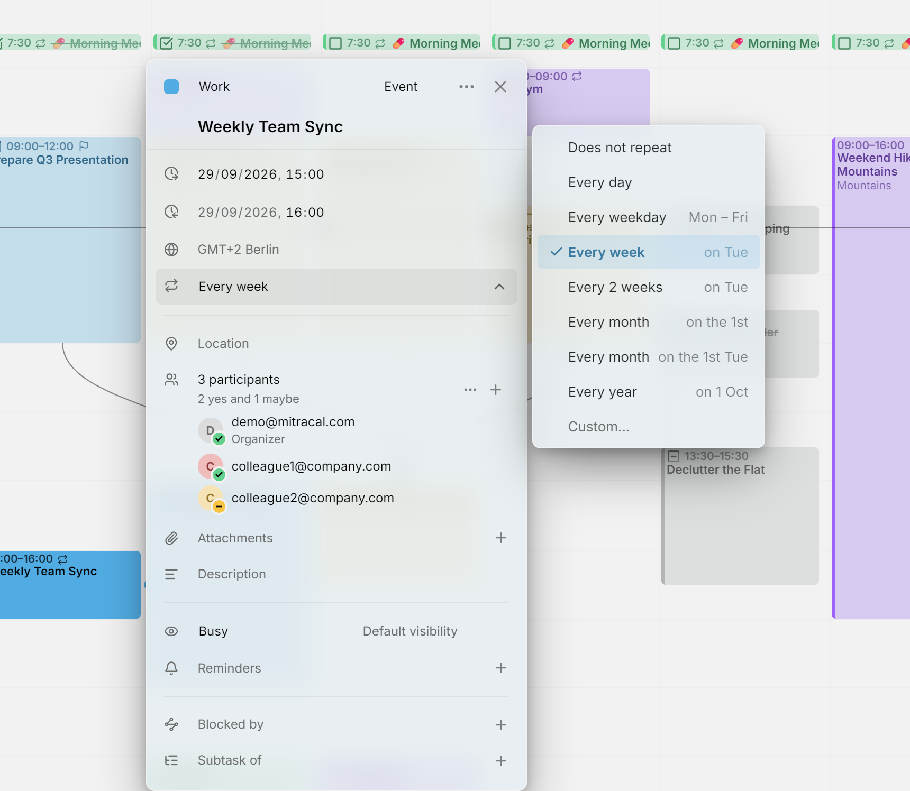
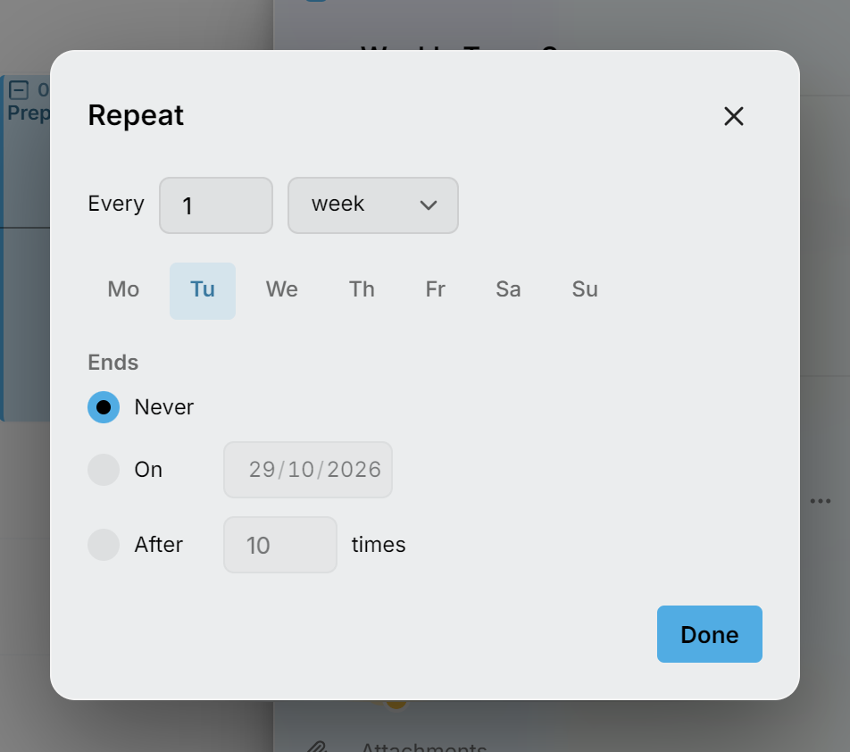

重复条目是带有重复规则的单个条目，比如每周一的团队例会，或者每月 1 日要交的房租。它落在的每个日期都是其中的一次（单次），在各个视图中都会显示一个小小的重复图标。

<picture>
  <source media="(prefers-color-scheme: dark)" srcset="../assets/screenshots/repeat-detail-dark.webp">
  
</picture>

## 让条目重复

打开条目，在**重复**这一行选择一条规则。条目有了日期之后才会出现这一行：可以是开始时间，对于未安排的任务，也可以是截止日期。

列表中的规则都根据重复条目的起始日期生成，即使你打开的是之后的某一次也一样。比如条目在 13 日（周二），列表会提供：**每 1 天**、**每个工作日**（周一到周五）、**每 1 周**的周二、**每 2 周**的周二、**每 1 个月**的 13 日、**每 1 个月**的第 2 个周二，以及**每 1 年**的这一天。如果起始日期落在当月的最后七天内，还会多一个选项：**每 1 个月**的最后一个周二。

要让条目不再重复，选择**不重复**。修改规则总是作用于整个重复条目，所以 Mitra 不会问你指的是哪几次。

### 自定义规则

需要其他规则时，选择**自定义…**。

<picture>
  <source media="(prefers-color-scheme: dark)" srcset="../assets/screenshots/repeat-custom-detail-dark.webp">
  
</picture>

在**每**后面输入一个数字，再选择天、周、月或年。按周重复的规则会显示一周中的各天：把条目要重复的每一天都打开，至少保留一天。按月重复的规则可以在与起始日期相同的日子重复，比如 13 日；也可以在当月相同序号的星期几重复，比如第 2 个周二。如果起始日期落在当月的最后七天内，还可以在最后一个周二重复。

在**结束**下，选择**永不**、**在**某个日期，或**发生**若干次后。点击**完成**后，**重复**这一行会把规则读出来，比如“每 2 周的周四，直到 12 月 18 日”。

## 修改或删除其中一次

修改重复条目中的某一次时，Mitra 会问你指的是哪些条目。把这一次拖到别的时间、拖动它的边缘、删除它，或者在编辑器中修改某个字段（比如标题）时，都会弹出这个问题。

- **此条目**只修改你选中的这一次。
- **此条目及后续条目**修改这一次以及之后的每一次。原来的重复条目在这一次之前结束，再从这一次起，带着你的修改开始一个新的重复条目，之前的各次保持不变。第一次不提供这个选项，因为对它来说，这就等于整个重复条目。
- **所有条目**修改每一次。把其中一次挪后一天，所有的都会挪后一天，于是每周一的例会变成了每周二的例会。调整其中一次的长短，所有的也都会变成新的长度。

删除也是同样的方式：**此条目**删除这一个日期，**此条目及后续条目**让重复条目在这一次之前结束，**所有条目**则删除整个重复条目。

想跳过这个问题、只修改这一次，可以在放下时按住 <kbd>Ctrl</kbd>（在 Mac 上按 <kbd>⌘</kbd>），或者在它打开时按 <kbd>Ctrl</kbd> + <kbd>Delete</kbd>。

有几种修改不会询问。把重复任务的某一次标为完成，只作用于这一次；给按截止日期重复的任务安排其中一次的时间，也只作用于这一次。

## 单独修改和删除过的单次

用**此条目**修改过的一次会脱离重复条目，成为一个独立的条目。重复条目会跳过它的日期，所以它不会出现两次，之后对整个重复条目的修改也不会影响到它。

删除的一次会一直保持删除状态。即使你之后移动或修改整个重复条目，它也不会再回来；使用同一日历的其他应用也同样不会显示它。

## 把重复条目移到另一个日历

在某一次的编辑器中选择另一个日历，同样会弹出这个问题，由它决定移动的是这一次、之后的各次，还是整个重复条目，详见[移动单个条目](calendars.md#move-a-single-entry)。

## 重复任务

重复任务的每一次都是一个独立的任务，需要分别标为完成。任务也可以只按截止日期重复，比如每月 1 日前交房租，详见[重复的截止日期](planning.md#repeating-due-dates)。重复任务永远不会逾期，也不能取消安排，因为正是它们的日期构成了这个重复条目。

## 重复条目的显示方式

经常重复的事情，比如每天的锻炼，在月视图和年视图中会显示为[例行事项](routines.md)：一行小标记，而不是每天一个色条。[时间线](views/timeline.md)只显示重复任务中已经到期的那几次，这样每天的任务就不会把它占满。

## 哪些日历支持重复

[Mitra 日历](integrations/mitra.md)和[日历服务器](integrations/caldav.md)（包括 Google 和 Apple）都支持重复条目。[Notion](integrations/notion.md) 和 [Tempo](integrations/tempo.md) 日历不支持，所以它们的编辑器中没有**重复**这一行，重复条目的编辑器也不会把它们列为可选的日历。

当你把一个日历中的[所有条目移到](calendars.md#move-or-copy-every-entry-to-another-calendar)一个不支持重复的日历时，Mitra 会问你如何处理重复条目。**留在这里**会把它们留在原处。**拆分为单独的条目**会把未来一年中的每一次都写成一个不再重复的独立条目。

[可用时间](availability.md)也是一种重复条目，默认每周重复。出于同样的原因，它不能放在 Notion 或 Tempo 日历中。
