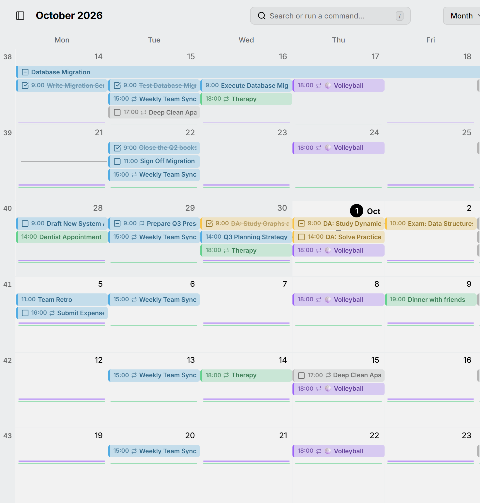
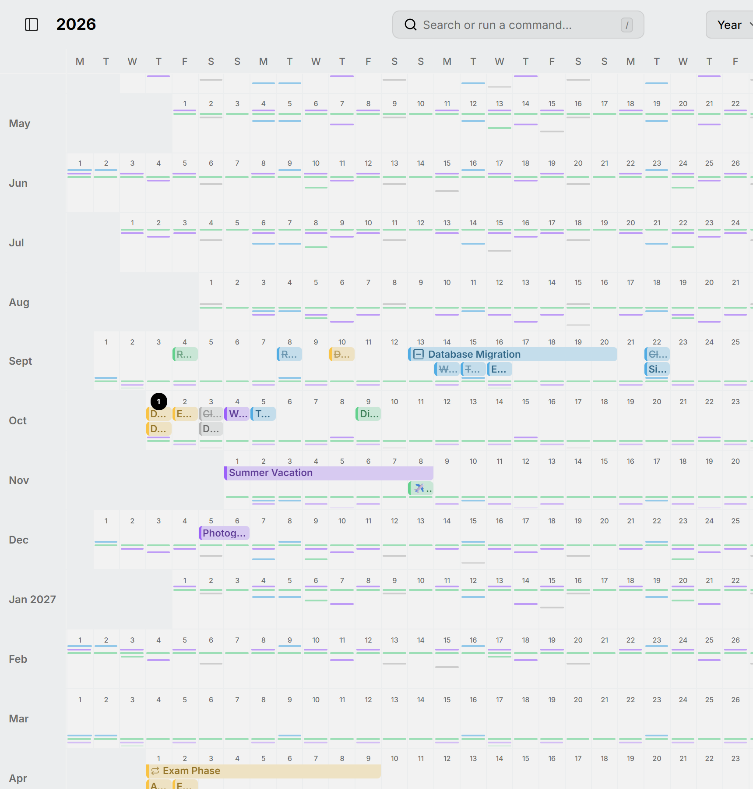
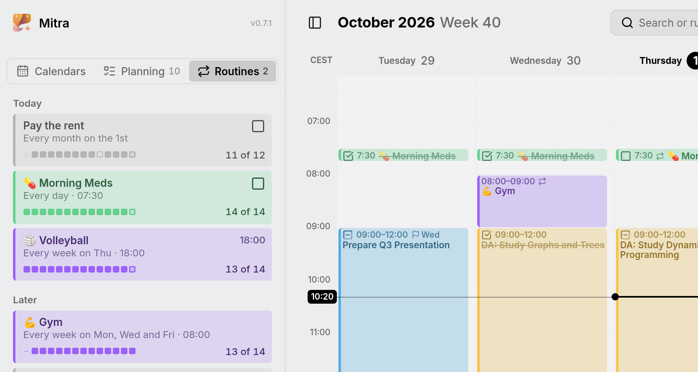

بعضی کارها آن‌قدر زیاد تکرار می‌شوند که یک نوار برای هرکدام، ماه را پر از نسخه‌های تکراری می‌کند: ورزش روزانه، داروهایتان، یا جلسهٔ کوتاه روزهای کاری. در نماهای ماه و سال، میترا آن‌ها را به‌جای نوار، به‌صورت یک **روتین** می‌کشد: یک خط باریک زیر روزها، با یک نشانه در هر روزی که روتین انجام می‌شود. زبانهٔ **روتین‌ها** در نوار کناری می‌شمارد که هر روتین چطور پیش رفته است.

<picture>
  <source media="(prefers-color-scheme: dark)" srcset="../assets/screenshots/month-detail-dark.webp">
  
</picture>

در نمای سال، که هر روز در آن کوچک است، روتین‌ها بیشتر از همه چیز به چشم می‌آیند: هر خط رنگی یک روتین است که در میان ماه‌ها ادامه دارد.

<picture>
  <source media="(prefers-color-scheme: dark)" srcset="../assets/screenshots/year-detail-dark.webp">
  
</picture>

## چه چیزی روتین می‌شود

موارد زمانی یک روتین می‌سازند که در یک تقویم باشند و عنوان یکسان داشته باشند. میترا روتین را هنگام ذخیره یا همگام‌سازی موارد تشخیص می‌دهد و آن را نگه می‌دارد.

- مورد تکرارشونده از همان ابتدا یک روتین است، هر چند وقت یک بار که تکرار شود، به شرطی که دست‌کم چهار تاریخ داشته باشد.
- مواردی که تکرار نمی‌شوند وقتی روتین می‌شوند که دست‌کم چهار تا از آن‌ها باشد و تقریباً هر پنج هفته یک بار یا بیشتر پیش بیایند، یا ریتم منظمی داشته باشند، مثل سالی یک بار. پس چند مورد جداگانه با عنوان «دویدن» درست مثل یک سری روزانه یک روتین می‌سازند.

تقویم‌هایی که فقط می‌توانید بخوانید، مثل اشتراک‌ها، روتینی نمی‌سازند.

موردی که یک بار عضو روتینی شد، در آن می‌ماند: وقتی نامش را عوض می‌کنید، آن را تیک می‌زنید، یکی از تکرارهایش را جابه‌جا می‌کنید یا آن را به تقویم دیگری می‌برید. موارد بعدی با همان عنوان به آن می‌پیوندند، هر قدر هم که از هم فاصله داشته باشند. رونوشتی در تقویمی دیگر، به روتین آن تقویم با همان عنوان می‌پیوندد. مورد بدون عنوان هرگز به موارد دیگر نمی‌پیوندد؛ اگر تکرارشونده باشد، خودش به‌تنهایی یک روتین است.

اینکه روتین چقدر پرتکرار است، تعیین می‌کند نماها آن را چگونه نشان دهند:

- در نمای ماه، روتینی که بیشتر از هفته‌ای یک بار پیش می‌آید به‌صورت نشانه نمایش داده می‌شود. چیزی که هفتگی است همچنان نوار می‌ماند.
- در نمای سال، روتینی که تقریباً هر پنج هفته یک بار یا بیشتر پیش می‌آید به‌صورت نشانه نمایش داده می‌شود، پس روتین‌های هفتگی و ماهانه هم. روتینی کم‌تکرارتر، مثل تولد، همچنان نوار می‌ماند.

## زبانهٔ روتین‌ها

**روتین‌ها** را در نوار کناری، کنار تقویم‌ها و برنامه‌ریزی، باز کنید یا نامش را در پالت فرمان بنویسید. **امروز** روتین‌هایی را که امروز پیش می‌آیند به ترتیب ساعتشان نشان می‌دهد و **بعداً** بقیه را به ترتیب تاریخ بعدی‌شان. هر ردیف نام روتین، زمان آن و نواری از ۱۴ تکرار آخرش را نشان می‌دهد، همراه با تعدادی که انجام داده‌اید.

<picture>
  <source media="(prefers-color-scheme: dark)" srcset="../assets/screenshots/routines-detail-dark.webp">
  
</picture>

هر خانهٔ نوار یک تکرار است:

- خانهٔ پر انجام شده است: رویدادی که برگزار شد، یا کاری که تیک زدید.
- خانهٔ توخالی از دست رفته است: کاری که پس از روزش باز ماند.
- یک خط تیره لغو شده است، که مثل یک تکرار ازدست‌رفته انجام‌نشده حساب می‌شود.
- خانهٔ حلقه‌دار مال امروز است و هنوز باز است.
- خانهٔ کم‌رنگ روزی است که روتین در آن پیش نمی‌آید.

Mitra فقط چیزی را می‌شمارد که در تقویم شماست. تکراری که حذف می‌کنید از بین می‌رود و شمرده نمی‌شود؛ پس برای اینکه جلسه‌ای که نرفته‌اید در سابقه بماند، به‌جای حذف آن را لغو کنید؛ [وضعیت رویداد](entries.md#event-status) را ببینید. رویدادها چیزی برای تیک زدن ندارند: رویداد برگزار شده است مگر اینکه لغو شده باشد.

وضعیت امروز در انتهای ردیف هر روتین است: کادر انتخاب یک کار، که مثل کادر روی تقویم آن را تیک می‌زند، و وضعیت یک رویداد وقتی لغوش کنید، تا بتوانید دوباره تغییرش دهید. نشان روی زبانه، کارهای روتینی را می‌شمارد که امروز هنوز باز هستند. تقویمی که پنهان می‌کنید، روتین‌هایش را از زبانه بیرون می‌برد.

## جزئیات یک روتین

روی یک ردیف کلیک کنید تا بیشتر ببینید: روتین از کی شروع شده، هفته‌های اخیرش به‌صورت جدولی از روزها، چند تا از آخرین تکرارها و سال گذشته را انجام داده‌اید، و در کدام روز هفته بیشتر جا می‌ماند. منوی **⋯** آن برای یک کار **امروز انجام شد**، برای لغو تکرار امروز **لغوشده** و برای باز کردن تکرار بعدی **نمایش در تقویم** را دارد.

## استفاده از یک روتین

اشاره‌گر را روی یک روتین ببرید تا عنوان آن و، اگر مورد تکرارشونده است، تواتر تکرارش را ببینید. روی آن کلیک کنید تا اولین مورد آن در همان ردیف باز شود: هفته در نمای ماه، یا ماه در نمای سال.

نمای هفته همیشه هر مورد را کامل و با ساعت‌هایش نشان می‌دهد.
