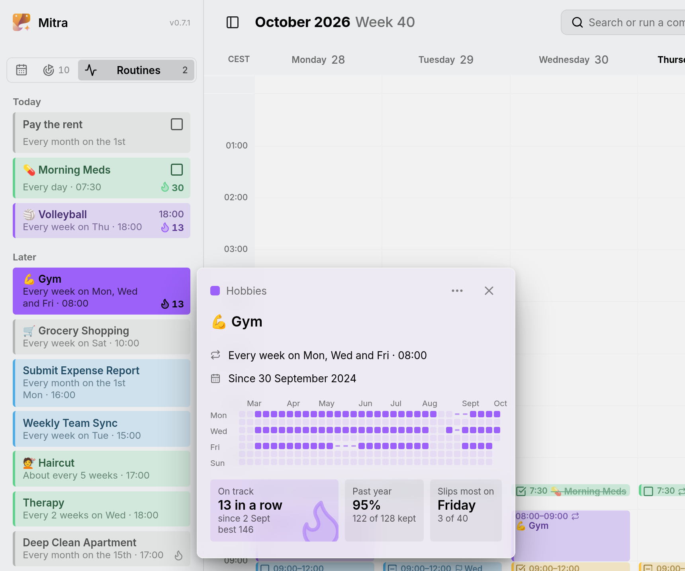

Sommige dingen gebeuren zo vaak dat een balk per keer een hele maand met kopieën zou vullen: een dagelijkse training, je medicijnen, een stand-up op werkdagen. In de maand- en jaarweergave tekent Mitra zulke items daarom als een **routine**: een dunne lijn onder de dagen, met een markering op elke dag waarop de routine plaatsvindt. Het tabblad **Routines** in de zijbalk houdt bij hoe elke routine is gegaan.

<picture>
  <source media="(prefers-color-scheme: dark)" srcset="../assets/screenshots/month-detail-dark.webp">
  
</picture>

In de jaarweergave, waar elke dag klein is, zijn routines het eerste wat je ziet: elke gekleurde lijn is een routine die door de maanden loopt.

<picture>
  <source media="(prefers-color-scheme: dark)" srcset="../assets/screenshots/year-detail-dark.webp">
  
</picture>

## Wat een routine wordt

Items vormen samen een routine als ze in dezelfde agenda staan en dezelfde titel hebben. Mitra herkent een routine zodra items worden opgeslagen of gesynchroniseerd, en onthoudt haar.

- Een terugkerend item is meteen een routine, hoe vaak het ook terugkeert, zolang het minstens vier datums heeft.
- Items die niet terugkeren, worden er een zodra er minstens vier zijn en ze een vast ritme aanhouden, zoals om de paar dagen, wekelijks of eens per jaar. Zo vormen losse items met de titel ‘Hardlopen’ net zo goed een routine als een dagelijkse reeks, maar een paar dicht op elkaar en dan een lange pauze, zoals de vluchten van twee reizen, niet.

Agenda's die je alleen kunt lezen, zoals abonnementen, vormen geen routines.

Hoort een item eenmaal bij een routine, dan blijft het daar: als je het hernoemt, afvinkt, een van zijn herhalingen verplaatst of het naar een andere agenda verplaatst. Latere items met dezelfde titel sluiten zich erbij aan, hoe ver ze ook uit elkaar liggen. Een kopie in een andere agenda gaat met haar titel bij de routine van die agenda horen. Een item zonder titel sluit zich nooit bij andere aan; een terugkerend item is op zichzelf een routine.

Hoe vaak een routine voorkomt, bepaalt hoe de weergaven haar tonen:

- In de maandweergave verschijnt een routine die vaker dan eens per week voorkomt als markeringen. Wat wekelijks terugkomt, blijft een balk.
- In de jaarweergave verschijnt een routine die ongeveer eens per vijf weken of vaker voorkomt als markeringen, dus ook wekelijkse en maandelijkse. Een zeldzamere, zoals een verjaardag, blijft een balk.

## Het tabblad Routines

Open **Routines** in de zijbalk, naast Agenda's en Planning, of typ de naam in het opdrachtenpalet. **Vandaag** toont de routines van vandaag, op volgorde van hun tijd, en **Lopend** de rest, op hun volgende datum. Routines die de laatste drie maanden nergens voorkwamen en niets meer voor zich hebben, klappen weg onder **Voorbij**, de laatste eerst. Om de routines van een agenda weg te laten, zoals die van je werkagenda, kies je **Routines verbergen** in het menu ervan in de zijbalk. Elke rij toont de naam van de routine, wanneer ze voorkomt, en haar reeks: een vlam in de kleur van haar agenda met hoeveel herhalingen je op rij hebt gedaan. Een gemiste of geannuleerde beëindigt de reeks, en de vlam wordt grijs.

<picture>
  <source media="(prefers-color-scheme: dark)" srcset="../assets/screenshots/routines-detail-dark.webp">
  
</picture>

Het detail van een routine toont haar laatste weken als raster, één vakje per dag:

- Een gevuld vakje is gedaan: een afspraak die heeft plaatsgevonden, of een taak die je hebt afgevinkt.
- Een leeg vakje is gemist: een taak die na haar dag open bleef.
- Een streepje is geannuleerd, wat net als een gemiste telt als niet gedaan.
- Een omcirkeld vakje is dat van vandaag, nog open.
- Een vaag vakje is een dag waarop ze niet voorkomt.

Mitra telt alleen wat in je agenda staat. Een herhaling die je verwijdert, is weg en telt niet mee, dus annuleer een overgeslagen keer in plaats van haar te verwijderen als je haar wilt bewaren; zie [Afspraakstatus](entries.md#event-status). Afspraken hebben niets om af te vinken: een afspraak heeft plaatsgevonden, tenzij ze is geannuleerd.

De status van vandaag staat aan het eind van de rij van een routine: het selectievakje van een taak, dat haar afvinkt zoals dat in de agenda doet, en die van een afspraak zodra je die annuleert, zodat je hem weer kunt wijzigen. Het getal op het tabblad telt de routinetaken die vandaag nog open zijn. Een agenda die je verbergt, haalt haar routines uit het tabblad.

## De details van een routine

Klik op een rij voor meer: sinds wanneer de routine loopt, haar laatste weken als raster van dagen en daaronder drie tegels: haar reeks, met als kop hoe het gaat, zoals **Op koers** of **Zakt weg**, en je record; hoeveel van het afgelopen jaar je hebt gedaan; en op welke weekdag ze het vaakst erbij inschiet. Het menu **⋯** heeft **Vandaag gedaan** voor een taak, **Geannuleerd** om de herhaling van vandaag te annuleren, en **In agenda tonen** om de volgende te openen. Vink daar **Bijhouden hoe het gaat** uit voor een routine die je alleen nakomt, zoals een rekening of een vergadering: ze toont dan geen reeks, en haar detail alleen het raster.

## Een routine corrigeren

Mitra vindt routines zelf, en het menu **⋯** in de details corrigeert waar het er een verkeerd heeft. **Naam wijzigen…** geeft de routine een eigen naam; je kunt ook op de naam klikken en typen. De knop naast een eigen naam, of de titel van haar items opnieuw typen, geeft haar weer de naam van haar items. **Samenvoegen met** opent de andere routines van dezelfde agenda; er een kiezen voegt de twee samen, voor één gewoonte met twee titels, zoals ‘Ochtendpillen’ en ‘Avondpillen’. **Geen routine** haalt haar voorgoed uit het tabblad: items met haar titel worden niet meer tot een routine samengevoegd, en ze blijven in je agenda. Wat je geen routine noemde, wacht ingeklapt onderaan het tabblad onder **Geen routines**; open het om er weer een routine van te maken.

De editor van een item heeft na de datums een rij **Routine**, die verschijnt als het item bij een routine hoort of zou kunnen horen. Kies daar een andere routine van zijn agenda, **Nieuwe routine** om er een te beginnen vanaf het item, waar latere items met zijn titel bij komen, of **Geen routine** om het er voorgoed uit te halen, zoals een lunch die alleen zijn titel deelt met een gewoonte. De rij toont de reeks van de routine naast haar naam.

## Een routine gebruiken

Houd de muis boven een routine om de titel te zien en, als het een terugkerend item is, hoe vaak het wordt herhaald. Klik erop om het eerste item in die rij te openen: de week in de maandweergave, of de maand in de jaarweergave.

De weekweergave toont elk item altijd volledig, met zijn tijden.
