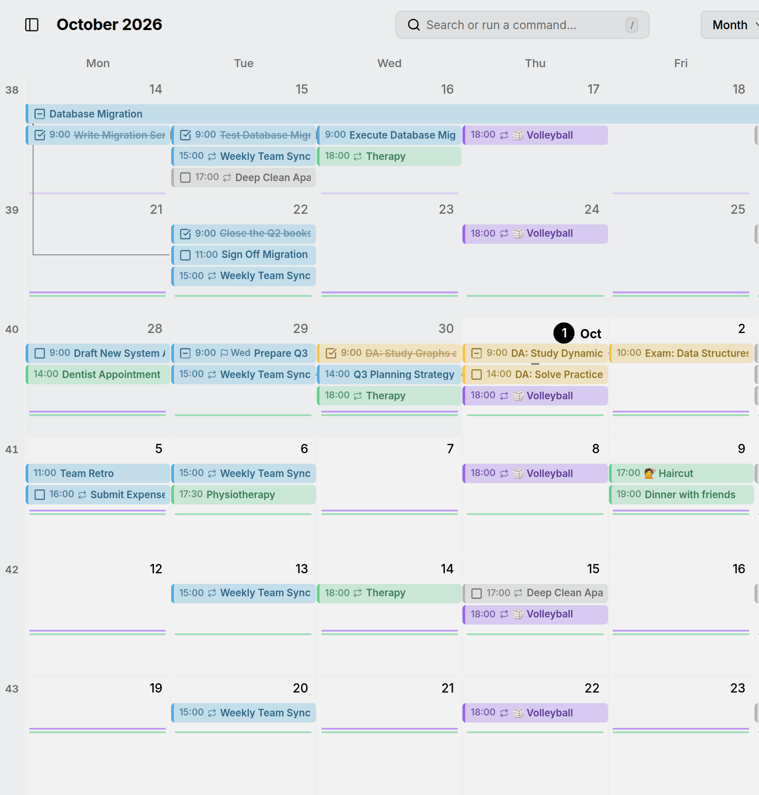

Có những việc diễn ra thường xuyên đến mức mỗi lần một thanh sẽ làm cả tháng đầy các bản sao: buổi tập hằng ngày, thuốc của bạn, buổi họp đứng vào các ngày trong tuần. Trong chế độ xem tháng và năm, Mitra vẽ chúng thành một **thói quen**: một đường mảnh dưới các ngày, với một dấu ở mỗi ngày thói quen diễn ra. Thẻ **Thói quen** trên thanh bên đếm xem từng thói quen của bạn diễn ra thế nào.

<picture>
  <source media="(prefers-color-scheme: dark)" srcset="../assets/screenshots/month-detail-dark.webp">
  
</picture>

Trong chế độ xem năm, nơi mỗi ngày rất nhỏ, thói quen là thứ bạn thấy nhiều nhất: mỗi đường màu là một thói quen chạy qua các tháng.

<picture>
  <source media="(prefers-color-scheme: dark)" srcset="../assets/screenshots/year-detail-dark.webp">
  
</picture>

## Điều gì trở thành thói quen

Các mục tạo thành một thói quen khi chúng ở cùng một lịch và có cùng tiêu đề. Mitra nhận ra thói quen khi các mục được lưu hoặc đồng bộ, và giữ nó lại.

- Một mục lặp lại là thói quen ngay từ đầu, dù nó lặp lại thường xuyên đến đâu, miễn là có ít nhất bốn ngày.
- Các mục không lặp lại sẽ thành thói quen khi có ít nhất bốn mục và chúng giữ một nhịp đều, chẳng hạn vài ngày một lần, hằng tuần hoặc mỗi năm một lần. Vì vậy các mục riêng lẻ cùng tên “Chạy bộ” tạo thành một thói quen giống như một chuỗi lặp lại hằng ngày, còn vài mục sát nhau rồi một khoảng trống dài, như các chuyến bay của hai chuyến đi, thì không.

Các lịch bạn chỉ đọc được, như lịch đăng ký, không tạo ra thói quen.

Một khi mục đã thuộc về một thói quen, nó ở lại đó: khi bạn đổi tên, đánh dấu xong, di chuyển một lần lặp của nó hoặc chuyển nó sang lịch khác. Các mục sau này có cùng tiêu đề sẽ tham gia vào đó, dù cách nhau bao xa. Một bản sao ở lịch khác trở thành một phần của thói quen trong lịch đó với tiêu đề của nó. Một mục không có tiêu đề không bao giờ gộp với mục khác; một mục lặp lại thì tự nó là một thói quen.

Mức độ thường xuyên của một thói quen quyết định cách các chế độ xem vẽ nó:

- Trong chế độ xem tháng, một thói quen diễn ra thường hơn một lần mỗi tuần sẽ hiện thành các dấu. Việc hằng tuần vẫn là một thanh.
- Trong chế độ xem năm, một thói quen diễn ra khoảng năm tuần một lần hoặc thường hơn sẽ hiện thành các dấu, nên thói quen hằng tuần và hằng tháng cũng vậy. Thói quen thưa hơn, như sinh nhật, vẫn là một thanh.

## Thẻ Thói quen

Mở **Thói quen** trên thanh bên, cạnh Lịch và Kế hoạch, hoặc gõ tên của nó vào bảng lệnh. **Hôm nay** liệt kê các thói quen diễn ra hôm nay, theo thứ tự giờ trong ngày, còn **Đang duy trì** liệt kê phần còn lại, theo ngày kế tiếp. Các thói quen không diễn ra lần nào trong ba tháng qua và không còn lần nào sắp tới sẽ được thu gọn vào **Đã qua**, mới nhất trước. Để bỏ qua các thói quen của một lịch, chẳng hạn lịch công việc, hãy chọn **Ẩn các thói quen của lịch** trong menu của lịch đó trên thanh bên. Mỗi hàng cho thấy tên thói quen, khi nào nó diễn ra, và chuỗi liên tiếp của nó: một ngọn lửa mang màu của lịch, kèm số lần lặp liên tiếp bạn đã giữ được. Một lần bị bỏ lỡ hoặc bị hủy sẽ kết thúc chuỗi, và ngọn lửa chuyển sang màu xám.

<picture>
  <source media="(prefers-color-scheme: dark)" srcset="../assets/screenshots/routines-detail-dark.webp">
  
</picture>

Chi tiết của một thói quen hiện các tuần gần đây dưới dạng lưới, mỗi ô là một ngày:

- Ô đặc là đã giữ được: một sự kiện đã diễn ra, hoặc một công việc bạn đã đánh dấu xong.
- Ô rỗng là đã bỏ lỡ: một công việc còn mở sau ngày của nó.
- Dấu gạch là đã hủy, được tính là không giữ được, giống như lần bỏ lỡ.
- Ô có viền tròn là hôm nay, vẫn còn mở.
- Ô mờ là ngày thói quen không diễn ra.

Mitra chỉ đếm những gì có trên lịch của bạn. Một lần lặp bạn xóa là biến mất và không được tính, nên để ghi lại một buổi bị bỏ qua, hãy hủy nó thay vì xóa; xem [Trạng thái sự kiện](entries.md#event-status). Sự kiện không có gì để đánh dấu: một sự kiện được coi là đã diễn ra trừ khi nó bị hủy.

Trạng thái hôm nay nằm ở cuối hàng của thói quen: ô đánh dấu của một công việc, dùng để đánh dấu xong giống như ô trên lịch, và của một sự kiện sau khi bạn hủy nó, để bạn có thể đổi lại. Huy hiệu trên thẻ đếm số công việc thói quen còn mở hôm nay. Một lịch bạn ẩn sẽ đưa các thói quen của nó ra khỏi thẻ.

## Chi tiết của một thói quen

Nhấp vào một hàng để xem thêm: thói quen chạy từ khi nào, các tuần gần đây dưới dạng lưới ngày, và ba ô bên dưới: chuỗi liên tiếp của nó, đứng đầu là tình trạng, như **Đúng nhịp** hoặc **Đang chững lại**, **Không còn lần nào sắp tới** khi không còn ngày nào được lên kế hoạch, hoặc **Đã đứt** khi nó đã chuyển sang Đã qua, cùng kỷ lục của bạn; bạn đã giữ được bao nhiêu trong năm qua; và ngày trong tuần bạn hay bỏ lỡ nhất. Menu **⋯** của nó có **Hôm nay đã xong** cho một công việc, **Đã hủy** cho lần lặp hôm nay, và **Hiện trên lịch** để mở lần kế tiếp. Bỏ chọn **Theo dõi tiến triển** ở đó cho một thói quen bạn tuân theo chứ không phải duy trì, như một hóa đơn hay một cuộc họp: khi đó nó không hiện chuỗi liên tiếp, và chi tiết của nó chỉ có lưới.

## Sửa một thói quen

Mitra tự tìm ra các thói quen, và menu **⋯** trong chi tiết sửa lại khi nó nhận sai. **Đổi tên…** đặt cho thói quen một tên riêng của bạn; bạn cũng có thể nhấp vào tên của nó rồi gõ. Nút bên cạnh tên riêng của bạn, hoặc việc gõ lại tiêu đề các mục của nó, sẽ đặt tên theo các mục của nó trở lại. **Gộp vào** mở các thói quen khác trong cùng lịch; chọn một thói quen sẽ nối hai thói quen lại, dành cho một thói quen có hai tiêu đề, như “Thuốc buổi sáng” và “Thuốc buổi tối”. **Không phải thói quen** đưa nó ra khỏi thẻ vĩnh viễn: các mục có tiêu đề của nó không còn được gom thành thói quen nữa, và chúng vẫn ở trên lịch của bạn. Những gì bạn đã nói không phải thói quen nằm ở cuối thẻ, được gập lại dưới **Không phải thói quen**; mở nó ra để đặt lại một mục làm thói quen.

Trình chỉnh sửa của một mục có hàng **Thói quen** sau phần ngày, hiện khi mục thuộc về một thói quen hoặc có thể thuộc về. Ở đó, hãy chọn một thói quen khác của lịch của nó, **Thói quen mới** để bắt đầu một thói quen từ mục này, mà các mục sau có cùng tiêu đề sẽ tham gia, hoặc **Không phải thói quen** để đưa nó ra vĩnh viễn, như bữa trưa chỉ trùng tiêu đề với một thói quen. Hàng này hiện chuỗi liên tiếp của thói quen bên cạnh tên của nó.

## Dùng một thói quen

Trỏ vào một thói quen để xem tiêu đề của nó và, nếu đó là một mục lặp lại, nó lặp lại thường xuyên đến đâu. Nhấp vào nó để mở mục đầu tiên của nó trong hàng đó: tuần trong chế độ xem tháng, hoặc tháng trong chế độ xem năm.

Chế độ xem tuần luôn hiện mỗi mục đầy đủ, kèm giờ của nó.
